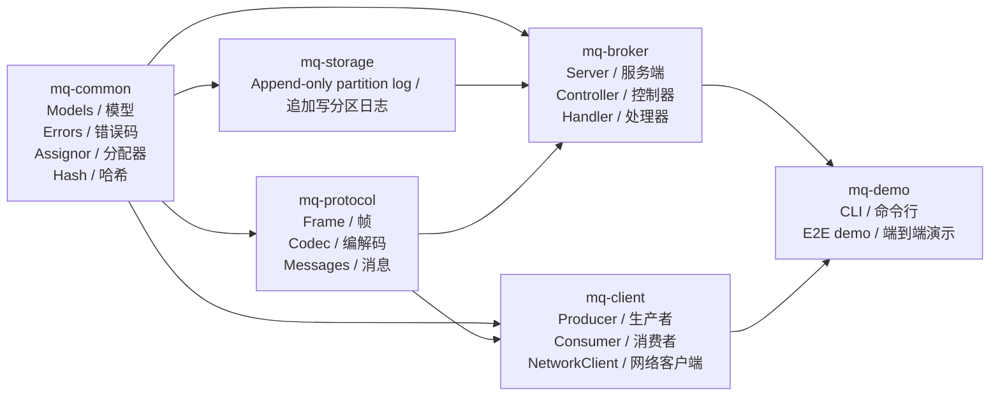

# MiniMQ Project Context Index / 项目上下文索引

> Last updated / 最后更新：2026-07-29
> Audience / 适用对象（英文）：new contributors, reviewers, and operators
> 适用对象：新贡献者、代码审查者与运维/排障读者

## 1. What This Project Is / 项目是什么

MiniMQ is a compact Java 17 message queue inspired by Kafka-style concepts. It is not a production Kafka replacement. It is a learning-oriented implementation that demonstrates binary protocol design, append-only storage, broker/controller coordination, producer and consumer SDKs, consumer group assignment, offset commit/fetch, V4 operator readiness, retry/DLQ links, delayed delivery, and a small CLI/Web demo.

MiniMQ 是一个 Java 17 实现的轻量消息队列项目，概念上参考 Kafka：二进制协议、追加写日志、Broker/Controller、Producer/Consumer SDK、Consumer Group、Offset 提交与拉取。它不是生产级 Kafka 替代品，而是一个便于理解分布式消息系统核心机制的学习级项目。

The current implementation uses etcd-backed Controller election and a single-leader partition model. Any Broker can become Controller; clients discover it through the bootstrap list and route produce/fetch with an exact Leader epoch.

The current V4 layer is implemented in source: operator APIs expose status, group lag, topic administration, failover audit, auth status, reliability links, metadata V2, metrics V2, and replica-state V2 reporting. Delayed messages use PRODUCE_V2, WAL type 8, visible-prefix fetches, and bounded Consumer waits.

当前实现采用 etcd 支持的 Controller 自动选举与单 Leader 分区模型。任意 Broker 都可接管 Controller；客户端通过 bootstrap 列表发现 Controller，并携带精确 Leader epoch 路由生产和拉取请求。

## 2. Reading Order / 推荐阅读顺序

| Order / 顺序 | Document / 文档 | Purpose / 用途 |
| ---: | --- | --- |
| 1 | [Project Architecture](architecture.md) / [项目架构](architecture.md) | Understand modules, runtime topology, dependency graph, and data/control flows. / 理解模块、运行时拓扑、依赖图、数据流与控制流。 |
| 2 | [System Design](design.md) / [系统设计](design.md) | Understand protocol format, storage format, metadata model, group coordination, and client behavior. / 理解协议格式、存储格式、元数据模型、消费组协调与客户端行为。 |
| 3 | [Testing Guide](testing.md) / [测试文档](testing.md) | Understand tests, coverage, commands, report locations, and quality gates. / 理解测试、覆盖率、命令、报告位置与质量门槛。 |
| 4 | [Roadmap](roadmap.md) / [代办与路线图](roadmap.md) | Understand known limitations, backlog items, version features, and recommended next tasks. / 理解已知限制、待办事项、版本功能与推荐下一步任务。 |
| 5 | [Code Review Fix Log](code-review-2026-07-02.md) / [代码审查修复记录](code-review-2026-07-02.md) | See recently fixed bugs and why they mattered. / 查看近期修复的问题以及它们的重要性。 |
| 5b | [V2.3 Code Review Fix Log](code-review-2026-07-17-v2.3-replication.md) / [V2.3 代码审查修复记录](code-review-2026-07-17-v2.3-replication.md) | See V2.3 replication review findings, `2.3.0` fixes, and `2.3.1` backlog. / 查看 V2.3 副本审查问题、`2.3.0` 修复与 `2.3.1` 待办。 |
| 6 | [Test Report](test-report-2026-07-10-v2-storage.md) / [测试报告](test-report-2026-07-10-v2-storage.md) | See the V2.0 storage recovery closeout results. / 查看 V2.0 存储恢复收口测试结果。 |
| 7 | [V2.3 Replication Test Report](test-report-2026-07-17-v2.3-replication.md) / [V2.3 副本机制测试报告](test-report-2026-07-17-v2.3-replication.md) | See the V2.3 replication release verification. / 查看 V2.3 副本机制发布验证。 |
| 7b | [V2.3.1 Replication Hardening Test Report](test-report-2026-07-18-v2.3.1-replication-hardening.md) | See the V2.3.1 replication hardening release verification. |
| 7c | [V2.4.0 Maintenance Operations Test Report](test-report-2026-07-19-v2.4.0-maintenance-ops.md) | See the V2.4.0 admin protocol and operator CLI verification. |
| 7d | [V2.5.0 Broker Leases And Automatic Failover Test Report](test-report-2026-07-19-v2.5.0-broker-leases-auto-failover.md) | See the V2.5.0 lease, fencing, clean failover, frozen partition, and recovery verification. |
| 7e | [V3.0.0 Control Plane HA Test Report](test-report-2026-07-20-v3.0.0-control-plane-ha.md) | See etcd election, Controller fencing, Leader epoch, truncation, and client discovery evidence. |
| 7f | [V3.0.1-V3.2 Productionization Test Report](test-report-2026-07-21-v3.0.1-v3.2-productionization.md) | See failover stabilization, runtime resilience, optional native transport, and bounded verification evidence. |
| 7g | [V3.0.1-V3.2 Known Issues](known-issues-2026-07-20-v3.0.1-v3.2.md) | Track the real-etcd environment gate and bounded-attempt policy. |
| 7h | [V4 Operator Readiness Design](designs/v4-operator-readiness-design.md) | Understand the implemented operations-focused major version and its compatibility rules. |
| 7i | [V4 Operator Readiness Implementation Plan](plans/v4-operator-readiness-implementation.md) | Historical implementation checklist; use source and focused tests as current truth. |
| 7j | [V3.3-V3.5 Production Hardening Test Report](test-report-2026-07-21-v3.3-v3.5-production-hardening.md) | See runtime metrics export, resilience matrix, benchmark transport selector, and bounded verification evidence. |
| 7k | [Future Storage Notes](roadmap.md#future-version-notes) | Review deferred experimental storage work after V4 is complete. |
| 7l | [V4.0.0 Operator Readiness Test Report](test-report-2026-07-22-v4.0.0-operator-readiness.md) | See the fresh full-reactor test counts, coverage, review regressions, and Docker-gated etcd status. |
| 8 | [Troubleshooting Guide](troubleshooting.md) / [故障排查指南](troubleshooting.md) | Resolve common Maven, port, Windows, test report, and GitHub/SSH issues. / 排查 Maven、端口、Windows、测试报告、GitHub/SSH 常见问题。 |

## 3. Current Snapshot / 当前快照

| Item / 项目 | Value / 值 |
| --- | --- |
| Language / 语言 | Java 17 |
| Project version | 4.0.0 |
| Build tool / 构建工具 | Maven multi-module project / Maven 多模块项目 |
| Network framework / 网络框架 | Netty 4.1 |
| Serialization / 序列化 | Custom binary protocol over Netty `ByteBuf` / 基于 Netty `ByteBuf` 的自定义二进制协议 |
| Metadata persistence / 元数据持久化 | etcd revision CAS + monotonic watch; local JSON only for explicit 2.x import / etcd revision CAS 与单调 watch；本地 JSON 仅用于显式 2.x 导入 |
| Storage / 存储 | WAL-backed segmented log with retention, compaction, dry-run reports, maintenance metrics, zero-copy FETCH sendfile, ISR-aware replication, delayed scheduling, and visible-prefix reads / 基于 WAL 的分段日志，支持保留策略、压缩、dry-run 报告、维护指标、零拷贝 FETCH sendfile、ISR 感知副本、延迟调度与可见前缀读取 |
| Tests / 测试 | JUnit 5 + Surefire |
| Coverage / 覆盖率 | JaCoCo |
| Latest milestone tag | Not cut for the current working tree; Maven project version is 4.0.0 |
| Latest release | V4 operator readiness in the working tree: operator APIs, bounded metrics V2, topic admin, failover audit, reliability links, delayed delivery, and FETCH_V2 visibility |
| Latest evidence | [V4.0.0 operator readiness test report](test-report-2026-07-22-v4.0.0-operator-readiness.md): 712 tests, zero failures/errors/skips, 91.17% overall line coverage, and every module above 90% |

## 4. Module Map / 模块地图



## 5. Fast Commands / 常用命令

Build and test / 构建并运行测试：

```powershell
mvn clean install -gs .mvn/settings.xml -s .mvn/settings.xml
mvn verify -gs .mvn/settings.xml -s .mvn/settings.xml
```

Generate coverage / 生成覆盖率：

```powershell
mvn verify -gs .mvn/settings.xml -s .mvn/settings.xml
```

JaCoCo HTML reports are generated under / JaCoCo HTML 报告生成在以下位置：

```text
mq-common/target/site/jacoco/index.html
mq-protocol/target/site/jacoco/index.html
mq-storage/target/site/jacoco/index.html
mq-broker/target/site/jacoco/index.html
mq-client/target/site/jacoco/index.html
mq-demo/target/site/jacoco/index.html
```

Start a three-broker demo cluster / 启动三节点 Broker 演示集群：

```powershell
docker compose -f deploy/etcd/docker-compose.yml up -d
java -jar mq-demo/target/mq-demo-4.0.0.jar broker --broker-id 0 --port 9092 --data-dir ./data/broker-0 --etcd-endpoints http://localhost:2379 --initialize-empty-cluster --admin-token <secret>
java -jar mq-demo/target/mq-demo-4.0.0.jar broker --broker-id 1 --port 9093 --data-dir ./data/broker-1 --etcd-endpoints http://localhost:2379 --admin-token <secret>
java -jar mq-demo/target/mq-demo-4.0.0.jar broker --broker-id 2 --port 9094 --data-dir ./data/broker-2 --etcd-endpoints http://localhost:2379 --admin-token <secret>
```

On Windows, `scripts/start-brokers.ps1` reads the current project version from the root POM and
uses etcd discovery plus the required admin token; it does not use the removed `--controller`
or `--controller-addr` flags. / Windows 下可使用 `scripts/start-brokers.ps1`，脚本会从根 POM
读取当前版本，并使用 etcd 发现和必需的 admin token，不再使用已移除的旧参数。

```powershell
.\scripts\start-brokers.ps1 -AdminToken <secret>
```

Delayed-message admission is bounded by --max-scheduled-records with default 100000. Use --max-scheduled-records 0 only when you want to disable admission of new future delayed records.

Create, produce, and consume / 创建 Topic、生产消息、消费消息：

```powershell
java -jar mq-demo/target/mq-demo-4.0.0.jar create-topic --brokers localhost:9092,localhost:9093,localhost:9094 --admin-token <secret> --name orders --partitions 3
java -jar mq-demo/target/mq-demo-4.0.0.jar produce --brokers localhost:9092,localhost:9093,localhost:9094 --topic orders --key user-1 --message hello
java -jar mq-demo/target/mq-demo-4.0.0.jar consume --brokers localhost:9092,localhost:9093,localhost:9094 --topic orders --group order-processors
```

Inspect and run storage maintenance / 查看并执行存储维护：

```powershell
java -jar mq-demo/target/mq-demo-4.0.0.jar maintenance-report --broker localhost:9092 --admin-token <secret>
java -jar mq-demo/target/mq-demo-4.0.0.jar maintenance-run --broker localhost:9092 --admin-token <secret>
java -jar mq-demo/target/mq-demo-4.0.0.jar maintenance-metrics --broker localhost:9092 --admin-token <secret>
java -jar mq-demo/target/mq-demo-4.0.0.jar runtime-metrics --broker localhost:9092 --admin-token <secret>
```

All brokers require the shared admin token. Invalid maintenance credentials return `UNAUTHORIZED`, while an overlapping destructive run returns `MAINTENANCE_BUSY`; report/run work executes on the broker's dedicated maintenance executor.

Benchmark FETCH heap versus sendfile / 对比 HEAP 与 sendfile 的 FETCH 基准：

```powershell
java -jar mq-demo/target/mq-demo-4.0.0.jar benchmark-fetch --records 256 --value-bytes 32768 --fetch-bytes 8388608 --warmup 10 --iterations 50 --segment-bytes 1048576 --network-transport nio
```

## 6. V4 Operator Readiness Notes

- API keys 20-37 are reserved and implemented for operator status, group lag, topic administration, failover audit, authorization status, reliability links, create-topic admin, PRODUCE_V2, REPLICA_FETCH_V2, FETCH_V2, METADATA_V2, RUNTIME_METRICS_V2, and replica-state V2.
- METADATA_V2 uses independent start-after cursors for active topic summaries and tombstones; legacy followers page V2 metadata and fetch exact legacy topic metadata when a snapshot has more than 10,000 active topics.
- Error codes are append-only through `STALE_TOMBSTONE = 19`; metadata format version is 4.
- Operator scopes are `STATUS`, `TOPIC_ADMIN`, `MAINTENANCE`, and `BROKER_OFFLINE`. The legacy admin token maps to all four scopes.
- Topic names use 1..249 characters from `[A-Za-z0-9._-]`, excluding `.` and `..`. Deletion advances `DELETING -> DELETED`; deleted names stay reserved and cannot be recreated.
- Topic deletion uses one caller deadline across queueing, metadata mutation, repository IO, and polling. A normal wait timeout returns the current `DELETING` tombstone; an uncertain mutation result returns `CONTROLLER_NOT_READY`.
- Retry and DLQ targets are ordinary operator-selected topics linked explicitly in metadata; MiniMQ does not infer naming conventions.
- WAL type 8 is SCHEDULED_DATA_APPEND. It keeps the existing data append body and adds deliverAtEpochMs for future visibility.
- Legacy FETCH and FETCH_V2 both hide future delayed records behind the contiguous visible prefix.
- Consumer uses FETCH_V2 and bounded client-side waiting: nextVisibleAtEpochMs caps the sleep by the remaining poll timeout, and the Broker request is not held open.
- V3 clients remain wire-compatible because keys 0-19 retain their layouts. Mixed V3/V4 Broker clusters are unsupported.
- Web AUTO mode falls back to mock only before a real side effect happens. Once real produce succeeds, later poll/commit failure is surfaced as a real error instead of mock success.

Controller-aware commands use the complete `--brokers` bootstrap list; Broker-local status,
maintenance, audit, auth, and metrics commands require exactly one `--broker` target.

```powershell
java -jar mq-demo/target/mq-demo-4.0.0.jar ops-status --broker localhost:9092 --admin-token <secret>
java -jar mq-demo/target/mq-demo-4.0.0.jar group-status --brokers localhost:9092,localhost:9093,localhost:9094 --admin-token <secret> --group order-processors
java -jar mq-demo/target/mq-demo-4.0.0.jar list-topics --brokers localhost:9092,localhost:9093,localhost:9094 --admin-token <secret>
java -jar mq-demo/target/mq-demo-4.0.0.jar describe-topic --brokers localhost:9092,localhost:9093,localhost:9094 --admin-token <secret> --topic orders
java -jar mq-demo/target/mq-demo-4.0.0.jar delete-topic --brokers localhost:9092,localhost:9093,localhost:9094 --admin-token <secret> --topic orders
```

The local workflow scripts use a PID/start-time manifest and bounded readiness. Recursive cleanup
requires a valid `.minimq-run-directory` ownership marker, and the failover demo waits for all three
replicas to enter ISR before stopping the initial Leader.

```powershell
.\scripts\start-brokers.ps1 -AdminToken <secret>
.\scripts\demo-v4-failover.ps1 -AdminToken <secret>
.\scripts\stop-brokers.ps1 -CleanupRunDirectory
```

## 7. Glossary / 专业名词解释

| Term / 术语 | 中文解释 | English explanation / 英文解释 |
| --- | --- | --- |
| Broker | 消息队列服务节点，负责接收生产请求、保存日志、响应消费请求。 | A server node that stores records and serves produce/fetch requests. |
| Controller | 管理集群元数据的角色，例如 Broker 注册、Topic 创建、Partition leader 分配。 | The node responsible for cluster metadata and leadership decisions. |
| Topic | 消息的逻辑分类，例如 `orders`、`payments`。 | A logical stream/category of messages. |
| Partition | Topic 的物理分片，用于并行写入和消费。 | A shard of a topic, enabling parallelism and routing. |
| Offset | 分区内消息的递增位置编号。 | A monotonically increasing position in a partition log. |
| Consumer Group | 一组消费者共享同一个消费进度和分区分配。 | A group of consumers coordinating partition ownership and offsets. |
| Assignment | Consumer Group 中“哪个成员消费哪些分区”的结果。 | The mapping from consumer members to partitions. |
| High Watermark | 当前分区下一条消息的 offset，也可理解为已写入尾部位置。 | The next offset after the last appended record. |
| Append-only Log | 只追加、不原地修改的日志文件。 | A log file that only appends new records. |
| Frame | 网络协议中的完整消息包，包含 magic、version、length、payload。 | A complete network packet with magic, version, length, and payload. |

## 8. Contributor Checklist / 贡献者接手清单

1. Read this index first. / 先阅读本索引。
2. Read `architecture.md` for module boundaries and runtime topology. / 阅读 `architecture.md`，理解模块边界和运行时拓扑。
3. Read `design.md` before changing protocol, storage, metadata, or consumer group logic. / 修改协议、存储、元数据或消费组逻辑前先阅读 `design.md`。
4. Run `mvn verify -gs .mvn/settings.xml -s .mvn/settings.xml` before and after changes. / 修改前后都运行完整 Maven 测试命令。
5. Check `docs/test-report-2026-07-22-v4.0.0-operator-readiness.md` for the current closeout baseline. / 查看 `docs/test-report-2026-07-22-v4.0.0-operator-readiness.md` 了解当前收口基线。
6. Do not treat target files as source of truth; source lives under `src/main/java` and `src/test/java`. / 不要把 `target` 目录当作事实来源，源码位于 `src/main/java` 和 `src/test/java`。
7. Keep JaCoCo overall line coverage at or above 90%. / 保持 JaCoCo 总体行覆盖率不低于 90%。
8. If changing protocol fields, update both `ProtocolSerdesTest` and the design document. / 如果修改协议字段，同时更新 `ProtocolSerdesTest` 和设计文档。
9. If changing topic/partition routing, update `ProducerIntegrationTest`, `ProduceFetchIntegrationTest`, and architecture diagrams. / 如果修改 Topic/Partition 路由，同时更新 `ProducerIntegrationTest`、`ProduceFetchIntegrationTest` 和架构图。
10. If changing CLI behavior, update `DemoCliTest` and command examples in docs. / 如果修改 CLI 行为，同时更新 `DemoCliTest` 和文档中的命令示例。

