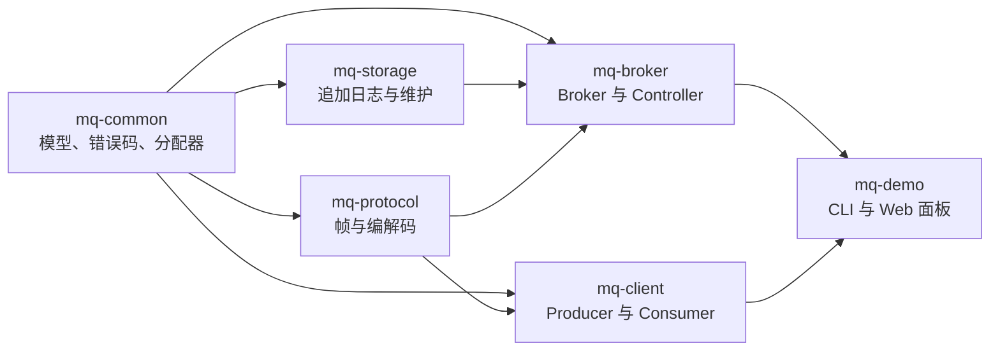

# MiniMQ 文档索引

本文档集面向新贡献者、代码审查者和本地运维/排障读者。MiniMQ 是一个 Java 17 实现的 Kafka 风格消息队列学习项目，不是生产级 Kafka 替代品。

## 推荐阅读顺序

| 顺序 | 文档 | 用途 |
|---:| --- | --- |
|  1 | [架构](architecture.md) | 理解模块边界、运行拓扑、依赖关系及数据/控制流。 |
|  2 | [总体设计](design.md) | 理解协议、日志存储、元数据、消费组和兼容性约束。 |
|  3 | [测试指南](testing.md) | 了解测试策略、覆盖率门禁和验证命令。 |
|  4 | [故障排查](troubleshooting.md) | 处理 Maven、端口、Windows 及 GitHub/SSH 常见问题。 |

## 当前快照

| 项目 | 当前值 |
| --- | --- |
| 语言 | Java 17 |
| 项目版本 | 5.0.0 |
| 构建工具 | Maven 多模块项目 |
| 网络框架 | Netty 4.1 |
| 元数据 | etcd 选举、revision CAS 与单调 watch |
| 存储 | WAL 支撑的分段日志，支持保留、压缩、恢复、延迟调度和零拷贝拉取 |
| 测试 | JUnit 5、Surefire 和 JaCoCo；每模块行覆盖率门槛为 90% |

## 模块地图



## 常用命令

构建、测试并执行覆盖率门禁：

```powershell
mvn clean verify -gs .mvn/settings.xml -s .mvn/settings.xml
```

启动三节点本地演示：

```powershell
docker compose -f deploy/etcd/docker-compose.yml up -d
.\scripts\start-brokers.ps1 -AdminToken <secret>
```

启动 Web 面板：

```powershell
.\scripts\start-web.cmd -AdminToken <secret>
```

运行、配置或协议发生变化时，请把源代码和聚合测试作为当前行为的事实来源，并同步更新本索引及对应主题文档。
