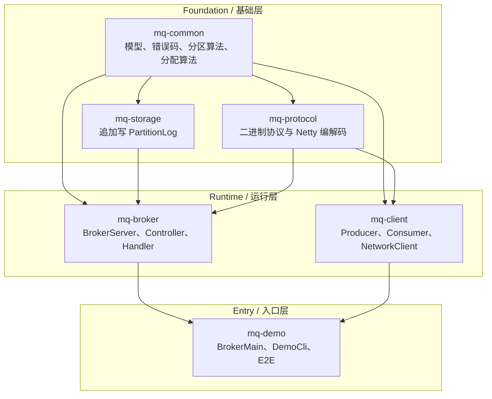
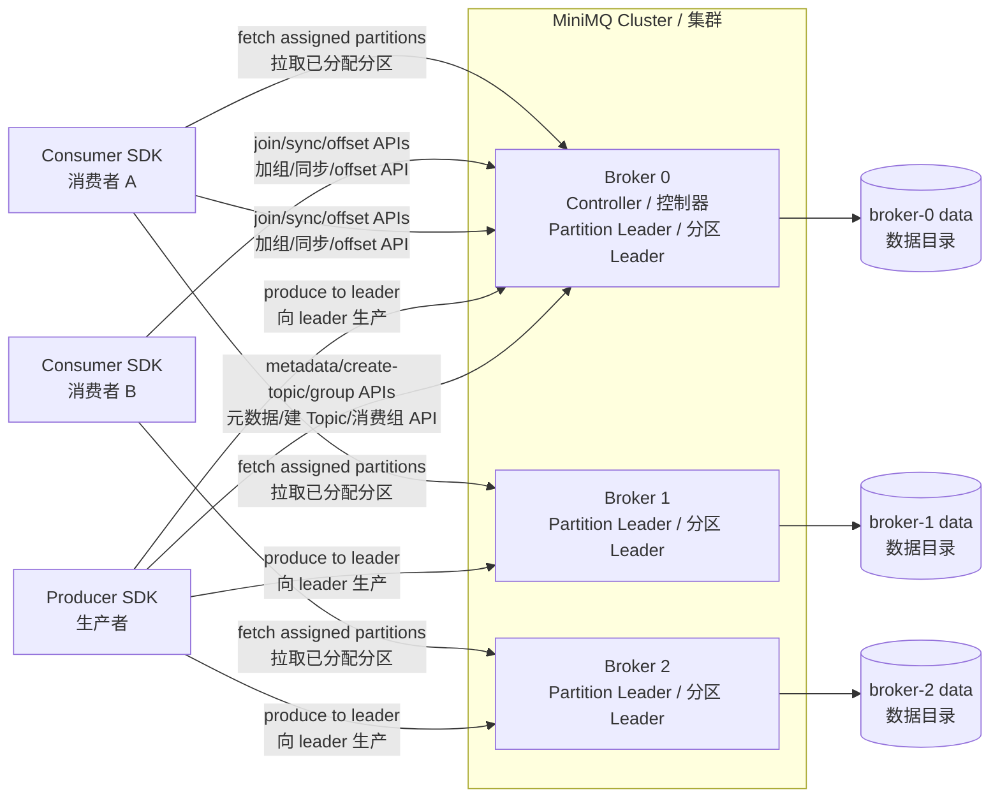
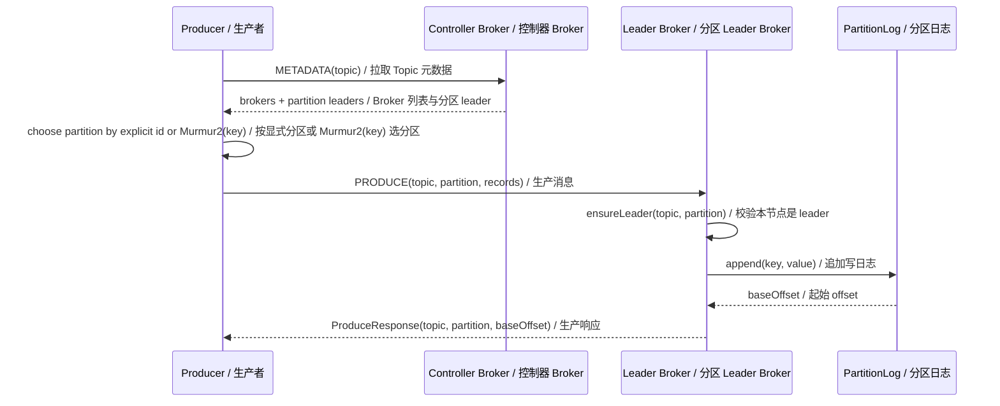
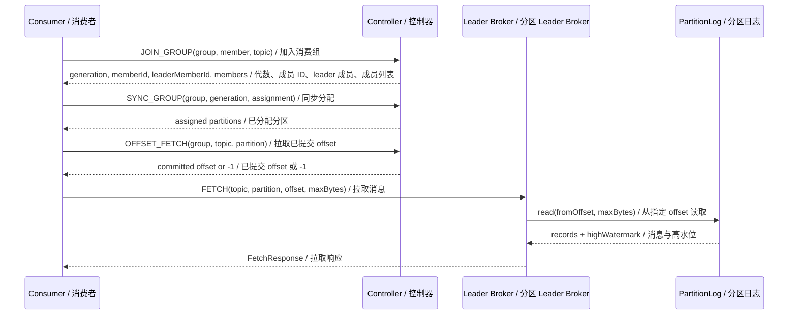
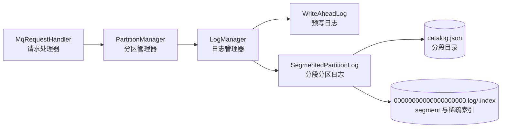

# MiniMQ Architecture / MiniMQ 项目架构文档

> Goal: help a new reader understand what runs where, how modules depend on one another, and how records move through the system.
> 目标：让新读者快速理解系统由哪些模块组成、运行时拓扑如何形成、消息如何在客户端、Broker、存储之间流动。

## 1. Executive Summary / 架构总览

MiniMQ is a modular Java message queue. It separates shared models, protocol encoding, local storage, broker runtime, client SDK, and demo CLI into independent Maven modules. The system is intentionally small, but it preserves the central shape of a partitioned message broker: producers write records to topic partitions, consumers fetch records by offset, and a controller maintains metadata so clients can route requests to the correct leader broker.

MiniMQ 是一个多模块 Java 消息队列系统。它把公共模型、协议编解码、本地存储、Broker 运行时、客户端 SDK、Demo CLI 拆成独立 Maven 模块。项目规模不大，但保留了分区消息系统的核心结构：Producer 按 Topic/Partition 写入消息，Consumer 按 Offset 拉取消息，Controller 维护元数据并指导客户端把请求路由到正确的 Leader Broker。

The architecture now supports partition replicas, ISR-aware high watermarks, persisted replica LEO, Broker heartbeat leases, and automatic LEO-aware Leader failover under one static Controller. It remains an educational architecture rather than a production quorum system: Controller HA, data-plane Leader epochs, unclean election, and failover log truncation are not implemented.

当前架构已经支持分区副本、ISR 感知 high watermark、持久化副本 LEO、Broker 心跳租约和静态 Controller 下的 LEO 感知自动故障转移。它仍是教学型架构，不是生产级 quorum 系统：Controller 高可用、数据面 Leader epoch、unclean election 和故障转移日志截断尚未实现。

## 2. Module Architecture / 模块架构



| Module | Responsibility / 职责 | Key classes / 关键类 |
| --- | --- | --- |
| `mq-common` | Shared domain objects, error codes, Murmur2 partitioning, range assignment, assignment serialization. / 公共领域对象、错误码、Murmur2 分区、Range 分配、分配结果序列化。 | `ErrorCode`, `Record`, `Murmur2Partitioner`, `RangeAssignor`, `AssignmentSerde` |
| `mq-storage` | Local append-only partition log with WAL-backed segmented storage, retention, and sealed-segment compaction. / 基于 WAL 的本地追加写分段分区日志、保留策略和 sealed segment 压缩。 | `PartitionLog`, `SegmentedPartitionLog`, `SegmentFile`, `SparseOffsetIndex`, `LogManager` |
| `mq-protocol` | Binary frame format, request/response headers, API messages, Netty decoder/encoder. / 二进制帧格式、请求/响应头、API 消息、Netty 编解码器。 | `MqFrame`, `ProtocolSerdes`, `MqDecoder`, `MqEncoder`, `ProtocolMessages` |
| `mq-broker` | Server runtime, metadata controller, group coordinator, request handling, metadata sync. / 服务端运行时、元数据 Controller、消费组协调器、请求处理、元数据同步。 | `BrokerServer`, `MqRequestHandler`, `ClusterController`, `GroupCoordinator`, `MetadataSync` |
| `mq-client` | Producer and Consumer SDK. / 生产者和消费者 SDK。 | `NetworkClient`, `Producer`, `Consumer` |
| `mq-demo` | CLI command entry and end-to-end demo. / 命令行入口和端到端演示。 | `DemoCli`, `BrokerMain`, `MiniMqE2ETest` |

## 3. Runtime Topology / 运行时拓扑

The common demo topology uses three brokers. Broker 0 starts as controller. Broker 1 and Broker 2 register with the controller and fetch metadata. Topic partitions are assigned round-robin across online brokers when the topic is created.

常见 Demo 拓扑为 3 个 Broker。Broker 0 作为 Controller 启动。Broker 1 和 Broker 2 向 Controller 注册，并拉取元数据。创建 Topic 时，Controller 会把分区按照在线 Broker 列表做轮询分配。



## 4. Request Flow / 请求流

### 4.1 Produce Flow / 生产流程



Producer 首先向 Controller 拉取 Topic 元数据。如果消息指定了 `partitionId`，Producer 直接使用该分区；如果未指定但有 key，则通过 Kafka 风格 Murmur2 hash 计算分区；如果没有 key，则默认分区 0。随后 Producer 根据分区 leader 连接对应 Broker 并发送 `PRODUCE` 请求。

The producer first asks the controller for metadata. If the record has an explicit partition id, that partition is used. If no partition id is present but a key exists, the producer uses Murmur2 hashing. If no key exists, partition 0 is used. The request is then routed to the leader broker.

### 4.2 Fetch Flow / 拉取流程



Consumer 订阅 Topic 时会加入 Consumer Group。组内 leader 负责根据成员列表和 Topic 分区数计算 Range Assignment，然后通过 `SYNC_GROUP` 写回 Controller。普通成员通过 `SYNC_GROUP` 获取自己的分区列表。消费后，客户端通过 `OFFSET_COMMIT` 提交进度。

When a consumer subscribes, it joins a consumer group. The group leader computes a range assignment and submits it through `SYNC_GROUP`. Every member receives its partition list from the coordinator. After processing records, the consumer commits offsets through `OFFSET_COMMIT`.

## 5. Data Plane And Control Plane / 数据面与控制面

MiniMQ separates requests into two conceptual planes:

MiniMQ 可以从概念上拆成两个面：

| Plane / 平面 | APIs / API | Description / 说明 |
| --- | --- | --- |
| Control plane / 控制面 | `CREATE_TOPIC`, `METADATA`, `JOIN_GROUP`, `SYNC_GROUP`, `HEARTBEAT`, `OFFSET_COMMIT`, `OFFSET_FETCH`, `REGISTER_BROKER` | Handles metadata, group membership, assignments, offsets, and broker registration. / 处理元数据、组成员、分配、offset 和 Broker 注册。 |
| Data plane / 数据面 | `PRODUCE`, `FETCH` | Handles record writes and reads against partition logs. / 处理分区日志上的消息写入与读取。 |

The controller broker currently serves all control-plane APIs. Data-plane APIs are served by the leader broker of each partition. This is a clean split for readers: controller code lives mainly in `ClusterController` and `GroupCoordinator`; data access flows through `MqRequestHandler`, `PartitionManager`, `LogManager`, the independent WAL/checkpoint layer, and `SegmentedPartitionLog`.

Controller Broker 当前承载所有控制面 API。数据面 API 则由对应分区的 Leader Broker 承载。对读代码的人来说，这条边界很清楚：控制面主要在 `ClusterController` 与 `GroupCoordinator`，数据面主要经过 `MqRequestHandler`、`PartitionManager`、`LogManager`、独立 WAL/checkpoint 层和 `SegmentedPartitionLog`。

## 6. Storage Architecture / 存储架构

Each topic-partition now has one segmented directory under the broker data directory:

每个 Topic-Partition 现在对应 broker 数据目录下的一个分段目录：

```text
{dataDir}/segments/{topic}-{partitionId}/
  catalog.json
  00000000000000000000.log
  00000000000000000000.index
  00000000000000000128.log
  00000000000000000128.index
```

`LogManager` still accepts old single-file `{topic}-{partitionId}.log` data during startup and migrates it into the segmented directory. WAL replay and checkpoint validation run before request handling, so the broker opens request traffic only after the partition logs have caught up or been replayed idempotently.

`LogManager` 在启动时仍会接受旧单文件 `{topic}-{partitionId}.log` 数据，并迁移到分段目录。WAL 重放和 checkpoint 校验会在开放请求处理之前完成，因此 Broker 只有在分区日志追上或完成幂等重放后才对外处理流量。

V2.1.1 maintenance runs after recovery on the same segmented catalog. Retention removes only sealed segments by age or total sealed bytes, compaction rewrites only sealed segments by latest key, and read snapshots delay physical deletion until in-flight fetches leave their segment view. WAL replay skips records below `logStartOffset`, so retained-away offsets are not restored on restart.

V2.1.1 日志维护在恢复完成后基于同一份分段 catalog 执行。保留策略只按时间或 sealed segment 总字节数删除 sealed segment，压缩只按最新 key 重写 sealed segment，读快照会延迟物理删除直到正在进行的 fetch 离开自己的 segment 视图。WAL replay 会跳过低于 `logStartOffset` 的记录，因此已被保留策略移除的 offset 不会在重启时恢复。

V2.1.2 adds one shared retention-then-compaction plan for preview and execution. Dry-run reports segment actions, original log bytes, and offset ranges without mutation. Real maintenance attempts reader quiescence before scanning compaction inputs; an active read snapshot returns `SKIPPED_READERS` immediately, while a successful acquisition blocks new reads only for the bounded planning and mutation interval. `PartitionManager` exposes Java entrypoints for manual execution, preview, and in-memory metric snapshots.

V2.1.2 为预览和真实执行增加统一的“先 retention、后 compaction”规划。Dry-run 会报告 segment 动作、原始日志字节数和 offset 范围，但不修改数据。真实维护会在扫描 compaction 输入前尝试获取 reader quiescence；存在活跃读快照时立即返回 `SKIPPED_READERS`，成功获取后只在受单次预算约束的规划与修改期间阻止新读取。`PartitionManager` 暴露手动执行、预览和内存指标快照的 Java 入口。



## 7. Deployment Shape / 部署形态

MiniMQ 3.0 is launched with an etcd endpoint on every Broker. Brokers campaign for one lease-bound Controller role; only the first node of a new cluster uses `--initialize-empty-cluster` (or `--initialize-cluster-from-local` for an explicit 2.x import).

MiniMQ 3.0 的每个 Broker 都配置 etcd endpoint，并竞选唯一的 lease-bound Controller。全新集群只有首节点使用 `--initialize-empty-cluster`；显式导入 2.x 本地元数据时改用 `--initialize-cluster-from-local`。

| Broker / 节点 | Example role / 示例角色 | Example port / 示例端口 | Data dir / 数据目录 |
| --- | --- | ---: | --- |
| Broker 0 | Controller + leader candidate / Controller 与 leader 候选节点 | 9092 | `./data/broker-0` |
| Broker 1 | Broker + leader candidate / Broker 与 leader 候选节点 | 9093 | `./data/broker-1` |
| Broker 2 | Broker + leader candidate / Broker 与 leader 候选节点 | 9094 | `./data/broker-2` |

Each Broker owns a `BrokerLeaseService` and `BrokerAvailabilityGuard`. Startup binds the client port while state is `STARTING`, registers and synchronizes metadata, confirms the epoch with a heartbeat, then moves to `ACTIVE`. Loss of Controller contact moves the Broker to `FENCED` before the Controller lease expires; recovery uses `RECOVERING` and must obtain a newer valid registration before returning to `ACTIVE`.

每个 Broker 拥有一个 `BrokerLeaseService` 和 `BrokerAvailabilityGuard`。启动时先绑定客户端端口并保持 `STARTING`，完成注册、元数据同步和 epoch 确认心跳后进入 `ACTIVE`。与 Controller 失联时，Broker 会在 Controller 租约到期前进入 `FENCED`；恢复过程使用 `RECOVERING`，只有重新获得有效注册后才能回到 `ACTIVE`。

The timing contract is `broker heartbeat interval < broker self-fence timeout < controller broker lease timeout`, configured by `--broker-heartbeat-interval-ms`, `--broker-self-fence-timeout-ms`, and `--controller-broker-lease-timeout-ms`.

## 8. Architectural Constraints / 架构约束

1. Replication and clean ISR failover exist, including crash-safe truncation before Leader readiness. MiniMQ still does not perform unclean election; a partition with no online ISR remains frozen. / 已有副本、ISR 内 clean failover 和 Leader ready 前的崩溃安全截断，但仍不执行 unclean election；没有在线 ISR 的分区保持 frozen。
2. Controller election uses etcd lease/election, a monotonically increasing Controller epoch, leader-identity comparison, and metadata revision CAS. / Controller 选举使用 etcd lease/election、单调 Controller epoch、Leader 身份比较和元数据 revision CAS。
3. Shared metadata is persisted in etcd and installed by a monotonic watch. The local JSON document remains only as the explicit 2.x import source. / 共享元数据持久化在 etcd 中，并由单调 watch 安装；本地 JSON 仅保留为显式 2.x 导入源。
4. Consumer group rebalancing is simplified. There is no full Kafka-style rebalance protocol, session management, or cooperative assignment. / 消费组再均衡经过简化，还没有完整 Kafka 风格的 rebalance 协议、会话管理或协作式分配。
5. The client SDK cycles the complete bootstrap list, discovers the current Controller through any Broker, rejects older metadata versions, carries the routed Leader epoch, and retries one stale route. The SDK has no etcd dependency. / 客户端 SDK 轮询完整 bootstrap 列表、通过任意 Broker 发现当前 Controller、拒绝较旧 metadata version、携带路由时的 Leader epoch，并对过期路由重试一次；SDK 不依赖 etcd。
6. Maintenance report, execution, and metrics are exposed through token-protected admin APIs and single-target CLI commands. Destructive maintenance remains opt-in and Broker-local. / 维护报告、执行和指标已通过令牌保护的管理 API 与单目标 CLI 命令开放；破坏性维护仍需显式触发，并且只作用于本地 Broker。

## 9. Architecture Glossary / 架构名词表

| Term / 术语 | 中文解释 | English explanation / 英文解释 |
| --- | --- | --- |
| Data plane | 处理消息读写的路径，例如 `PRODUCE` 和 `FETCH`。 | The path that handles record reads and writes. |
| Control plane | 处理元数据、组成员、分配和 offset 的路径。 | The path that manages metadata, groups, assignments, and offsets. |
| Leader broker | 某个分区当前负责读写的 Broker。 | The broker that serves reads/writes for a partition. |
| Controller broker | 管理集群元数据和消费组状态的 Broker。 | The broker managing cluster metadata and group state. |
| Fat jar | 包含项目类和依赖的可执行 jar。 | An executable jar including project classes and dependencies. |
| Topology | 系统运行时节点和连接关系。 | The runtime shape of nodes and their connections. |
