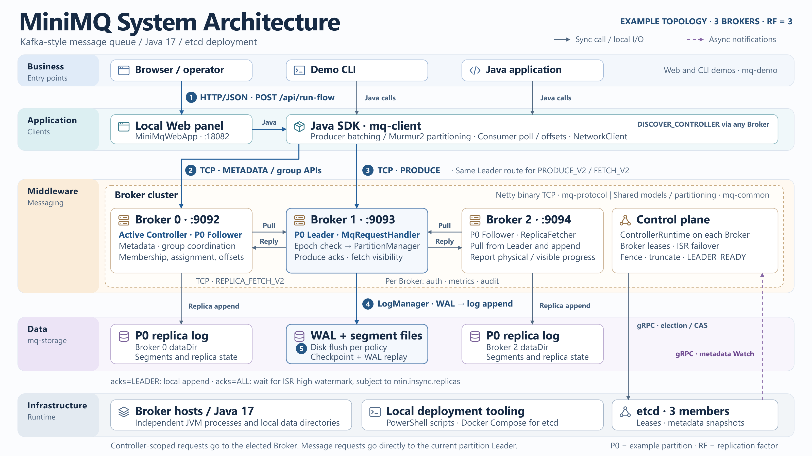
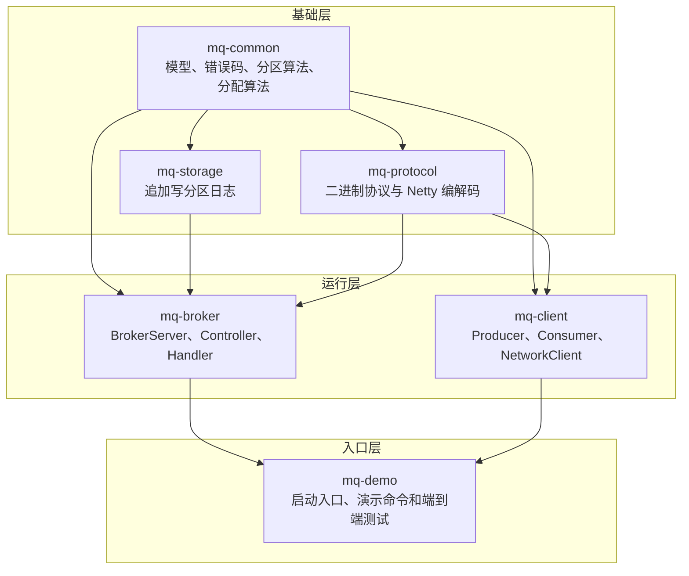
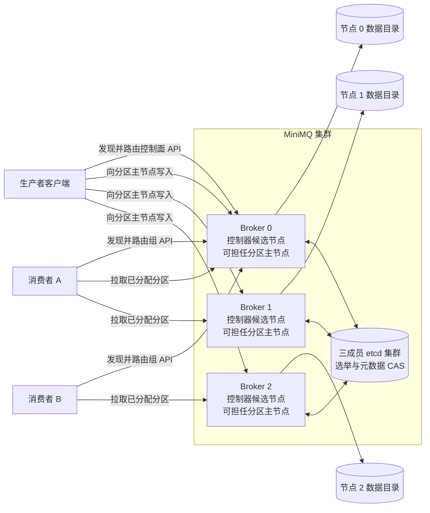
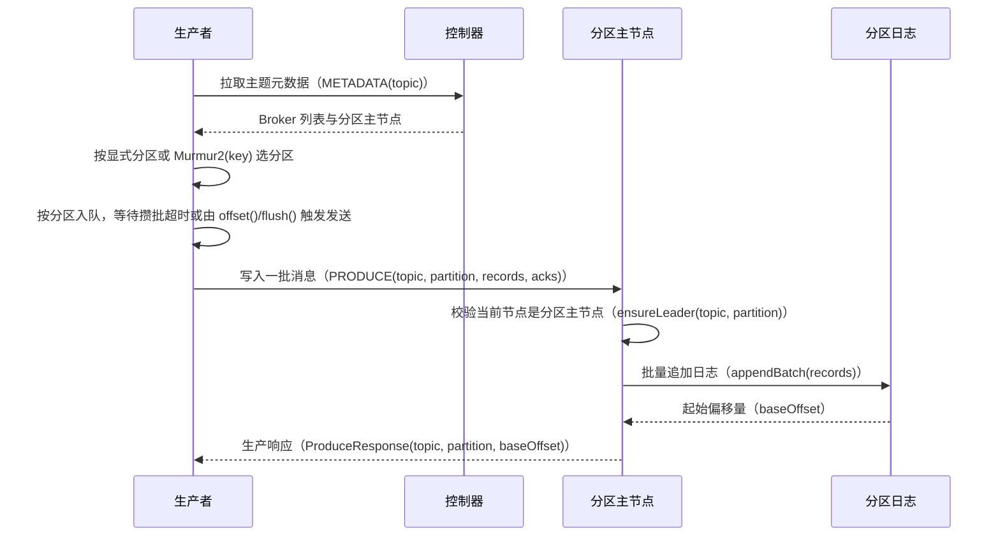
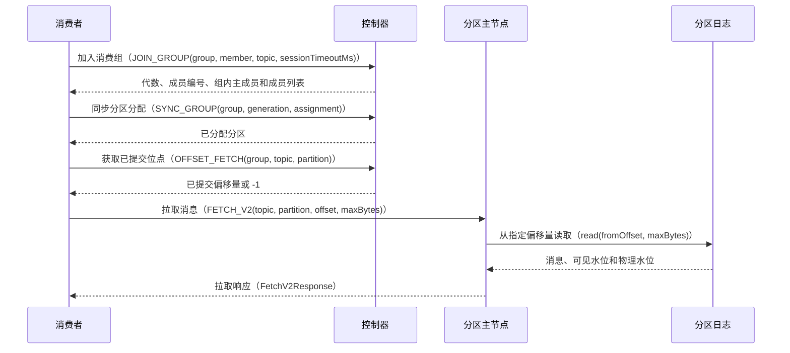
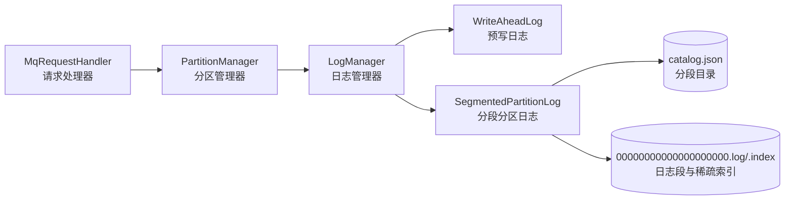

# MiniMQ 项目架构文档

> 目标：让新读者快速理解系统由哪些模块组成、运行时拓扑如何形成、消息如何在客户端、Broker、存储之间流动。

## 1. 架构总览

MiniMQ 是一个多模块 Java 消息队列系统。公共模型、协议编解码、本地存储、Broker 运行时、客户端 SDK 和演示命令行各自对应 Maven 模块。生产者向主题分区写入消息，消费者按偏移量拉取消息。控制器维护元数据，客户端据此把请求发给对应分区的主节点。

当前架构支持分区副本、基于同步副本集合（ISR）的物理水位和可见水位、副本状态持久化、Broker 心跳租约、基于 etcd 的控制器选举、分区主节点任期校验，以及故障转移时的崩溃安全截断。项目用于学习消息队列原理，选主仅限在线 ISR，尚未实现事务或恰好一次处理语义。

V5 支持 `acks=LEADER` 和 `acks=ALL`。`acks=ALL` 在专用线程池中等待当前 ISR 的复制水位，并要求 `isr.size() >= min.insync.replicas`。消费组成员可通过 `LEAVE_GROUP` 离组，也会在各自的会话超时后被移除。运维人员可调整 `min.insync.replicas`、重新分配分区副本，并将首选副本选为主节点。

### 系统架构图解

[](../diagram/minimq-architecture/minimq-architecture.svg)

图中以 3 个 Broker、3 个 etcd 成员和一个三副本分区 `P0` 为例。Broker 0 是当前集群控制器（Controller），同时持有 `P0` 的一个跟随副本（Follower）。Broker 1 担任 `P0` 的主节点（Leader），Broker 2 持有另一个跟随副本。控制器和分区主节点的位置会随各自的选举结果变化。实线表示同步调用或本地读写，虚线表示 etcd 的异步监听通知。

按图中的 ①–⑤ 跟踪一次 Web 发布请求。

1. **HTTP 入口。** 浏览器调用 Web 面板的 `POST /api/run-flow`。面板在 Java 进程内调用 MiniMQ SDK。命令行工具和 Java 应用也可直接使用 SDK。
2. **查询路由。** SDK 通过任意可用的引导节点发现当前控制器，再用 `METADATA` 查询目标分区的主节点。
3. **向分区主节点发送。** SDK 通过 MiniMQ 的二进制 TCP 协议，把 `PRODUCE` 直接发给 Broker 1。Broker 校验自身的主节点身份和请求携带的主节点任期，避免旧路由上的请求写入日志。
4. **追加日志。** `LogManager` 先写 WAL（预写日志），再追加分区的分段日志。读取使用分段日志，重启时通过检查点和 WAL 重放恢复数据。
5. **按策略刷盘。** Broker 按配置的刷盘策略将数据强制写入磁盘。`acks=LEADER` 在主节点完成本地追加后确认。`acks=ALL` 还要求当前同步副本数达到 `min.insync.replicas`，并等待复制水位覆盖这批消息。

**副本拉取与消费。** Broker 0 和 Broker 2 向 Broker 1 发起 `REPLICA_FETCH_V2`，收到记录后写入各自的本地日志。消费者向控制器获取消费组的分区分配和已提交的消费位点，再向对应分区的主节点发起 `FETCH_V2`。可读范围同时受复制水位和延迟消息的可见时间限制。

**集群协调与故障转移。** 所有 Broker 都通过 etcd 参与控制器选举，当前控制器提交集群元数据。Broker 监听元数据变更并更新本地视图。分区主节点故障时，控制器从在线同步副本中选出接任者。新主节点按恢复点完成日志截断并确认 `LEADER_READY` 后，才恢复该分区的读写。没有在线同步副本时，分区保持冻结。

## 2. 模块架构



| 模块 | 职责 | 关键类 |
| --- | --- | --- |
| `mq-common` | 公共领域对象、错误码、Murmur2 分区、范围分配、分配结果序列化。 | `ErrorCode`, `Record`, `Murmur2Partitioner`, `RangeAssignor`, `AssignmentSerde` |
| `mq-storage` | 基于 WAL 的本地追加式分区日志，支持分段、保留清理和已封存日志段压缩。 | `PartitionLog`, `SegmentedPartitionLog`, `SegmentFile`, `SparseOffsetIndex`, `LogManager` |
| `mq-protocol` | 二进制帧格式、请求/响应头、API 消息、Netty 编解码器。 | `MqFrame`, `ProtocolSerdes`, `MqDecoder`, `MqEncoder`, `ProtocolMessages` |
| `mq-broker` | 服务端运行时、元数据控制器、消费组协调器、请求处理和元数据同步。 | `BrokerServer`, `MqRequestHandler`, `ClusterController`, `GroupCoordinator`, `MetadataSync` |
| `mq-client` | 生产者和消费者 SDK，含按分区定时攒批。 | `NetworkClient`, `Producer`, `ProducerConfig`, `Consumer` |
| `mq-demo` | 命令行入口和端到端演示。 | `DemoCli`, `BrokerMain`, `MiniMqE2ETest` |

## 3. 运行时拓扑

常见演示拓扑包含 3 个 Broker 和 3 个 etcd 成员。每个 Broker 都参与基于租约的控制器选举。Broker 0 负责初始化全新的空集群，之后与其他节点一样参与竞选。客户端通过任意可用的引导节点发现当前控制器。创建主题时，控制器会在在线 Broker 之间轮询分配分区。



## 4. 请求流

### 4.1 生产流程



生产者首先向控制器拉取主题元数据。消息指定 `partitionId` 时直接使用该分区。未指定时，有消息键就用 Kafka 风格的 Murmur2 哈希计算分区，无键则使用分区 0。`send(record)` 按分区入队并立即返回。同一分区的消息按 `batchSize=50` 和 `lingerMs=5` 形成批次，也可由调用方读取 `offset()` 或调用 `flush()`、`close()` 触发发送。生产者将批次通过 `PRODUCE` 发往对应分区的主节点。立即调用 `send().offset()` 仍是单条请求往返。使用 `acks=ALL` 时，分区主节点在 ISR 复制水位覆盖本批消息后才响应。

### 4.2 拉取流程



消费者订阅主题时会加入消费组。组内主成员按成员列表和主题分区数计算范围分配结果，再通过 `SYNC_GROUP` 提交给控制器。每个成员通过 `SYNC_GROUP` 获取自己的分区列表，消费后通过 `OFFSET_COMMIT` 提交进度。每个成员按 `JOIN_GROUP` 中的 `sessionTimeoutMs` 设置会话超时，默认 10 秒。超时未发送心跳的成员会被移除，分区重新分配并进入新一代。`Consumer.close()` 会发送 `LEAVE_GROUP`。`HEARTBEAT` 与 `OFFSET_COMMIT` 编码均带 `generationId`，`OFFSET_COMMIT` 还带 `memberId`。解码仍接受省略这些字段的旧请求体。旧客户端入组后，协调器会拒绝代数为 0 的请求。

## 5. 数据面与控制面

MiniMQ 可以从概念上拆成两个面：

| 平面 | 接口 | 说明 |
| --- | --- | --- |
| 控制面 | `CREATE_TOPIC`, `METADATA`, `JOIN_GROUP`, `SYNC_GROUP`, `HEARTBEAT`, `LEAVE_GROUP`, `OFFSET_COMMIT`, `OFFSET_FETCH`, `REGISTER_BROKER`, `ALTER_TOPIC_CONFIG`, `REASSIGN_PARTITIONS`, `ELECT_PREFERRED_LEADERS` | 管理元数据、消费组成员与分区分配、消费位点、Broker 注册、主题配置与副本布局。 |
| 数据面 | `PRODUCE`, `PRODUCE_V2`, `FETCH`, `FETCH_V2` | 向分区日志写入或读取消息。消费者 SDK 使用 `FETCH_V2`。 |

当前当选的控制器负责处理控制面接口。客户端从所有配置的引导节点中发现它，并在路由失效时刷新后重试一次。状态查询、日志维护、审计、鉴权和运行指标等节点级接口访问指定的 Broker。数据面由各分区的主节点处理。控制面主要由 `ControllerRuntime`、`ClusterController` 和 `GroupCoordinator` 实现。数据访问经由 `MqRequestHandler`、`PartitionManager`、`LogManager`、WAL 和检查点机制及 `SegmentedPartitionLog` 完成。

## 6. 存储架构

每个主题分区对应 Broker 数据目录下的一个分段日志目录：

```text
{dataDir}/segments/{topic}-{partitionId}/
  catalog.json
  00000000000000000000.log
  00000000000000000000.index
  00000000000000000128.log
  00000000000000000128.index
```

`LogManager` 在启动时仍可读取旧的单文件日志 `{topic}-{partitionId}.log`，并将其迁移到分段目录。Broker 完成检查点校验和幂等的 WAL 重放后才开始处理请求。

V4 延迟消息使用 WAL 的第 8 类记录（`SCHEDULED_DATA_APPEND`）和普通分段日志。持久化的投递计划为每个分区确定连续可见的记录范围。客户端拉取以该范围为限，副本则继续复制物理记录及其投递时间。日志保留与压缩会保护包含未到期记录的日志段，其他已封存日志段仍可维护。

V2.1.1 日志维护在恢复完成后使用同一份分段目录。保留策略按时间或容量选择可删除的已封存日志段，压缩按消息键保留最新记录。维护执行时检查读快照是否已释放。WAL 重放会跳过 `logStartOffset` 以下的记录，以免重启时恢复已清理的消息。

V2.1.2 为预览和执行共用一套先保留清理、后压缩的计划。预览只报告日志段的处理方式、原始日志字节数和偏移量范围。执行维护时，先检查是否还有活跃读快照。若有，本轮返回 `SKIPPED_READERS`。否则，新读取只需等待本轮计划生成和执行完毕，单次维护受配置预算约束。`PartitionManager` 提供手动执行、预览和查询内存指标快照的 Java 接口。



## 7. 部署形态

MiniMQ 5.0.0 的每个 Broker 都配置 etcd 端点，并通过租约竞选唯一的控制器。初始化全新集群时，仅首个节点使用 `--initialize-empty-cluster`。显式导入 2.x 本地元数据时使用 `--initialize-cluster-from-local`。

| 节点 | 示例角色 | 示例端口 | 数据目录 |
| --- | --- | ---: | --- |
| Broker 0 | 集群初始化节点，也可竞选控制器或成为分区主节点 | 9092 | `./data/broker-0` |
| Broker 1 | 可竞选控制器或成为分区主节点 | 9093 | `./data/broker-1` |
| Broker 2 | 可竞选控制器或成为分区主节点 | 9094 | `./data/broker-2` |

每个 Broker 都运行 `BrokerLeaseService`，并由 `BrokerAvailabilityGuard` 管理可用状态。启动时，Broker 先绑定客户端端口并保持 `STARTING`，随后加载初始元数据版本、核对所有主题删除标记并清理本地存储、完成注册并发送确认当前任期的心跳，最后进入 `ACTIVE`。删除清理失败时，存储隔离会持续生效。与控制器失联时，Broker 在控制器判定租约过期前进入 `FENCED`。恢复期间使用 `RECOVERING` 状态，重新取得有效注册后回到 `ACTIVE`。

Broker 心跳间隔必须短于自身隔离超时，自身隔离超时必须短于控制器判定 Broker 租约失效的时限。三项配置依次为 `--broker-heartbeat-interval-ms`、`--broker-self-fence-timeout-ms` 和 `--controller-broker-lease-timeout-ms`。

## 8. 架构约束

1. 故障转移只从在线 ISR 中选主。新主节点完成崩溃安全的日志截断后才提供服务。没有在线 ISR 的分区保持冻结。
2. 控制器选举使用 etcd 租约和单调递增的控制器任期。更新元数据时校验当前控制器身份，并按元数据版本执行比较并交换（CAS）。
3. 共享元数据持久化在 etcd 中。各节点监听变更并按递增版本应用快照。本地 JSON 文件仅作为显式导入 2.x 元数据的来源。
4. 消费组使用简化的再均衡机制。成员超过自身的 `sessionTimeoutMs` 未发送心跳时会被移除，默认超时为 10 秒，可配置范围为 1 到 300 秒。项目尚未实现完整的 Kafka 再均衡协议或协作式分配。
5. 客户端 SDK 轮询完整的引导节点列表，通过任一可用 Broker 发现当前控制器，拒绝较旧的元数据版本，并在请求中带上路由时的主节点任期。路由过期后会刷新并重试一次。SDK 不依赖 etcd。
6. 维护报告、执行和指标通过令牌保护的管理接口提供，命令行工具可以指定目标节点。删除或重写日志文件的维护操作仍需显式触发，且只作用于本地 Broker。
7. 编号 0–19 的接口保留原字段顺序。`HEARTBEAT` 与 `OFFSET_COMMIT` 在末尾追加可选成员字段。解码接受旧请求体，编码始终使用当前布局。省略代数字段的旧客户端入组后会被协调器拒绝。V3 与 V4 的 Broker 无法在同一集群混用，因为只有 V4 内部复制会保留延迟投递状态。
8. 主题名称须满足跨平台的路径安全要求。长度为 1 到 249 个字符，只能使用 `[A-Za-z0-9._-]`，且不能是 `.` 或 `..`。删除状态按 `DELETING -> DELETED` 持久化，已标记删除的主题名永久保留。

## 9. 架构名词表

| 术语 | 说明 |
| --- | --- |
| 数据面 | 处理消息读写的路径，例如 `PRODUCE` 和 `FETCH`。 |
| 控制面 | 管理元数据、消费组成员、分区分配和消费位点的路径。 |
| 分区主节点（Leader） | 当前负责该分区读写的 Broker。 |
| 控制器（Controller） | 管理集群元数据和消费组状态的 Broker。 |
| 可执行 JAR（Fat JAR） | 包含项目类和依赖的可执行 JAR 文件。 |
| 拓扑 | 系统运行时的节点及其连接关系。 |
