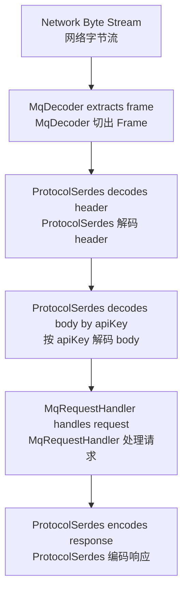
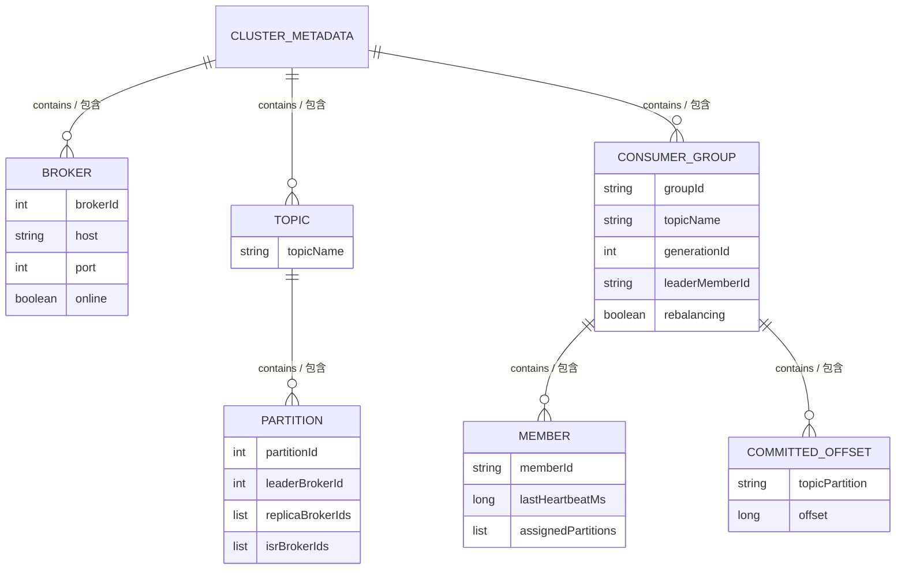

# MiniMQ System Design / MiniMQ 系统设计文档

> This document explains design choices and internal contracts. It is the document to read before changing protocol, storage, metadata, or consumer group behavior.  
> 本文解释系统设计选择与内部契约。修改协议、存储、元数据、消费组逻辑之前，建议先阅读本文。

## 1. Design Goals / 设计目标

MiniMQ aims to be small enough to read, but realistic enough to explain the essential moving parts of a partitioned message queue. The project intentionally avoids hiding behavior behind frameworks. Protocol serialization is explicit. Storage layout is explicit. Group assignment is visible in code. This makes the project suitable for learning, design discussion, and contributor iteration.

MiniMQ 的目标是“小到能读完，大到能讲清消息队列核心机制”。项目有意避免把关键行为藏在框架里：协议序列化是手写的，存储格式是显式的，消费组分配逻辑也直接体现在代码里。因此它适合作为学习项目、设计讨论材料以及后续贡献者继续迭代的上下文载体。

The design optimizes for clarity, determinism, and testability. V4 adds etcd-fenced Controller HA, exact Leader epochs, automatic Broker failure detection, physical/visible replica watermarks, scoped operator APIs, crash-safe Topic deletion, explicit retry/DLQ links, and required delayed-message delivery. Producer acknowledgement policies, transactions, and exactly-once semantics remain future work.

当前设计优先考虑清晰性、确定性和可测试性。V4 已增加 etcd fencing 的 Controller HA、精确 Leader epoch、Broker 自动故障检测、物理/可见副本水位、细粒度运维 API、崩溃安全 Topic 删除、显式 retry/DLQ 关联和必需的延迟投递。Producer 确认策略、事务与 exactly-once 语义仍属于后续工作。

## 2. Protocol Design / 协议设计

MiniMQ uses a custom binary protocol over TCP. Netty receives bytes and `MqDecoder` extracts complete frames. `ProtocolSerdes` then decodes request/response headers and bodies.

MiniMQ 使用自定义 TCP 二进制协议。Netty 接收字节流后，由 `MqDecoder` 切出完整 Frame，再由 `ProtocolSerdes` 解码请求/响应头和 body。

### 2.1 Frame Layout / 帧格式

```text
+----------+---------+----------------+--------------------+
| magic(2) | ver(1)  | length(4)      | payload(length)    |
+----------+---------+----------------+--------------------+
```

| Field / 字段 | Size / 大小 | Meaning / 含义 |
| --- | ---: | --- |
| `magic` | 2 bytes | Constant `0x4D51`, used to identify MiniMQ frames. / 固定魔数，用于识别 MiniMQ 协议帧。 |
| `version` | 1 byte | Current protocol version, value `1`. / 当前协议版本。 |
| `length` | 4 bytes | Payload length. Must be non-negative and <= `MAX_FRAME_BYTES`. / Payload 长度，需要在合法范围内。 |
| `payload` | variable | Request or response payload. / 请求或响应内容。 |

The current max frame size is 16 MiB. This is important because untrusted length fields can otherwise cause memory pressure or OOM.

当前最大 Frame 为 16 MiB。这个限制很重要，因为来自网络的不可信长度字段如果不校验，可能导致内存压力甚至 OOM。

### 2.2 Request Payload / 请求 Payload

```text
+-----------+------------------+--------------------+------+
| apiKey(2) | correlationId(4) | clientId(str16)    | body |
+-----------+------------------+--------------------+------+
```

`correlationId` lets clients match responses to requests. `clientId` is currently used mostly for traceability. Body structure depends on `apiKey`.

`correlationId` 用于客户端把响应和请求配对。`clientId` 当前主要用于可观测和调试。Body 的结构由 `apiKey` 决定。

### 2.3 Response Payload / 响应 Payload

```text
+------------------+--------------+------+
| correlationId(4) | errorCode(2) | body |
+------------------+--------------+------+
```

If `errorCode != NONE`, response body is omitted. This rule keeps error responses compact and avoids body decoding ambiguity.

如果 `errorCode != NONE`，响应 body 会被省略。这样错误响应更紧凑，也避免客户端在错误场景下错误解析 body。

### 2.4 API Keys / API 列表

| ApiKey | Name / 名称 | Plane / 平面 | Purpose / 用途 |
| ---: | --- | --- | --- |
| 0 | `CREATE_TOPIC` | Control / 控制面 | Create a topic with N partitions and replication factor. / 创建包含 N 个分区与副本因子的 Topic。 |
| 1 | `METADATA` | Control / 控制面 | Fetch brokers and topic-partition leader, replica, and ISR metadata. / 拉取 Broker 列表和 Topic-Partition leader、副本与 ISR 元数据。 |
| 2 | `PRODUCE` | Data / 数据面 | Append records to a topic partition. / 向 Topic 分区追加消息。 |
| 3 | `FETCH` | Data / 数据面 | Read records from a topic partition starting at an offset. / 从指定 offset 开始读取 Topic 分区消息。 |
| 4 | `JOIN_GROUP` | Control / 控制面 | Join a consumer group. / 加入消费组。 |
| 5 | `SYNC_GROUP` | Control / 控制面 | Submit or fetch partition assignment. / 提交或拉取分区分配结果。 |
| 6 | `HEARTBEAT` | Control / 控制面 | Refresh member liveness. / 刷新成员存活状态。 |
| 7 | `OFFSET_COMMIT` | Control / 控制面 | Commit consumed offset. / 提交已消费 offset。 |
| 8 | `OFFSET_FETCH` | Control / 控制面 | Fetch committed offset. / 拉取已提交 offset。 |
| 9 | `REGISTER_BROKER` | Control / 控制面 | Register broker with controller. / 向 Controller 注册 Broker。 |
| 10 | `REPLICA_FETCH` | Data / 数据面 | Follower replica pulls leader log bytes. / Follower 副本从 Leader 拉取日志字节。 |
| 11 | `MARK_BROKER_OFFLINE` | Control / 控制面 | Controller marks a broker offline and elects replacement leaders. / Controller 将 Broker 标记离线并选举替代 Leader。 |
| 12 | `UPDATE_REPLICA_LEO` | Control / 控制面 | Report a replica log-end offset to the controller. / 向 Controller 上报副本日志末端 offset。 |
| 13 | `MAINTENANCE_REPORT` | Admin / 管理面 | Preview local retention and compaction actions without changing files. / 预览本地保留与压缩动作，不修改文件。 |
| 14 | `MAINTENANCE_RUN` | Admin / 管理面 | Run local storage maintenance immediately. / 立即执行本地存储维护。 |
| 15 | `MAINTENANCE_METRICS` | Admin / 管理面 | Read cumulative local maintenance counters and the last run status. / 读取本地维护累计指标和最近运行状态。 |
| 16 | `BROKER_HEARTBEAT` | Control / 控制面 | Renew a Broker lease for one persisted `brokerEpoch`. / 使用持久化 `brokerEpoch` 续期 Broker 租约。 |
| 17 | `DISCOVER_CONTROLLER` | Control / 控制面 | Discover the active Controller through any bootstrap Broker. / 通过任意 bootstrap Broker 发现当前 Controller。 |
| 18 | `LEADER_READY` | Control / 控制面 | Confirm a promoted leader has recovered and can serve data. / 确认提升后的 Leader 已恢复并可服务数据面。 |
| 19 | `RUNTIME_METRICS` | Admin / 管理面 | Read authenticated runtime request, response, latency, and throttling counters. / 鉴权读取运行时请求、响应、延迟与限流指标。 |
| 20 | `OPS_STATUS` | Admin / 管理面 | Read one Broker's bounded operational snapshot. / 读取单个 Broker 的有界运维快照。 |
| 21 | `GROUP_STATUS` | Control / 控制面 | Read bounded group membership, offsets, watermarks, and lag. / 读取有界消费组成员、位点、水位与 lag。 |
| 22 | `LIST_TOPICS` | Control / 控制面 | List active Topic names with total/truncated metadata. / 列出 active Topic 名称及 total/truncated 元数据。 |
| 23 | `DESCRIBE_TOPIC` | Control / 控制面 | Describe partitions, reliability links, and optional tombstone state. / 描述分区、可靠性关联和可选 tombstone 状态。 |
| 24 | `DELETE_TOPIC` | Control / 控制面 | Start or observe durable Topic deletion. / 启动或观察持久化 Topic 删除。 |
| 25 | `INCREASE_PARTITIONS` | Control / 控制面 | Increase, never decrease, a Topic's partition count. / 只增加、不减少 Topic 分区数。 |
| 26 | `FAILOVER_AUDIT` | Admin / 管理面 | Read a Broker-local bounded failover audit ring. / 读取 Broker-local 有界故障转移审计环。 |
| 27 | `AUTH_STATUS` | Admin / 管理面 | Report the caller credential's scopes on one Broker. / 报告调用凭据在单个 Broker 上的 scopes。 |
| 28 | `CONFIGURE_TOPIC_RELIABILITY` | Control / 控制面 | Atomically set or clear explicit retry/DLQ links. / 原子设置或清除显式 retry/DLQ 关联。 |
| 29 | `MARK_BROKER_OFFLINE_ADMIN` | Control / 控制面 | Authorized operator request to mark a Broker offline. / 经授权的运维 Broker 下线请求。 |
| 30 | `CREATE_TOPIC_ADMIN` | Control / 控制面 | Scoped V4 Topic creation. / V4 scoped Topic 创建。 |
| 31 | `PRODUCE_V2` | Data / 数据面 | Append immediate or delayed records with `deliverAtEpochMs`. / 追加带 `deliverAtEpochMs` 的即时或延迟记录。 |
| 32 | `REPLICA_FETCH_V2` | Internal data / 内部数据面 | Fenced replica fetch preserving delivery timestamps. / 保留投递时间且带 fencing 的副本拉取。 |
| 33 | `TOPIC_DELETE_ACK` | Internal control / 内部控制面 | Acknowledge versioned local tombstone cleanup. / 确认指定版本的本地 tombstone 清理。 |
| 34 | `FETCH_V2` | Data / 数据面 | Bounded fetch with physical/visible watermarks and next visibility time. / 带物理/可见水位与下次可见时间的有界拉取。 |
| 35 | `METADATA_V2` | Control / 控制面 | Bounded active metadata, independent topic/tombstone cursors, and explicit reliability links. / 有界 active 元数据、独立 topic/tombstone 游标与显式可靠性关联。 |
| 36 | `RUNTIME_METRICS_V2` | Admin / 管理面 | Bounded rates, payload bytes, latency, lag, and audit overwrite metrics. / 有界速率、payload 字节、延迟、lag 与审计覆盖指标。 |
| 37 | `UPDATE_REPLICA_STATE_V2` | Internal control / 内部控制面 | Report fenced physical and visible replica progress. / 上报带 fencing 的物理与可见副本进度。 |

## 3. Serialization Rules / 序列化规则

Strings use UTF-8 with a 2-byte unsigned length prefix. Byte arrays use a 4-byte signed length prefix, where `-1` means `null` and `0` means an empty byte array. Some group assignment payloads use a short-prefixed byte array because they are nested inside protocol messages and are bounded by the frame limit.

字符串采用 UTF-8 编码，并使用 2 字节无符号长度前缀。字节数组采用 4 字节有符号长度前缀，其中 `-1` 表示 `null`，`0` 表示空数组。部分消费组 assignment 使用 short 前缀字节数组，因为它们嵌套在协议消息中，并受 Frame 上限约束。



## 4. Storage Design / 存储设计

`LogManager` now stores active topic-partitions with `SegmentedPartitionLog`. A partition is represented by a segment directory, a catalog file, ordered `.log` segment files, and sparse `.index` files. `FilePartitionLog` remains as the legacy single-file layout used for migration compatibility and focused recovery tests.

`LogManager` 现在使用 `SegmentedPartitionLog` 存储活跃 Topic-Partition。一个分区由 segment 目录、catalog 文件、有序 `.log` segment 文件和稀疏 `.index` 文件组成。`FilePartitionLog` 保留为旧单文件布局，用于迁移兼容和聚焦恢复测试。

### 4.1 Record Layout / 记录格式

```text
+-----------+-------------+------------+---------------+--------------+
| offset(8) | keyLen(4)   | key(bytes) | valueLen(4)   | value(bytes) |
+-----------+-------------+------------+---------------+--------------+
```

| Field / 字段 | Meaning / 含义 |
| --- | --- |
| `offset` | Long offset assigned by the partition log. / 由分区日志分配的 long 类型 offset。 |
| `keyLen` | `-1` for null key, `0` for empty key, positive for byte length. / `-1` 表示 null key，`0` 表示空 key，正数表示字节长度。 |
| `key` | Optional key bytes. / 可选 key 字节。 |
| `valueLen` | `-1` for null value, `0` for empty value, positive for byte length. / `-1` 表示 null value，`0` 表示空 value，正数表示字节长度。 |
| `value` | Optional value bytes. / 可选 value 字节。 |

V2.1.0 recovers a segmented partition by loading `catalog.json`, opening each listed segment in offset order, rebuilding sparse indexes when needed, truncating only an incomplete active segment tail, and rejecting structural corruption such as non-monotonic offsets or incomplete tails in sealed segments. If an old `{topic}-{partition}.log` file exists, `LogManager` migrates it once into the new segment directory and cleans interrupted `.migrating` staging directories before retrying.

V2.1.0 通过加载 `catalog.json` 恢复分段分区，按 offset 顺序打开每个 segment，必要时重建稀疏索引，只截断活跃 segment 的尾部半条记录，并拒绝非单调 offset、sealed segment 尾部半条记录等结构性损坏。如果发现旧 `{topic}-{partition}.log` 文件，`LogManager` 会一次性迁移到新的 segment 目录，并在重试前清理中断遗留的 `.migrating` staging 目录。

### 4.2 Write Safety / 写入安全

The implementation uses a `writeFully(ByteBuffer)` loop because `FileChannel.write` does not guarantee that the whole buffer is written in one call. After each append, `channel.force(false)` flushes file contents to storage.

实现中使用 `writeFully(ByteBuffer)` 循环写满，因为 `FileChannel.write` 不保证一次写完整个 buffer。每次 append 后调用 `channel.force(false)` 刷盘。

### 4.3 V2.0 WAL, Checkpoint, And Flush Policy / V2.0 WAL、Checkpoint 与刷盘策略

V2.0 starts the storage recovery foundation. The main change is to separate durable write intent from the legacy single-file partition-log layout. The WAL is not a replacement for segmented logs; it remains the ordered recovery source replayed into the V2.1 segmented layout. V2.1.1 now applies retention and compaction on sealed segments after replay has restored the partition logs.

V2.0 启动存储恢复基础。核心变化是把持久化写入意图与旧单文件分区日志布局拆开。WAL 不替代分段日志；它仍是有序恢复来源，会重放到 V2.1 分段布局中。V2.1.1 会在重放恢复分区日志之后，对 sealed segment 执行保留策略与压缩。

#### WAL Contract / WAL 契约

```text
-----------+----------+-------------+-------------+-----------------+
| magic(2) | ver(1)   | type(1)     | length(4)   | body(length)    |
+-----------+----------+-------------+-------------+-----------------+
| crc32(4)                                                     |
+--------------------------------------------------------------+
```

For `DATA_APPEND`, the body is:

`DATA_APPEND` 的 body 为：

```text
+----------------+--------------+--------------+-----------+-----------+
| topicLen(2)    | topic(bytes) | partition(4) | offset(8) | keyLen(4) |
+----------------+--------------+--------------+-----------+-----------+
| key(bytes)     | valueLen(4)  | value(bytes) |
+----------------+--------------+--------------+
```

Rules / 规则：

1. WAL records are appended before the corresponding partition-log append is considered durable. / 对应分区日志 append 被视为 durable 之前，必须先追加 WAL 记录。
2. `DATA_APPEND` records are replayed idempotently by topic-partition and offset. / `DATA_APPEND` 按 topic-partition 和 offset 幂等重放。
3. Duplicate offsets already present in a partition log are skipped if payloads match; mismatched duplicate payloads fail recovery. / 如果分区日志已有重复 offset 且 payload 一致，则跳过；payload 不一致则恢复失败。
4. Offset gaps during replay fail fast because they imply missing durable intent. / 重放时出现 offset 空洞需要快速失败，因为它表示持久化意图缺失。
5. Incomplete WAL tail records are truncated. Structural corruption or checksum mismatch fails clearly. / WAL 尾部半条记录可截断；结构性损坏或 checksum 不匹配必须清晰失败。

#### Checkpoint Contract / Checkpoint 契约

V2.0 stores checkpoints as JSON at:

V2.0 checkpoint 以 JSON 存放在：

```text
{dataDir}/checkpoint/recovery-checkpoint.json
```

The checkpoint contains:

checkpoint 包含：

| Field / 字段 | Meaning / 含义 |
| --- | --- |
| `walPosition` | Byte position after the last WAL record included in the checkpoint. / checkpoint 已覆盖的最后一条 WAL 记录之后的字节位置。 |
| `partitionHighWatermarks` | Map of `topic-partition -> nextOffset`. / `topic-partition -> nextOffset` 映射。 |
| `createdAtEpochMs` | Creation timestamp for diagnostics. / 用于诊断的创建时间戳。 |

Checkpoint writes use the same safe-write model as metadata: temp file, force, and atomic replace where supported. If the checkpoint is missing or corrupt, recovery replays from WAL position 0 and validates partition logs using V1.3 corruption-recovery rules. A loaded checkpoint is trusted only when each checkpointed partition log has reached at least the stored high watermark; if any partition log falls behind, startup replays from WAL position 0 so the idempotent append path can refill missing records.

checkpoint 写入使用与元数据相同的安全写入模型：临时文件、刷盘，并在平台支持时原子替换。checkpoint 缺失或损坏时，恢复从 WAL position 0 开始重放，并使用 V1.3 损坏恢复规则校验分区日志。已加载的 checkpoint 只有在每个已记录分区日志都达到对应高水位时才可信；只要任一分区日志落后，启动会从 WAL position 0 重放，让幂等 append 路径补齐缺失记录。

#### Flush Policy / 刷盘策略

V2.0 introduces an explicit `FlushPolicy`:

V2.0 引入显式 `FlushPolicy`：

| Policy / 策略 | Behavior / 行为 | Use case / 使用场景 |
| --- | --- | --- |
| `ALWAYS` | Force WAL and partition log on every append. / 每次 append 都刷 WAL 与分区日志。 | Default safety baseline. / 默认安全基线。 |
| `EVERY_N_APPENDS` | Force after N successful appends. / 每 N 次成功 append 后刷盘。 | Lower latency with bounded loss window. / 降低延迟，同时控制丢失窗口。 |
| `INTERVAL_MS` | Background or append-triggered force after a time interval. / 到达时间间隔后由后台或 append 触发刷盘。 | Throughput-oriented local testing. / 偏吞吐的本地测试。 |
| `MANUAL_ON_CLOSE` | Flush only on explicit flush or close. / 仅在显式 flush 或 close 时刷盘。 | Tests and demos where durability is not the focus. / 不以持久性为重点的测试和演示。 |

The default remains `ALWAYS` until replication and stronger recovery tests exist. This preserves V1.3's conservative durability behavior while making future performance work explicit.

默认策略保持 `ALWAYS`，直到副本机制和更强恢复测试完成。这保留 V1.3 的保守持久性行为，同时把后续性能优化显式化。

Broker CLI flags expose the V2.0 policy without changing existing defaults:

Broker CLI 参数暴露 V2.0 策略，同时不改变现有默认行为：

| Flag / 参数 | Meaning / 含义 |
| --- | --- |
| `--flush-policy always` | Default: force WAL and partition logs after every append. / 默认：每次 append 后刷 WAL 与分区日志。 |
| `--flush-policy every-n-appends --flush-every-n-appends N` | Force after every `N` successful appends. / 每 `N` 次成功 append 后刷盘。 |
| `--flush-policy interval-ms --flush-interval-ms N` | Force when at least `N` milliseconds have elapsed since the last flush. / 距上次刷盘至少经过 `N` 毫秒后刷盘。 |
| `--flush-policy manual-on-close` | Do not flush during append; explicit checkpoint or broker shutdown still flushes before saving checkpoint. / append 期间不主动刷盘；显式 checkpoint 或 Broker 关闭仍会在保存 checkpoint 前刷盘。 |
| `--checkpoint-every-n-appends N` | Save a recovery checkpoint after every `N` successful appends; `0` disables append-count checkpointing. / 每 `N` 次成功 append 后保存恢复 checkpoint；`0` 表示关闭按次数 checkpoint。 |
| `--segment-max-bytes N` | Roll the active segment after it would exceed `N` bytes; default comes from `SegmentedLogConfig`. / 活跃 segment 追加后将超过 `N` 字节时滚动；默认值来自 `SegmentedLogConfig`。 |
| `--sparse-index-interval-records N` | Add one sparse index entry every `N` records per segment. / 每个 segment 内每 `N` 条记录写入一个稀疏索引项。 |
| `--retention-ms N` | Delete sealed segments whose last update is older than `N` milliseconds; `0` disables time-based retention. / 删除最后更新时间早于 `N` 毫秒的 sealed segment；`0` 关闭按时间保留。 |
| `--retention-bytes N` | Keep total sealed-segment bytes under `N` when possible while preserving the active segment. / 在尽量保留活跃 segment 的前提下，将 sealed segment 总字节数控制在 `N` 以内。 |
| `--compaction-enabled` | Enable sealed-segment compaction. / 启用 sealed segment 压缩。 |
| `--compaction-max-segments N` | Bound one compaction run to at most `N` sealed segments. / 单次压缩最多处理 `N` 个 sealed segment。 |
| `--compaction-max-bytes N` | Bound one compaction run to at most `N` original segment bytes; `0` disables the byte cap. / 单次压缩最多处理 `N` 字节的原始 segment；`0` 表示不按字节限速。 |
| `--maintenance-window-start-hour H` | UTC hour when append-triggered maintenance may start; use with end hour. / 允许按 append 触发维护开始的 UTC 小时，需要与结束小时一起使用。 |
| `--maintenance-window-end-hour H` | UTC hour when append-triggered maintenance stops; equal start/end means all day. / 按 append 触发维护停止的 UTC 小时；开始和结束相等表示全天允许。 |
| `--maintenance-every-n-appends N` | Run log maintenance after every `N` appends; `0` keeps maintenance manual. / 每 `N` 次 append 后触发日志维护；`0` 保持手动维护。 |

### 4.4 V2.1.0 Segmented Log And Sparse Index / V2.1.0 分段日志与稀疏索引

The V2.1.0 layout is:

V2.1.0 布局为：

```text
{dataDir}/
  segments/
    {topic}-{partition}/
      catalog.json
      00000000000000000000.log
      00000000000000000000.index
      00000000000000000042.log
      00000000000000000042.index
```

`catalog.json` records the active segment base offset, log start offset, generation, and ordered segment descriptors. Segment log files reuse the record format above. Sparse index files contain fixed-width `(offset, filePosition)` entries and are rebuilt from segment logs if missing or corrupt. V2.1.0 intentionally stops at segment rolling, sparse indexes, migration, and startup recovery.

`catalog.json` 记录活跃 segment base offset、log start offset、generation 和有序 segment descriptor。Segment log 文件复用上面的记录格式。稀疏索引文件保存固定宽度的 `(offset, filePosition)` 条目；缺失或损坏时会从 segment log 重建。V2.1.0 有意只收敛到 segment 滚动、稀疏索引、迁移和启动恢复。

### 4.5 V2.1.1 Retention, Compaction, And Read Snapshots / V2.1.1 保留策略、压缩与读快照

V2.1.1 adds `LogMaintenanceConfig`, `RetentionPolicy`, and `CompactionPolicy` around the segmented layout. Retention deletes only fully sealed segments, never the active segment, and advances `logStartOffset` through an atomic catalog update after old files are moved to cleanup paths. Time-based and size-based retention can be enabled independently.

V2.1.1 在分段布局外增加 `LogMaintenanceConfig`、`RetentionPolicy` 和 `CompactionPolicy`。保留策略只删除完整 sealed segment，不删除活跃 segment，并在旧文件移动到清理路径后通过原子 catalog 更新推进 `logStartOffset`。按时间和按容量保留可以独立启用。

Compaction also runs only on sealed segments. It rewrites a bounded set of sealed segments into cleaned segment files, keeps the latest value for each non-null key, preserves null-key records, and allows offset holes because compacted logs retain logical offsets instead of rewriting them. The compacted catalog is published atomically, and startup cleanup removes interrupted `.cleaned`, `.obsolete`, and temporary catalog files before opening traffic.

压缩同样只作用于 sealed segment。它会把有界数量的 sealed segment 重写为 cleaned segment 文件，保留每个非 null key 的最新值，保留 null-key 记录，并允许 offset 空洞，因为压缩后的日志保留逻辑 offset 而不是重新编号。压缩后的 catalog 原子发布；启动清理会在开放流量前移除中断遗留的 `.cleaned`、`.obsolete` 和临时 catalog 文件。

Readers use active read snapshots during maintenance. Segment files scheduled for deletion wait until in-flight reads exit, so a fetch that started before retention or compaction sees a consistent segment view. WAL replay skips records below the catalog `logStartOffset`, preventing retained-away offsets from being resurrected during broker restart.

读取路径在维护期间使用活跃读快照。计划删除的 segment 文件会等待正在进行的读取退出，因此保留策略或压缩开始前发起的 fetch 能看到一致的 segment 视图。WAL replay 会跳过低于 catalog `logStartOffset` 的记录，避免 Broker 重启时把已经按保留策略删除的 offset 重新恢复出来。

### 4.6 V2.1.2 Maintenance Observability And Controls / V2.1.2 维护可观测性与控制

V2.1.2 exposes maintenance before and after it mutates files. `LogManager.dryRunMaintenance()` returns a `LogMaintenanceReport` that lists each planned `RETENTION_DELETE`, `COMPACTION_REWRITE`, or `COMPACTION_DELETE` action with partition, segment base offset, first/last affected offset, and original segment bytes. Preview and execution share the same retention-then-compaction order, so compaction is planned only over segments that survive simulated retention. Dry-runs do not save catalogs, rewrite segments, delete files, or checkpoint.

V2.1.2 会在维护修改文件之前和之后暴露维护信息。`LogManager.dryRunMaintenance()` 返回 `LogMaintenanceReport`，列出每个计划中的 `RETENTION_DELETE`、`COMPACTION_REWRITE` 或 `COMPACTION_DELETE` 动作，包括分区、segment base offset、受影响的首尾 offset 和原始 segment 字节数。预览与真实执行共享“先 retention、后 compaction”的顺序，因此 compaction 只会基于模拟 retention 后仍存活的 segment 规划。Dry-run 不会保存 catalog、重写 segment、删除文件或写 checkpoint。

`LogMaintenanceMetrics` is an in-memory snapshot of maintenance activity: real run count, dry-run count, deleted bytes/segments, compacted bytes/segments, maintenance attempts skipped by active readers, cleanup failures, and last real run status. Dry-run does not replace the last real status. `PartitionManager` forwards dry-run, manual maintenance, and metrics methods; V2.4.0 exposes them through broker admin APIs 13-15 and the `maintenance-report`, `maintenance-run`, and `maintenance-metrics` CLI commands.

`LogMaintenanceMetrics` 是内存中的维护活动快照，包含真实执行次数、dry-run 次数、删除字节/segment、压缩字节/segment、因活跃 reader 跳过的维护尝试数、清理失败和最近一次真实运行状态。Dry-run 不会覆盖最近真实状态。`PartitionManager` 转发 dry-run、手动维护和指标方法，便于后续 Broker 管理 API 暴露这些能力，而不需要直接访问存储内部实现。

Compaction throttling now has two dimensions: `maxSegmentsPerRun` and `maxBytesPerRun`. The byte cap selects a prefix of sealed segments only while their original bytes stay within the configured budget. Append-triggered maintenance can also be limited to a UTC hour window; manual `maintain()` calls intentionally bypass that window so operators can force a controlled run.

压缩限速现在有两个维度：`maxSegmentsPerRun` 和 `maxBytesPerRun`。字节上限只会在原始 segment 字节数不超过预算时选择 sealed segment 前缀。按 append 触发的维护也可以限制在 UTC 小时窗口内；手动 `maintain()` 会有意绕过该窗口，方便运维执行受控维护。

Real maintenance attempts reader quiescence before compaction planning reads segment contents. If a read snapshot is active, the pass returns `SKIPPED_READERS` without changing files or catalogs; otherwise new reads wait until the bounded pass finishes. Window start/end CLI options must be configured together.

真实维护会在 compaction 规划读取 segment 内容前尝试获取 reader quiescence。存在活跃读快照时，本次维护返回 `SKIPPED_READERS`，且不修改文件或 catalog；获取成功后，新读取会等待受单次预算约束的维护结束。CLI 的维护窗口 start/end 参数必须成对配置。

## 5. Metadata Design / 元数据设计

V4 shared cluster metadata uses format version 4 and is persisted under the etcd metadata snapshot through revision CAS. `MetadataStore` still reads the local JSON document below only as the explicit 2.x import source:

V4 共享集群元数据格式版本为 4，通过 revision CAS 持久化到 etcd metadata snapshot。`MetadataStore` 只在显式导入 2.x 时读取以下本地 JSON：

```text
{dataDir}/cluster-metadata.json
```

V1.3 metadata corruption recovery should validate this file before applying it to controller state. Empty files, malformed JSON, partially written JSON, or schema-incompatible documents are treated as corrupt. The preferred write path is temp-file write, force, and atomic replace where the platform supports it. The preferred recovery path is to quarantine the unreadable file with a timestamped `.corrupt` suffix and either fail fast with a clear error or start from an empty metadata state only when corruption recovery is explicitly enabled.

V1.3 元数据损坏恢复需要在应用到 Controller 状态前校验该文件。空文件、畸形 JSON、半截 JSON 或结构不兼容文档都视为损坏。推荐写入路径是先写临时文件、刷盘，再在平台支持时原子替换正式文件。推荐恢复路径是把不可读文件隔离为带时间戳的 `.corrupt` 文件，然后要么带清晰错误快速失败，要么仅在显式启用损坏恢复时从空元数据状态启动。

The format-4 object contains Brokers, active Topics, durable Topic tombstones, explicit retry/DLQ links, partitions with epoch/readiness and per-replica physical/visible progress, complete watermark snapshots, consumer groups, members, and committed offsets.

格式 4 元数据包含 Broker、active Topic、持久化 Topic tombstone、显式 retry/DLQ 关联、带 epoch/readiness 和逐副本物理/可见进度的 Partition、完整水位快照、Consumer Group、成员与已提交 offset。



`ClusterController.snapshot()` returns a deep copy so callers cannot mutate internal metadata outside the controller lock. Mutations go through synchronized controller methods or `updateMetadata`.

`ClusterController.snapshot()` 返回深拷贝，避免调用方在 controller 锁外修改内部元数据。修改必须通过同步方法或 `updateMetadata` 完成。

## 6. Topic And Partition Design / Topic 与 Partition 设计

Topic creation accepts only portable names of 1..249 characters from `[A-Za-z0-9._-]`; `.` and `..` are rejected. The same validator is used at protocol, metadata, and storage boundaries, while storage also verifies normalized paths remain below its root. Partition count must be positive. Leaders are assigned round-robin over online Brokers sorted by Broker id.

创建 Topic 时只接受长度 1..249、字符集为 `[A-Za-z0-9._-]` 的可移植名称，并拒绝 `.` 与 `..`。协议、元数据和存储边界共用同一校验器，存储层还会确认规范化路径仍位于数据根目录内。分区数必须大于 0；Leader 按 Broker id 排序后的在线 Broker 列表做 round-robin。

Deletion persists `DELETING` first, reconciles local storage on every required Broker, and then persists `DELETED`. The default API wait is 10,000 ms; timeout returns the current `DELETING` response instead of pretending failure or completion. Tombstones remain in metadata after `DELETED`, so a deleted name cannot be recreated. Broker activation waits for an initial metadata revision and successful reconciliation of every installed tombstone.

删除先持久化 `DELETING`，在所有 required Broker 对账并清理本地存储，再持久化 `DELETED`。API 默认最多等待 10,000ms；超时返回当前 `DELETING`，不会伪装失败或完成。进入 `DELETED` 后 tombstone 仍保留在元数据中，因此名称不可重新创建。Broker 进入 `ACTIVE` 前必须安装初始 metadata revision，并成功对账其中全部 tombstone。

Example / 示例：

```text
brokers: [0, 1, 2]
topic: orders, partitions: 5
leaders: p0->0, p1->1, p2->2, p3->0, p4->1
```

## 7. Consumer Group Design / 消费组设计

Consumer group coordination is simplified but captures the essential flow:

消费组协调逻辑经过简化，但保留了核心流程：

1. Consumer sends `JOIN_GROUP`. / Consumer 发送 `JOIN_GROUP`。
2. Coordinator assigns or reuses `memberId`. / Coordinator 分配或复用 `memberId`。
3. Coordinator increments `generationId`. / Coordinator 递增 `generationId`。
4. One member becomes group leader. / 其中一个成员成为 group leader。
5. Leader computes assignment with `RangeAssignor`. / Leader 使用 `RangeAssignor` 计算分配结果。
6. Leader submits assignment through `SYNC_GROUP`. / Leader 通过 `SYNC_GROUP` 提交分配结果。
7. Members fetch their assignment through `SYNC_GROUP`. / 成员通过 `SYNC_GROUP` 拉取自己的分配结果。
8. Consumers commit offsets after processing. / Consumer 处理消息后提交 offset。

`RangeAssignor` sorts members and then allocates contiguous partition ranges. For example, 3 partitions and 2 members results in member 0 receiving partitions `[0, 1]` and member 1 receiving `[2]`.

`RangeAssignor` 会先排序成员，再分配连续分区范围。例如 3 个分区、2 个成员时，成员 0 得到 `[0, 1]`，成员 1 得到 `[2]`。

## 8. Client SDK Design / 客户端设计

`NetworkClient` is a small synchronous request/response wrapper over Netty. It maintains a map from `correlationId` to a one-element blocking queue. When a response arrives, the inbound handler reads the correlation id and offers the retained `ByteBuf` to the matching queue.

`NetworkClient` 是 Netty 上的同步请求/响应封装。它维护 `correlationId -> blocking queue` 的映射。响应到达后，入站 handler 读取 correlation id，并把 retained `ByteBuf` 放入对应队列。

`Producer` and `Consumer` use the complete bootstrap list to discover the current Controller, and lazily create partition-Leader clients. They cache metadata for at most 30 seconds and invalidate it on routing errors before one bounded refresh/retry. Producer reliability-link metadata uses the same 30-second bound; a routing error invalidates both route and link state and resolves the link once more.

`Producer` 与 `Consumer` 使用完整 bootstrap 列表发现当前 Controller，并懒加载分区 Leader 客户端。元数据最多缓存 30 秒；路由错误会先使缓存失效，再执行一次有界刷新/重试。Producer 的 reliability-link 元数据同样最多缓存 30 秒；路由错误会同时失效路由和 link，并重新解析一次。

V1.3 adds the client-resilience boundary for stale metadata. `NetworkClient` supports configurable synchronous request timeout and converts common failures into typed client exceptions. `Producer` and `Consumer` cache metadata per topic, invalidate the cache when a data-plane request receives `NOT_LEADER` or `BROKER_FENCED`, or cached metadata can no longer route the topic/partition, refresh metadata once, and retry once. The retry budget is fixed at initial request plus one refresh retry. If the second attempt still fails, the surfaced `MiniMqServerException` includes operation context such as API, topic, partition, routed Broker, and attempt count.

V1.3 补齐了过期元数据相关的客户端韧性边界。`NetworkClient` 支持同步请求超时配置，并把常见失败转换为类型化客户端异常。`Producer` 和 `Consumer` 按 Topic 缓存元数据；当数据面请求遇到 `NOT_LEADER`，或缓存元数据已经无法路由 topic/partition 时，会失效缓存、刷新元数据并重试一次。重试预算固定为初始请求 + 一次刷新重试；如果第二次仍失败，抛出的 `MiniMqServerException` 会包含 API、topic、partition、attempt 等用户可见上下文。

### 8.1 Web Runtime Reuse / Web Runtime 复用

The Web demo backend is intentionally closer to a real application than to a one-shot CLI command. It keeps a small runtime cache keyed by `bootstrapServers + topic + groupId`. Each real-flow runtime owns a controller-aware admin client, one `Producer`, one `Consumer`, topic-readiness state, and consumer-subscription state. Operator endpoints use the same controller-aware bootstrap behavior for controller operations and require one explicit Broker for Broker-local operations. Credentials stay on the server, and error text is redacted and capped at 256 characters. The cache uses an access-ordered LRU policy and keeps at most 4 active runtimes.

Web 演示后端更接近真实应用，而不是一次性 CLI 命令。它按 `bootstrapServers + topic + groupId` 维护一个小型 runtime 缓存。每个真实流程 runtime 拥有一个 controller-aware 管理客户端、一个 `Producer`、一个 `Consumer`、Topic 就绪状态和 Consumer 订阅状态。Controller 操作使用相同的 bootstrap 自动发现，Broker-local 操作要求单个明确 Broker。凭据只保留在服务端，错误文本经过脱敏且最多 256 字符。缓存采用按访问顺序排列的 LRU 策略，最多保留 4 个活跃 runtime。

Why this is needed / 为什么需要这样设计：

| Concern / 关注点 | If Not Fixed / 不修复的问题 | Current Design / 当前修复方式 |
| --- | --- | --- |
| Concurrent produce/poll / 并发生产与消费 | Two HTTP requests sharing one Consumer could interleave `produce` and `poll`, so request A might consume request B's message. / 两个共享同一 Consumer 的 HTTP 请求可能交错执行 `produce` 和 `poll`，导致请求 A 消费到请求 B 的消息。 | `RealFlowRuntime.run` synchronizes the full create-topic, produce, poll, and commit sequence. / `RealFlowRuntime.run` 将建 Topic、生产、拉取和提交位点作为完整同步单元执行。 |
| Stale runtime after failure / 异常后的旧 runtime | A closed runtime could stay in cache and make later real requests fail or wait for request timeout. / 已关闭的 runtime 如果留在缓存里，后续真实请求可能持续失败或等待请求超时。 | Real mode evicts and rebuilds only for the explicit stale-runtime signal, then retries once. Other failures evict and close the runtime but surface the original error; AUTO never converts a flow that may have written data into mock success. / Real 模式只在明确的失效状态下驱逐并重建 runtime 后重试一次。其他失败会驱逐并关闭 runtime，直接透传原始错误；AUTO 不会把可能已写入数据的流程伪装成 mock 成功。 |
| Unbounded runtime cache / 无上限 runtime 缓存 | Repeated topic/group experiments could leak sockets, event loops, and heartbeat threads. / 反复测试不同 topic/group 可能造成 socket、EventLoop 和心跳线程持续增长。 | Runtime cache is capped at 4 entries; LRU eviction removes the eldest runtime and closes it asynchronously. / runtime 缓存上限为 4；LRU 淘汰最久未访问 runtime，并异步关闭其资源。 |

The eviction path removes the runtime from the cache before cleanup. Cleanup is delegated to a single daemon executor so that closing Netty channels and heartbeat schedulers does not block the user-facing HTTP response. Application shutdown still closes all currently cached runtimes synchronously before stopping the cleanup executor.

淘汰路径会先把 runtime 从缓存移除，再做资源清理。清理动作交给单线程 daemon executor，避免关闭 Netty 通道和心跳调度器时阻塞用户可见的 HTTP 响应。应用关闭时仍会同步关闭当前缓存中的所有 runtime，然后停止清理 executor。

## 9. Error Model / 错误模型

MiniMQ uses `ErrorCode` in response headers:

MiniMQ 在响应头里使用 `ErrorCode`：

| Code | Name / 名称 | Meaning / 含义 |
| ---: | --- | --- |
| 0 | `NONE` | Success. / 成功。 |
| 1 | `UNKNOWN_TOPIC` | Topic does not exist. / Topic 不存在。 |
| 2 | `UNKNOWN_PARTITION` | Partition does not exist. / Partition 不存在。 |
| 3 | `NOT_LEADER` | Target Broker is not the partition Leader. / 目标 Broker 不是分区 Leader。 |
| 4 | `INVALID_REQUEST` | Malformed request or invalid arguments. / 请求畸形或参数非法。 |
| 5 | `GROUP_NOT_FOUND` | Consumer group/member is missing. / 消费组或成员不存在。 |
| 6 | `REBALANCE_IN_PROGRESS` | Group assignment is not stable. / 消费组分配尚未稳定。 |
| 7 | `UNAUTHORIZED` | Credential is missing or unknown. / 凭据缺失或未知。 |
| 8 | `MAINTENANCE_BUSY` | Destructive maintenance/storage work cannot be admitted. / 无法准入破坏性维护或存储工作。 |
| 9 | `BROKER_FENCED` | Broker epoch or local lease is invalid. / Broker epoch 或本地租约失效。 |
| 10 | `BROKER_ID_IN_USE` | Broker ID still has a live lease. / Broker ID 仍有有效租约。 |
| 11 | `CONTROLLER_FENCED` | Controller identity/epoch cannot mutate state. / Controller 身份或 epoch 无权修改状态。 |
| 12 | `NOT_CONTROLLER` | Request reached a non-Controller Broker. / 请求到达非 Controller Broker。 |
| 13 | `STALE_LEADER_EPOCH` | Routed Leader epoch is stale. / 路由携带的 Leader epoch 已过期。 |
| 14 | `LEADER_NOT_READY` | Promoted Leader has not completed activation. / 新 Leader 尚未完成激活。 |
| 15 | `CONTROLLER_NOT_READY` | Controller path is temporarily unavailable. / Controller 路径暂不可用。 |
| 16 | `THROTTLED` | Broker in-flight limit rejected the request. / Broker 并发上限拒绝请求。 |
| 17 | `FORBIDDEN` | Credential is authenticated but lacks the required scope. / 凭据有效但缺少所需 scope。 |
| 18 | `UNKNOWN_BROKER` | Referenced Broker does not exist. / 引用的 Broker 不存在。 |
| 19 | `STALE_TOMBSTONE` | Topic-deletion acknowledgement uses a stale version. / Topic 删除确认使用过期版本。 |

Malformed request bodies are handled inside `MqRequestHandler` so that, when the request header is valid, the broker can return `INVALID_REQUEST` with the original `correlationId`.

畸形请求 body 会在 `MqRequestHandler` 内部处理；只要 header 能成功解析，Broker 会带着原始 `correlationId` 返回 `INVALID_REQUEST`。

## 10. V2.2 Zero-Copy FETCH / V2.2 零拷贝 FETCH

V2.2 keeps the wire protocol at version 1 and adds an optional sendfile path for successful FETCH responses:

V2.2 保持线协议版本为 1，并为成功的 FETCH 响应增加可选 sendfile 路径：

- segmented logs expose stable `FetchPlan` file slices;
- sparse indexes choose the floor position;
- the Broker emits a prefix followed by `DefaultFileRegion` objects;
- plans hold reader leases through asynchronous writes;
- retention/compaction return `SKIPPED_READERS` while a transfer is active;
- `AUTO` falls back before write for `HEAP` mode, unsupported logs/pipelines, or TLS;
- failures after prefix queueing close the channel;
- transfer timeout defaults to 30 seconds.

- 分段日志暴露稳定的 `FetchPlan` 文件区间；
- 稀疏索引选择 floor 位置；
- Broker 先写前缀，再写 `DefaultFileRegion`；
- 计划在异步写期间持有读租约；
- 传输进行中 retention/compaction 返回 `SKIPPED_READERS`；
- `AUTO` 仅在写前对 `HEAP`、不支持的日志/pipeline 或 TLS 回退；
- 前缀入队后的失败会关闭 channel；
- 传输超时默认 30 秒。

CLI flags: `--fetch-transfer-mode=auto|heap` and `--fetch-transfer-timeout-ms`.

CLI 参数：`--fetch-transfer-mode=auto|heap` 与 `--fetch-transfer-timeout-ms`。

CLI 参数：`--fetch-transfer-mode=auto|heap` 与 `--fetch-transfer-timeout-ms`。

## 11. V2.3 Replication / V2.3 副本机制

V2.3 keeps wire protocol version 1 and extends metadata plus internal replica traffic:

V2.3 保持线协议版本为 1，并扩展元数据与内部副本流量：

- `CreateTopicRequest` adds `replicationFactor`;
- `METADATA` partition entries expose `replicaBrokerIds` and `isrBrokerIds`;
- followers pull leader bytes through `REPLICA_FETCH` and append locally without WAL;
- leaders track ISR replica log-end offsets in `ReplicaStateManager`;
- client `FETCH` and sendfile responses expose replication-aware high watermarks and omit records at or above that watermark;
- `REPLICA_FETCH` still returns leader log bytes needed for catch-up even when the replication watermark is lower;
- `MARK_BROKER_OFFLINE` removes a broker from ISR and elects the next ISR leader on the static controller.

- `CreateTopicRequest` 增加 `replicationFactor`；
- `METADATA` 分区项暴露 `replicaBrokerIds` 与 `isrBrokerIds`；
- Follower 通过 `REPLICA_FETCH` 拉取 Leader 字节并在本地无 WAL 追加；
- Leader 在 `ReplicaStateManager` 中跟踪 ISR 副本 log-end offset；
- 客户端 `FETCH` 与 sendfile 响应暴露复制感知 high watermark，并省略不低于该 watermark 的记录；
- 即使复制 watermark 较低，`REPLICA_FETCH` 仍返回 Follower 追平所需的 Leader 日志字节；
- `MARK_BROKER_OFFLINE` 将 Broker 移出 ISR，并在静态 Controller 上选举下一个 ISR Leader；
- `ReplicaStateManager.noteLeadership` records the leader log end at election time and applies an election grace period: before new writes, unreported ISR followers do not block reads of pre-election data; after new writes, strict replication HW semantics apply again;
- `updateReplicaLeo` uses monotonic `Math.max`, so retried replica fetch requests cannot lower replication HW.

- `ReplicaStateManager.noteLeadership` 在选举时记录 Leader log end，并应用选举宽限期：无新写入前，未上报的 ISR follower 不阻塞故障前数据读取；有新写入后恢复严格 replication HW 语义；
- `updateReplicaLeo` 使用单调 `Math.max`，避免重试的副本拉取请求拉低 replication HW。

### 11.1 V2.5.0 Broker Leases And Automatic Failover / Broker 租约与自动故障转移

V2.5.0 keeps the static Controller architecture and adds Broker liveness leases. `ClusterController` persists a monotonically increasing `brokerEpoch` for every Broker and keeps lease deadlines in memory. `PartitionEntry.frozen` is persisted with partition metadata so a no-ISR partition remains unavailable across Controller restarts instead of being normalized back into service.

V2.5.0 保留静态 Controller 架构，并增加 Broker 存活租约。`ClusterController` 为每个 Broker 持久化单调递增的 `brokerEpoch`，在内存中维护租约 deadline；`PartitionEntry.frozen` 随分区元数据持久化，避免没有 ISR 的分区在 Controller 重启后被错误恢复为可用。

The timing contract is strict:

```text
brokerHeartbeatIntervalMs < brokerSelfFenceTimeoutMs < controllerBrokerLeaseTimeoutMs
```

The matching CLI options are `--broker-heartbeat-interval-ms`, `--broker-self-fence-timeout-ms`, and `--controller-broker-lease-timeout-ms`. A Broker transitions through `STARTING`, `ACTIVE`, `STORAGE_DEGRADED`, `FENCED`, and `RECOVERING`. `ACTIVE` admits all data-plane work. `STORAGE_DEGRADED` keeps read, metadata, discovery, and diagnostic paths available while rejecting produce and destructive maintenance with `MAINTENANCE_BUSY`. Fenced or recovering Brokers reject data-plane work; metadata and maintenance read APIs remain available for diagnosis.

When a lease expires, the Controller removes the Broker from ISR and chooses the highest-LEO online ISR replica, preserving replica order as the tie-breaker. If no online ISR survives, the partition becomes frozen with an empty ISR and retains its original Leader ID. Only that original Broker can unfreeze the partition by registering with a higher epoch. Unclean election is deliberately not performed.

Producer and Consumer treat `BROKER_FENCED` like `NOT_LEADER`: invalidate the routed Broker client, refresh metadata once, and retry once.

### 11.2 V3.0.0 Controller HA And Leader Epoch Fencing / Controller 高可用与 Leader epoch

Every production Broker connects to etcd and campaigns for one lease-bound Controller role. The winner increments `/controller/epoch`, installs an exact identity under the lease, and may mutate `/metadata/snapshot` only when both that identity and the expected etcd revision still match. Followers install snapshots through one serialized monotonic watch; SDK clients discover the Controller through any bootstrap Broker and never connect to etcd.

生产 Broker 都连接 etcd 并竞选唯一的 lease-bound Controller。胜者递增 `/controller/epoch`，在 lease 下安装精确身份；只有该身份和预期 etcd revision 同时匹配时才可修改 `/metadata/snapshot`。Follower 通过单线程单调 watch 安装快照；SDK 可通过任意 bootstrap Broker 发现 Controller，但不连接 etcd。

Partition metadata now includes `leaderEpoch`, `leaderEpochStartOffset`, and `leaderReady`. `PRODUCE`, `FETCH`, and `REPLICA_FETCH` require an exact epoch. A promoted Leader persists its epoch proof, crash-safely truncates to the recovery offset, sends `LEADER_READY`, and only then serves data. WAL replay recognizes committed truncation so a divergent tail cannot return after restart. Unclean election remains deliberately unsupported.

分区元数据新增 `leaderEpoch`、`leaderEpochStartOffset` 和 `leaderReady`；三个数据 API 都要求精确 epoch。提升后的 Leader 先持久化 epoch 证明、崩溃安全截断到恢复点，再发送 `LEADER_READY`，最后开放数据面。WAL 重放识别已提交截断，分叉尾部不会在重启后复活。unclean election 仍明确不支持。

Known limitations fixed in follow-up `2.3.1` are tracked in `docs/code-review-2026-07-17-v2.3-replication.md`.

已知限制与 `2.3.1` 计划修复项见 `docs/code-review-2026-07-17-v2.3-replication.md`。

### 11.3 V3.1 Operational Resilience / 运行时韧性

V3.1 adds small runtime protection primitives around the existing broker request boundary without changing the wire protocol version:

- `BrokerRuntimeMetrics` records request counts by API key, response counts by `ErrorCode`, per-API latency totals/counts, and throttled request counts. `BrokerServer.runtimeMetrics()` exposes immutable snapshots for tests and future operator endpoints.
- `RequestThrottler` enforces `--max-in-flight-requests` at `MqRequestHandler.channelRead0`. The default value is `0`, which disables throttling and preserves existing behavior; rejected requests return `THROTTLED`.
- `CircuitBreaker` protects repeated Controller update failures in `ReplicaStateReporter`. When the breaker is open, the reporter returns `CONTROLLER_NOT_READY` instead of repeatedly hitting an unhealthy Controller path.
- `BrokerAvailabilityGuard.State.STORAGE_DEGRADED` rejects `PRODUCE` and destructive maintenance runs with `MAINTENANCE_BUSY`, while allowing `FETCH`, metadata, discovery, and maintenance metrics/reporting for diagnosis.

The V3.1 scope is intentionally in-process. External metrics export, dashboards, alerting, and persistent runtime telemetry remain follow-up work.

### 11.4 V3.2 Network Transport Selection / 网络传输选择

V3.2 introduces `--network-transport nio|auto|epoll` and routes `BrokerServer` event-loop/channel construction through `NettyTransportFactory`.

- `nio` is the default and always uses `NioEventLoopGroup` with `NioServerSocketChannel`, keeping Windows and macOS development safe.
- `auto` uses reflection-based native availability checks and falls back to NIO when epoll classes or runtime support are unavailable.
- `epoll` is explicit opt-in. If the native transport is unavailable, startup fails with a clear `IllegalStateException` instead of silently selecting a partial path.

Native transport support is therefore an optional performance path, not a correctness dependency.

### 11.5 V3.3-V3.5 Production Hardening / 生产化增强

V3.3 externalizes the V3.1 in-process `BrokerRuntimeMetrics` snapshot through protocol API 19 (`RUNTIME_METRICS`) and the demo CLI command `runtime-metrics --broker host:port --admin-token <secret>`. The response uses bounded lists for request counts by API key, response counts by error code, per-API latency summaries, and throttled request counts. The same broker admin token model used by maintenance APIs protects the endpoint.

V3.4 adds deterministic resilience coverage instead of a broad fault-injection framework. Embedded-channel tests now verify that `STORAGE_DEGRADED` rejects produce and destructive maintenance while allowing fetch, metadata, maintenance metrics, and runtime metrics. A pre-acquired `RequestThrottler` slot verifies `THROTTLED` responses and runtime throttling counters without sleeps or high concurrency.

V3.5 extends `benchmark-fetch` with `--network-transport nio|auto|epoll`. The benchmark passes the selected mode into `BrokerConfig` and prints `networkTransport=<mode>` before heap/sendfile rows, so transport comparisons are auditable without changing the benchmark's local, bounded shape.

## 12. V4 Operator Readiness / V4 运维就绪设计

V4 preserves frame version 1 and all positional layouts for keys 0-19. V3 clients therefore remain wire-compatible with a V4 Broker. A mixed V3/V4 Broker cluster is unsupported: V4 replication keys 32 and 37 are required to preserve delivery timestamps and authoritative physical/visible progress, so every Broker must be upgraded together. Metadata format 4 is likewise a cluster-wide contract.

V4 保持 frame version 1 以及 API 0-19 的全部位置布局，因此 V3 客户端仍可连接 V4 Broker。但 V3/V4 Broker 混合集群不受支持：只有 V4 的 key 32 与 37 会保留 delivery timestamp 和权威物理/可见进度，所以所有 Broker 必须一起升级；metadata format 4 同样是集群级契约。

Authorization is local to each Broker. `--admin-token` maps to every scope; repeated `--operator-credential token=scope,scope` entries can grant only `STATUS`, `TOPIC_ADMIN`, `MAINTENANCE`, and/or `BROKER_OFFLINE`. Authentication runs before mutation, storage access, or expensive snapshot assembly. `UNAUTHORIZED` means the credential is unknown; `FORBIDDEN` means it is known but lacks the required scope.

运维鉴权配置在各 Broker 本地。`--admin-token` 映射到全部 scope；可重复使用 `--operator-credential token=scope,scope`，只授予 `STATUS`、`TOPIC_ADMIN`、`MAINTENANCE` 和/或 `BROKER_OFFLINE`。鉴权发生在元数据修改、存储访问或昂贵快照组装之前。`UNAUTHORIZED` 表示凭据未知，`FORBIDDEN` 表示凭据有效但缺少所需 scope。

`FETCH_V2` and `REPLICA_FETCH_V2` encode at most 10,000 records even when many zero-payload records fit under `maxBytes`; their bounded-list `total` and `truncated` fields describe the complete read result. One immutable visibility snapshot supplies physical high watermark, visible high watermark, and next-visible time for each response. Runtime payload metrics count only successfully written key/value bytes, excluding record and frame headers.

`FETCH_V2` 与 `REPLICA_FETCH_V2` 最多编码 10,000 条记录，即使大量零 payload 记录仍满足 `maxBytes`；有界列表的 `total` 与 `truncated` 描述完整读取结果。每个响应只使用一份不可变 visibility snapshot，统一提供物理 high watermark、可见 high watermark 和下次可见时间。Runtime payload metrics 只统计成功写出的 key/value 字节，不包括 record/frame framing。

Retry and dead-letter targets are explicit operator-selected active Topic names. Configuration rejects self-links, missing/deleted targets, and cycles across both link types; deleting a Topic clears inbound and outbound links atomically. Producer helpers resolve only these links. Link metadata is cached for at most 30 seconds and, after a routing error, invalidated and resolved once more before the bounded retry.

Retry 与 dead-letter 目标是运维人员显式选择的 active Topic 名称。配置会拒绝自关联、不存在/已删除目标，以及跨两种关联形成的环；删除 Topic 时原子清理入边和出边。Producer helper 只按这些显式 link 路由。Link metadata 最多缓存 30 秒；遇到路由错误后先失效并重新解析一次，再执行有界重试。

Delayed records are required V4 behavior. WAL type 8 stores the ordinary key/value record plus `deliverAtEpochMs`. A Broker-wide `--max-scheduled-records` limit defaults to 100000; zero rejects new future records but never discards recovery or replication state. Fetch exposes only the contiguous visible prefix. Consumer sleeps for at most the smaller of time-until-due and remaining poll deadline, then checks the deadline immediately after waking. Future records protect only their containing segments from retention and compaction; after due time they follow ordinary maintenance policy.

延迟消息是 V4 必需行为。WAL type 8 保存普通 key/value 记录及 `deliverAtEpochMs`。Broker-wide `--max-scheduled-records` 默认 100000；设为 0 会拒绝新的 future record，但不会丢弃恢复或复制状态。FETCH 只暴露连续可见前缀。Consumer sleep 不超过“距离到期时间”和“poll 剩余 deadline”中的较小值，唤醒后立即再次检查 deadline。Future record 只保护其所在 segment 不被 retention/compaction；到期后恢复普通维护策略。

The local scripts own one run directory through `.minimq-run-directory`, record PID plus process start time, bound readiness and shutdown waits, and preserve unowned or surviving processes. Recursive cleanup is refused without the valid ownership marker. The failover demo waits until all three replicas are in ISR before stopping the initial Leader, then captures status/audit evidence and always performs owned-process cleanup.

本地脚本通过 `.minimq-run-directory` 声明运行目录所有权，记录 PID 与进程启动时间，对 readiness/shutdown 设置上限，并保留非自身进程或未退出进程。没有有效 ownership marker 时拒绝递归清理。Failover demo 会等 3 个副本全部进入 ISR 后才停止初始 Leader，随后采集状态/审计证据，并始终清理自己拥有的进程。

## 13. Design Tradeoffs / 设计取舍

| Decision / 决策 | Benefit / 收益 | Cost / 代价 |
| --- | --- | --- |
| Custom binary protocol / 自定义二进制协议 | Easy to inspect low-level messaging behavior. / 便于观察底层消息行为。 | More validation and compatibility work than JSON/HTTP. / 比 JSON/HTTP 需要更多校验和兼容性工作。 |
| Segmented local log per partition / 每分区本地分段日志 | Supports sparse indexing, faster recovery boundaries, whole-segment retention, sealed-segment compaction, dry-run reports, and maintenance metrics. / 支持稀疏索引、更清晰的恢复边界、整段保留删除、sealed segment 压缩、dry-run 报告和维护指标。 | External operator APIs still need to render maintenance reports and metrics. / 仍需要外部运维 API 输出维护报告与指标。 |
| JSON metadata store / JSON 元数据存储 | Human-readable and easy for demos. / 人类可读，适合演示。 | Not a scalable metadata log. / 不是可扩展的元数据日志。 |
| etcd-fenced Controller role / etcd fencing 的 Controller 角色 | Automatic takeover with epoch and revision fencing. / 使用 epoch 与 revision fencing 自动接管。 | Production Brokers require reachable etcd; SDK clients do not. / 生产 Broker 依赖可达 etcd，但 SDK 不依赖。 |
| Synchronous client API / 同步客户端 API | Easy to use and test. / 易用且易测。 | Lower throughput than async batching. / 吞吐低于异步批量方案。 |
| Sendfile FETCH path / sendfile FETCH 路径 | Removes payload copies on the Broker network write path. / 去掉 Broker 网络写路径上的 payload 复制。 | TLS and unsupported pipelines still use heap fallback. / TLS 与不支持的 pipeline 仍走 heap 回退。 |

## 14. Professional Terms / 专业名词解释

| Term / 术语 | 中文解释 | English explanation / 英文解释 |
| --- | --- | --- |
| Serialization | 把对象转换成可传输/可存储的字节格式。 | Converting objects into bytes for transport/storage. |
| Deserialization | 把字节恢复成对象。 | Converting bytes back into objects. |
| Correlation ID | 请求与响应匹配用的唯一编号。 | An id used to match a response to its request. |
| Idempotency | 重复执行不会改变最终结果的性质。 | The property that repeated execution has the same final effect. |
| Backpressure | 下游处理慢时向上游施加压力，避免无限堆积。 | A mechanism to prevent unbounded buffering when downstream is slow. |
| Rebalance | 消费组成员变化时重新分配分区。 | Reassigning partitions when group membership changes. |
| Retention | 根据时间或大小删除旧日志。 | Deleting old log data by time or size. |
| Compaction | 保留每个 key 最新值的日志压缩策略。 | Keeping the latest value per key in a log. |
| Zero-copy / sendfile | 尽量避免用户态拷贝，把文件字节直接发到 socket。 | Avoiding userspace copies by transferring file bytes directly to a socket. |
| File region | 一段可零拷贝发送的文件区间描述。 | A transferable description of a contiguous file byte range. |
