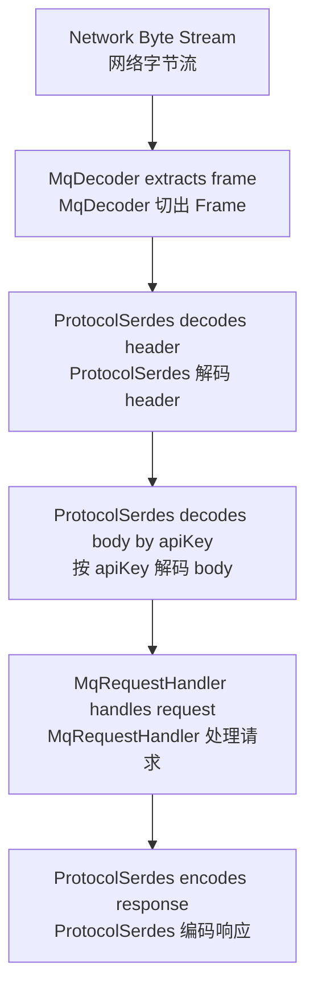
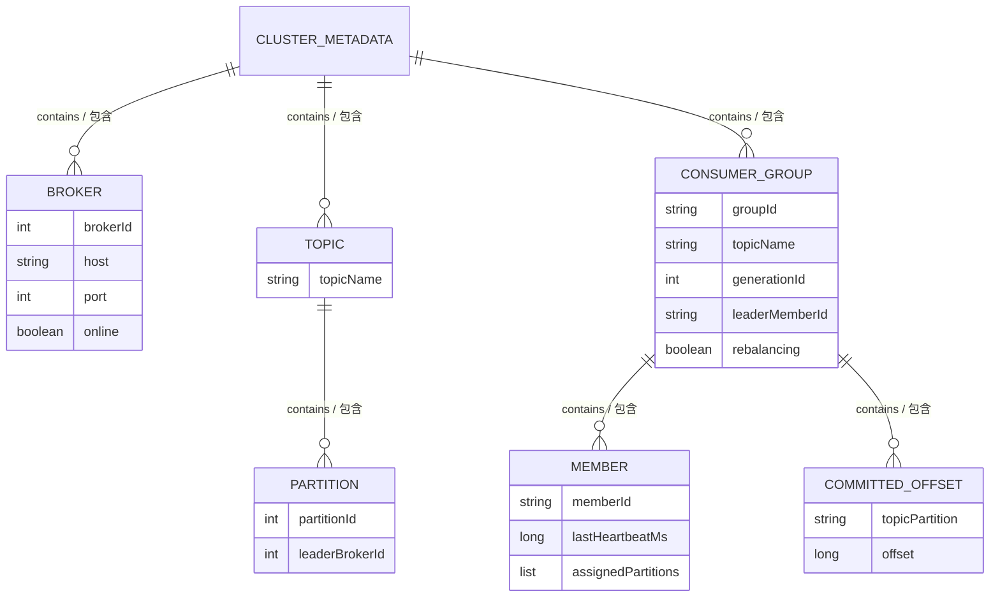

# MiniMQ System Design / MiniMQ 系统设计文档

> This document explains design choices and internal contracts. It is the document to read before changing protocol, storage, metadata, or consumer group behavior.  
> 本文解释系统设计选择与内部契约。修改协议、存储、元数据、消费组逻辑之前，建议先阅读本文。

## 1. Design Goals / 设计目标

MiniMQ aims to be small enough to read, but realistic enough to explain the essential moving parts of a partitioned message queue. The project intentionally avoids hiding behavior behind frameworks. Protocol serialization is explicit. Storage layout is explicit. Group assignment is visible in code. This makes the project suitable for teaching, interview discussion, and agent-driven iteration.

MiniMQ 的目标是“小到能读完，大到能讲清消息队列核心机制”。项目有意避免把关键行为藏在框架里：协议序列化是手写的，存储格式是显式的，消费组分配逻辑也直接体现在代码里。因此它适合作为学习项目、面试作品、以及新 agent 继续迭代的上下文载体。

The design optimizes for clarity, determinism, and testability. It does not yet optimize for throughput, replication safety, multi-tenant isolation, or operational automation.

当前设计优先考虑清晰性、确定性和可测试性，还没有优先考虑吞吐极限、副本安全、多租户隔离或运维自动化。

## 2. Protocol Design / 协议设计

MiniMQ uses a custom binary protocol over TCP. Netty receives bytes and `MqDecoder` extracts complete frames. `ProtocolSerdes` then decodes request/response headers and bodies.

MiniMQ 使用自定义 TCP 二进制协议。Netty 接收字节流后，由 `MqDecoder` 切出完整 Frame，再由 `ProtocolSerdes` 解码请求/响应头和 body。

### 2.1 Frame Layout / 帧格式

```text
+----------+---------+----------------+--------------------+
| magic(2) | ver(1)  | length(4)      | payload(length)    |
+----------+---------+----------------+--------------------+
```

| Field / 字段 | Size / 大小 | Meaning / 含义 |
| --- | ---: | --- |
| `magic` | 2 bytes | Constant `0x4D51`, used to identify MiniMQ frames. / 固定魔数，用于识别 MiniMQ 协议帧。 |
| `version` | 1 byte | Current protocol version, value `1`. / 当前协议版本。 |
| `length` | 4 bytes | Payload length. Must be non-negative and <= `MAX_FRAME_BYTES`. / Payload 长度，需要在合法范围内。 |
| `payload` | variable | Request or response payload. / 请求或响应内容。 |

The current max frame size is 16 MiB. This is important because untrusted length fields can otherwise cause memory pressure or OOM.

当前最大 Frame 为 16 MiB。这个限制很重要，因为来自网络的不可信长度字段如果不校验，可能导致内存压力甚至 OOM。

### 2.2 Request Payload / 请求 Payload

```text
+-----------+------------------+--------------------+------+
| apiKey(2) | correlationId(4) | clientId(str16)    | body |
+-----------+------------------+--------------------+------+
```

`correlationId` lets clients match responses to requests. `clientId` is currently used mostly for traceability. Body structure depends on `apiKey`.

`correlationId` 用于客户端把响应和请求配对。`clientId` 当前主要用于可观测和调试。Body 的结构由 `apiKey` 决定。

### 2.3 Response Payload / 响应 Payload

```text
+------------------+--------------+------+
| correlationId(4) | errorCode(2) | body |
+------------------+--------------+------+
```

If `errorCode != NONE`, response body is omitted. This rule keeps error responses compact and avoids body decoding ambiguity.

如果 `errorCode != NONE`，响应 body 会被省略。这样错误响应更紧凑，也避免客户端在错误场景下错误解析 body。

### 2.4 API Keys / API 列表

| ApiKey | Name / 名称 | Plane / 平面 | Purpose / 用途 |
| ---: | --- | --- | --- |
| 0 | `CREATE_TOPIC` | Control / 控制面 | Create a topic with N partitions. / 创建包含 N 个分区的 Topic。 |
| 1 | `METADATA` | Control / 控制面 | Fetch brokers and topic-partition leader metadata. / 拉取 Broker 列表和 Topic-Partition leader 元数据。 |
| 2 | `PRODUCE` | Data / 数据面 | Append records to a topic partition. / 向 Topic 分区追加消息。 |
| 3 | `FETCH` | Data / 数据面 | Read records from a topic partition starting at an offset. / 从指定 offset 开始读取 Topic 分区消息。 |
| 4 | `JOIN_GROUP` | Control / 控制面 | Join a consumer group. / 加入消费组。 |
| 5 | `SYNC_GROUP` | Control / 控制面 | Submit or fetch partition assignment. / 提交或拉取分区分配结果。 |
| 6 | `HEARTBEAT` | Control / 控制面 | Refresh member liveness. / 刷新成员存活状态。 |
| 7 | `OFFSET_COMMIT` | Control / 控制面 | Commit consumed offset. / 提交已消费 offset。 |
| 8 | `OFFSET_FETCH` | Control / 控制面 | Fetch committed offset. / 拉取已提交 offset。 |
| 9 | `REGISTER_BROKER` | Control / 控制面 | Register broker with controller. / 向 Controller 注册 Broker。 |

## 3. Serialization Rules / 序列化规则

Strings use UTF-8 with a 2-byte unsigned length prefix. Byte arrays use a 4-byte signed length prefix, where `-1` means `null` and `0` means an empty byte array. Some group assignment payloads use a short-prefixed byte array because they are nested inside protocol messages and are bounded by the frame limit.

字符串采用 UTF-8 编码，并使用 2 字节无符号长度前缀。字节数组采用 4 字节有符号长度前缀，其中 `-1` 表示 `null`，`0` 表示空数组。部分消费组 assignment 使用 short 前缀字节数组，因为它们嵌套在协议消息中，并受 Frame 上限约束。



## 4. Storage Design / 存储设计

`FilePartitionLog` stores records in a binary append-only file. Each append writes the next offset and the key/value byte arrays.

`FilePartitionLog` 使用二进制追加写文件保存消息。每次 append 会写入下一条 offset 和 key/value 字节数组。

### 4.1 Record Layout / 记录格式

```text
+-----------+-------------+------------+---------------+--------------+
| offset(8) | keyLen(4)   | key(bytes) | valueLen(4)   | value(bytes) |
+-----------+-------------+------------+---------------+--------------+
```

| Field / 字段 | Meaning / 含义 |
| --- | --- |
| `offset` | Long offset assigned by the partition log. / 由分区日志分配的 long 类型 offset。 |
| `keyLen` | `-1` for null key, `0` for empty key, positive for byte length. / `-1` 表示 null key，`0` 表示空 key，正数表示字节长度。 |
| `key` | Optional key bytes. / 可选 key 字节。 |
| `valueLen` | `-1` for null value, `0` for empty value, positive for byte length. / `-1` 表示 null value，`0` 表示空 value，正数表示字节长度。 |
| `value` | Optional value bytes. / 可选 value 字节。 |

The log recovers `nextOffset` by scanning the file from the beginning and setting `nextOffset = lastOffset + 1`. This is simple but O(file size). A future segmented design should store checkpoints or sparse indexes.

日志启动时通过从头扫描文件恢复 `nextOffset`，最终设置为 `lastOffset + 1`。这种方式简单但复杂度是 O(file size)。未来分段日志应引入 checkpoint 或稀疏索引。

### 4.2 Write Safety / 写入安全

The implementation uses a `writeFully(ByteBuffer)` loop because `FileChannel.write` does not guarantee that the whole buffer is written in one call. After each append, `channel.force(false)` flushes file contents to storage.

实现中使用 `writeFully(ByteBuffer)` 循环写满，因为 `FileChannel.write` 不保证一次写完整个 buffer。每次 append 后调用 `channel.force(false)` 刷盘。

## 5. Metadata Design / 元数据设计

Cluster metadata is persisted by `MetadataStore` as JSON in:

元数据由 `MetadataStore` 持久化为 JSON：

```text
{dataDir}/cluster-metadata.json
```

The metadata object contains brokers, topics, partitions, consumer groups, group members, and committed offsets.

元数据对象包含 Broker、Topic、Partition、Consumer Group、成员和已提交 offset。



`ClusterController.snapshot()` returns a deep copy so callers cannot mutate internal metadata outside the controller lock. Mutations go through synchronized controller methods or `updateMetadata`.

`ClusterController.snapshot()` 返回深拷贝，避免调用方在 controller 锁外修改内部元数据。修改必须通过同步方法或 `updateMetadata` 完成。

## 6. Topic And Partition Design / Topic 与 Partition 设计

Topic creation validates that the topic name is non-blank and partition count is positive. Leaders are assigned round-robin over online brokers sorted by broker id.

创建 Topic 时会校验名称非空、分区数大于 0。Leader 分配逻辑会按 broker id 排序后的在线 Broker 列表做 round-robin。

Example / 示例：

```text
brokers: [0, 1, 2]
topic: orders, partitions: 5
leaders: p0->0, p1->1, p2->2, p3->0, p4->1
```

## 7. Consumer Group Design / 消费组设计

Consumer group coordination is simplified but captures the essential flow:

消费组协调逻辑经过简化，但保留了核心流程：

1. Consumer sends `JOIN_GROUP`. / Consumer 发送 `JOIN_GROUP`。
2. Coordinator assigns or reuses `memberId`. / Coordinator 分配或复用 `memberId`。
3. Coordinator increments `generationId`. / Coordinator 递增 `generationId`。
4. One member becomes group leader. / 其中一个成员成为 group leader。
5. Leader computes assignment with `RangeAssignor`. / Leader 使用 `RangeAssignor` 计算分配结果。
6. Leader submits assignment through `SYNC_GROUP`. / Leader 通过 `SYNC_GROUP` 提交分配结果。
7. Members fetch their assignment through `SYNC_GROUP`. / 成员通过 `SYNC_GROUP` 拉取自己的分配结果。
8. Consumers commit offsets after processing. / Consumer 处理消息后提交 offset。

`RangeAssignor` sorts members and then allocates contiguous partition ranges. For example, 3 partitions and 2 members results in member 0 receiving partitions `[0, 1]` and member 1 receiving `[2]`.

`RangeAssignor` 会先排序成员，再分配连续分区范围。例如 3 个分区、2 个成员时，成员 0 得到 `[0, 1]`，成员 1 得到 `[2]`。

## 8. Client SDK Design / 客户端设计

`NetworkClient` is a small synchronous request/response wrapper over Netty. It maintains a map from `correlationId` to a one-element blocking queue. When a response arrives, the inbound handler reads the correlation id and offers the retained `ByteBuf` to the matching queue.

`NetworkClient` 是 Netty 上的同步请求/响应封装。它维护 `correlationId -> blocking queue` 的映射。响应到达后，入站 handler 读取 correlation id，并把 retained `ByteBuf` 放入对应队列。

`Producer` keeps one bootstrap controller client and lazily creates leader broker clients. `Consumer` keeps one controller client, joins the group during subscribe, starts heartbeat scheduling, and polls assigned partitions.

`Producer` 保留一个 bootstrap controller client，并懒加载 leader broker client。`Consumer` 保留一个 controller client，在 subscribe 时加入 group，启动 heartbeat，并轮询 assigned partitions。

## 9. Error Model / 错误模型

MiniMQ uses `ErrorCode` in response headers:

MiniMQ 在响应头里使用 `ErrorCode`：

| Code / 错误码 | Meaning / 含义 |
| --- | --- |
| `NONE` | Success. / 成功。 |
| `UNKNOWN_TOPIC` | Topic does not exist. / Topic 不存在。 |
| `UNKNOWN_PARTITION` | Topic exists but partition does not. / Topic 存在但 Partition 不存在。 |
| `NOT_LEADER` | Broker is not leader for the partition. / 当前 Broker 不是该分区 leader。 |
| `INVALID_REQUEST` | Malformed request, invalid arguments, or wrong endpoint role. / 请求畸形、参数非法或端点角色错误。 |
| `GROUP_NOT_FOUND` | Consumer group/member is missing. / 消费组或成员不存在。 |
| `REBALANCE_IN_PROGRESS` | Reserved for future rebalance behavior. / 为未来 rebalance 行为预留。 |

Malformed request bodies are handled inside `MqRequestHandler` so that, when the request header is valid, the broker can return `INVALID_REQUEST` with the original `correlationId`.

畸形请求 body 会在 `MqRequestHandler` 内部处理；只要 header 能成功解析，Broker 会带着原始 `correlationId` 返回 `INVALID_REQUEST`。

## 10. Design Tradeoffs / 设计取舍

| Decision / 决策 | Benefit / 收益 | Cost / 代价 |
| --- | --- | --- |
| Custom binary protocol / 自定义二进制协议 | Easy to inspect low-level messaging behavior. / 便于观察底层消息行为。 | More validation and compatibility work than JSON/HTTP. / 比 JSON/HTTP 需要更多校验和兼容性工作。 |
| Single local log file per partition / 每分区一个本地日志文件 | Very easy to understand and test. / 非常易于理解和测试。 | No retention, compaction, or fast sparse indexing. / 没有保留策略、压缩或快速稀疏索引。 |
| JSON metadata store / JSON 元数据存储 | Human-readable and easy for demos. / 人类可读，适合演示。 | Not a scalable metadata log. / 不是可扩展的元数据日志。 |
| Static controller role / 静态 Controller 角色 | Simple bootstrapping. / 启动流程简单。 | No controller high availability. / 没有 Controller 高可用。 |
| Synchronous client API / 同步客户端 API | Easy to use and test. / 易用且易测。 | Lower throughput than async batching. / 吞吐低于异步批量方案。 |

## 11. Professional Terms / 专业名词解释

| Term / 术语 | 中文解释 | English explanation / 英文解释 |
| --- | --- | --- |
| Serialization | 把对象转换成可传输/可存储的字节格式。 | Converting objects into bytes for transport/storage. |
| Deserialization | 把字节恢复成对象。 | Converting bytes back into objects. |
| Correlation ID | 请求与响应匹配用的唯一编号。 | An id used to match a response to its request. |
| Idempotency | 重复执行不会改变最终结果的性质。 | The property that repeated execution has the same final effect. |
| Backpressure | 下游处理慢时向上游施加压力，避免无限堆积。 | A mechanism to prevent unbounded buffering when downstream is slow. |
| Rebalance | 消费组成员变化时重新分配分区。 | Reassigning partitions when group membership changes. |
| Retention | 根据时间或大小删除旧日志。 | Deleting old log data by time or size. |
| Compaction | 保留每个 key 最新值的日志压缩策略。 | Keeping the latest value per key in a log. |
