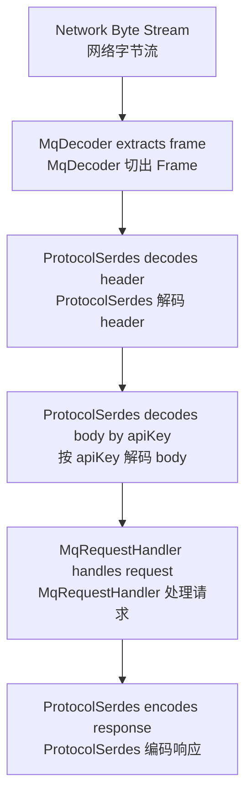
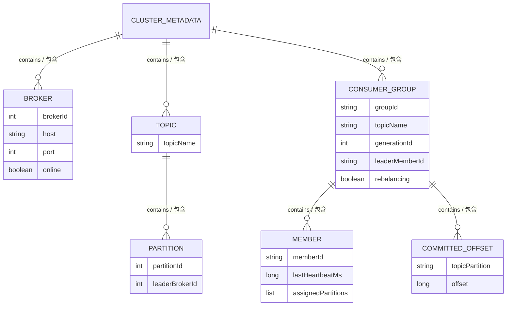

# MiniMQ System Design / MiniMQ 系统设计文档

> This document explains design choices and internal contracts. It is the document to read before changing protocol, storage, metadata, or consumer group behavior.  
> 本文解释系统设计选择与内部契约。修改协议、存储、元数据、消费组逻辑之前，建议先阅读本文。

## 1. Design Goals / 设计目标

MiniMQ aims to be small enough to read, but realistic enough to explain the essential moving parts of a partitioned message queue. The project intentionally avoids hiding behavior behind frameworks. Protocol serialization is explicit. Storage layout is explicit. Group assignment is visible in code. This makes the project suitable for teaching, interview discussion, and agent-driven iteration.

MiniMQ 的目标是“小到能读完，大到能讲清消息队列核心机制”。项目有意避免把关键行为藏在框架里：协议序列化是手写的，存储格式是显式的，消费组分配逻辑也直接体现在代码里。因此它适合作为学习项目、面试作品、以及新 agent 继续迭代的上下文载体。

The design optimizes for clarity, determinism, and testability. It does not yet optimize for throughput, replication safety, multi-tenant isolation, or operational automation.

当前设计优先考虑清晰性、确定性和可测试性，还没有优先考虑吞吐极限、副本安全、多租户隔离或运维自动化。

## 2. Protocol Design / 协议设计

MiniMQ uses a custom binary protocol over TCP. Netty receives bytes and `MqDecoder` extracts complete frames. `ProtocolSerdes` then decodes request/response headers and bodies.

MiniMQ 使用自定义 TCP 二进制协议。Netty 接收字节流后，由 `MqDecoder` 切出完整 Frame，再由 `ProtocolSerdes` 解码请求/响应头和 body。

### 2.1 Frame Layout / 帧格式

```text
+----------+---------+----------------+--------------------+
| magic(2) | ver(1)  | length(4)      | payload(length)    |
+----------+---------+----------------+--------------------+
```

| Field / 字段 | Size / 大小 | Meaning / 含义 |
| --- | ---: | --- |
| `magic` | 2 bytes | Constant `0x4D51`, used to identify MiniMQ frames. / 固定魔数，用于识别 MiniMQ 协议帧。 |
| `version` | 1 byte | Current protocol version, value `1`. / 当前协议版本。 |
| `length` | 4 bytes | Payload length. Must be non-negative and <= `MAX_FRAME_BYTES`. / Payload 长度，需要在合法范围内。 |
| `payload` | variable | Request or response payload. / 请求或响应内容。 |

The current max frame size is 16 MiB. This is important because untrusted length fields can otherwise cause memory pressure or OOM.

当前最大 Frame 为 16 MiB。这个限制很重要，因为来自网络的不可信长度字段如果不校验，可能导致内存压力甚至 OOM。

### 2.2 Request Payload / 请求 Payload

```text
+-----------+------------------+--------------------+------+
| apiKey(2) | correlationId(4) | clientId(str16)    | body |
+-----------+------------------+--------------------+------+
```

`correlationId` lets clients match responses to requests. `clientId` is currently used mostly for traceability. Body structure depends on `apiKey`.

`correlationId` 用于客户端把响应和请求配对。`clientId` 当前主要用于可观测和调试。Body 的结构由 `apiKey` 决定。

### 2.3 Response Payload / 响应 Payload

```text
+------------------+--------------+------+
| correlationId(4) | errorCode(2) | body |
+------------------+--------------+------+
```

If `errorCode != NONE`, response body is omitted. This rule keeps error responses compact and avoids body decoding ambiguity.

如果 `errorCode != NONE`，响应 body 会被省略。这样错误响应更紧凑，也避免客户端在错误场景下错误解析 body。

### 2.4 API Keys / API 列表

| ApiKey | Name / 名称 | Plane / 平面 | Purpose / 用途 |
| ---: | --- | --- | --- |
| 0 | `CREATE_TOPIC` | Control / 控制面 | Create a topic with N partitions. / 创建包含 N 个分区的 Topic。 |
| 1 | `METADATA` | Control / 控制面 | Fetch brokers and topic-partition leader metadata. / 拉取 Broker 列表和 Topic-Partition leader 元数据。 |
| 2 | `PRODUCE` | Data / 数据面 | Append records to a topic partition. / 向 Topic 分区追加消息。 |
| 3 | `FETCH` | Data / 数据面 | Read records from a topic partition starting at an offset. / 从指定 offset 开始读取 Topic 分区消息。 |
| 4 | `JOIN_GROUP` | Control / 控制面 | Join a consumer group. / 加入消费组。 |
| 5 | `SYNC_GROUP` | Control / 控制面 | Submit or fetch partition assignment. / 提交或拉取分区分配结果。 |
| 6 | `HEARTBEAT` | Control / 控制面 | Refresh member liveness. / 刷新成员存活状态。 |
| 7 | `OFFSET_COMMIT` | Control / 控制面 | Commit consumed offset. / 提交已消费 offset。 |
| 8 | `OFFSET_FETCH` | Control / 控制面 | Fetch committed offset. / 拉取已提交 offset。 |
| 9 | `REGISTER_BROKER` | Control / 控制面 | Register broker with controller. / 向 Controller 注册 Broker。 |

## 3. Serialization Rules / 序列化规则

Strings use UTF-8 with a 2-byte unsigned length prefix. Byte arrays use a 4-byte signed length prefix, where `-1` means `null` and `0` means an empty byte array. Some group assignment payloads use a short-prefixed byte array because they are nested inside protocol messages and are bounded by the frame limit.

字符串采用 UTF-8 编码，并使用 2 字节无符号长度前缀。字节数组采用 4 字节有符号长度前缀，其中 `-1` 表示 `null`，`0` 表示空数组。部分消费组 assignment 使用 short 前缀字节数组，因为它们嵌套在协议消息中，并受 Frame 上限约束。



## 4. Storage Design / 存储设计

`LogManager` now stores active topic-partitions with `SegmentedPartitionLog`. A partition is represented by a segment directory, a catalog file, ordered `.log` segment files, and sparse `.index` files. `FilePartitionLog` remains as the legacy single-file layout used for migration compatibility and focused recovery tests.

`LogManager` 现在使用 `SegmentedPartitionLog` 存储活跃 Topic-Partition。一个分区由 segment 目录、catalog 文件、有序 `.log` segment 文件和稀疏 `.index` 文件组成。`FilePartitionLog` 保留为旧单文件布局，用于迁移兼容和聚焦恢复测试。

### 4.1 Record Layout / 记录格式

```text
+-----------+-------------+------------+---------------+--------------+
| offset(8) | keyLen(4)   | key(bytes) | valueLen(4)   | value(bytes) |
+-----------+-------------+------------+---------------+--------------+
```

| Field / 字段 | Meaning / 含义 |
| --- | --- |
| `offset` | Long offset assigned by the partition log. / 由分区日志分配的 long 类型 offset。 |
| `keyLen` | `-1` for null key, `0` for empty key, positive for byte length. / `-1` 表示 null key，`0` 表示空 key，正数表示字节长度。 |
| `key` | Optional key bytes. / 可选 key 字节。 |
| `valueLen` | `-1` for null value, `0` for empty value, positive for byte length. / `-1` 表示 null value，`0` 表示空 value，正数表示字节长度。 |
| `value` | Optional value bytes. / 可选 value 字节。 |

V2.1.0 recovers a segmented partition by loading `catalog.json`, opening each listed segment in offset order, rebuilding sparse indexes when needed, truncating only an incomplete active segment tail, and rejecting structural corruption such as non-monotonic offsets or incomplete tails in sealed segments. If an old `{topic}-{partition}.log` file exists, `LogManager` migrates it once into the new segment directory and cleans interrupted `.migrating` staging directories before retrying.

V2.1.0 通过加载 `catalog.json` 恢复分段分区，按 offset 顺序打开每个 segment，必要时重建稀疏索引，只截断活跃 segment 的尾部半条记录，并拒绝非单调 offset、sealed segment 尾部半条记录等结构性损坏。如果发现旧 `{topic}-{partition}.log` 文件，`LogManager` 会一次性迁移到新的 segment 目录，并在重试前清理中断遗留的 `.migrating` staging 目录。

### 4.2 Write Safety / 写入安全

The implementation uses a `writeFully(ByteBuffer)` loop because `FileChannel.write` does not guarantee that the whole buffer is written in one call. After each append, `channel.force(false)` flushes file contents to storage.

实现中使用 `writeFully(ByteBuffer)` 循环写满，因为 `FileChannel.write` 不保证一次写完整个 buffer。每次 append 后调用 `channel.force(false)` 刷盘。

### 4.3 V2.0 WAL, Checkpoint, And Flush Policy / V2.0 WAL、Checkpoint 与刷盘策略

V2.0 starts the storage recovery foundation. The main change is to separate durable write intent from the legacy single-file partition-log layout. The WAL is not a replacement for segmented logs; it remains the ordered recovery source replayed into the V2.1 segmented layout. V2.1.1 now applies retention and compaction on sealed segments after replay has restored the partition logs.

V2.0 启动存储恢复基础。核心变化是把持久化写入意图与旧单文件分区日志布局拆开。WAL 不替代分段日志；它仍是有序恢复来源，会重放到 V2.1 分段布局中。V2.1.1 会在重放恢复分区日志之后，对 sealed segment 执行保留策略与压缩。

#### WAL Contract / WAL 契约

```text
-----------+----------+-------------+-------------+-----------------+
| magic(2) | ver(1)   | type(1)     | length(4)   | body(length)    |
+-----------+----------+-------------+-------------+-----------------+
| crc32(4)                                                     |
+--------------------------------------------------------------+
```

For `DATA_APPEND`, the body is:

`DATA_APPEND` 的 body 为：

```text
+----------------+--------------+--------------+-----------+-----------+
| topicLen(2)    | topic(bytes) | partition(4) | offset(8) | keyLen(4) |
+----------------+--------------+--------------+-----------+-----------+
| key(bytes)     | valueLen(4)  | value(bytes) |
+----------------+--------------+--------------+
```

Rules / 规则：

1. WAL records are appended before the corresponding partition-log append is considered durable. / 对应分区日志 append 被视为 durable 之前，必须先追加 WAL 记录。
2. `DATA_APPEND` records are replayed idempotently by topic-partition and offset. / `DATA_APPEND` 按 topic-partition 和 offset 幂等重放。
3. Duplicate offsets already present in a partition log are skipped if payloads match; mismatched duplicate payloads fail recovery. / 如果分区日志已有重复 offset 且 payload 一致，则跳过；payload 不一致则恢复失败。
4. Offset gaps during replay fail fast because they imply missing durable intent. / 重放时出现 offset 空洞需要快速失败，因为它表示持久化意图缺失。
5. Incomplete WAL tail records are truncated. Structural corruption or checksum mismatch fails clearly. / WAL 尾部半条记录可截断；结构性损坏或 checksum 不匹配必须清晰失败。

#### Checkpoint Contract / Checkpoint 契约

V2.0 stores checkpoints as JSON at:

V2.0 checkpoint 以 JSON 存放在：

```text
{dataDir}/checkpoint/recovery-checkpoint.json
```

The checkpoint contains:

checkpoint 包含：

| Field / 字段 | Meaning / 含义 |
| --- | --- |
| `walPosition` | Byte position after the last WAL record included in the checkpoint. / checkpoint 已覆盖的最后一条 WAL 记录之后的字节位置。 |
| `partitionHighWatermarks` | Map of `topic-partition -> nextOffset`. / `topic-partition -> nextOffset` 映射。 |
| `createdAtEpochMs` | Creation timestamp for diagnostics. / 用于诊断的创建时间戳。 |

Checkpoint writes use the same safe-write model as metadata: temp file, force, and atomic replace where supported. If the checkpoint is missing or corrupt, recovery replays from WAL position 0 and validates partition logs using V1.3 corruption-recovery rules. A loaded checkpoint is trusted only when each checkpointed partition log has reached at least the stored high watermark; if any partition log falls behind, startup replays from WAL position 0 so the idempotent append path can refill missing records.

checkpoint 写入使用与元数据相同的安全写入模型：临时文件、刷盘，并在平台支持时原子替换。checkpoint 缺失或损坏时，恢复从 WAL position 0 开始重放，并使用 V1.3 损坏恢复规则校验分区日志。已加载的 checkpoint 只有在每个已记录分区日志都达到对应高水位时才可信；只要任一分区日志落后，启动会从 WAL position 0 重放，让幂等 append 路径补齐缺失记录。

#### Flush Policy / 刷盘策略

V2.0 introduces an explicit `FlushPolicy`:

V2.0 引入显式 `FlushPolicy`：

| Policy / 策略 | Behavior / 行为 | Use case / 使用场景 |
| --- | --- | --- |
| `ALWAYS` | Force WAL and partition log on every append. / 每次 append 都刷 WAL 与分区日志。 | Default safety baseline. / 默认安全基线。 |
| `EVERY_N_APPENDS` | Force after N successful appends. / 每 N 次成功 append 后刷盘。 | Lower latency with bounded loss window. / 降低延迟，同时控制丢失窗口。 |
| `INTERVAL_MS` | Background or append-triggered force after a time interval. / 到达时间间隔后由后台或 append 触发刷盘。 | Throughput-oriented local testing. / 偏吞吐的本地测试。 |
| `MANUAL_ON_CLOSE` | Flush only on explicit flush or close. / 仅在显式 flush 或 close 时刷盘。 | Tests and demos where durability is not the focus. / 不以持久性为重点的测试和演示。 |

The default remains `ALWAYS` until replication and stronger recovery tests exist. This preserves V1.3's conservative durability behavior while making future performance work explicit.

默认策略保持 `ALWAYS`，直到副本机制和更强恢复测试完成。这保留 V1.3 的保守持久性行为，同时把后续性能优化显式化。

Broker CLI flags expose the V2.0 policy without changing existing defaults:

Broker CLI 参数暴露 V2.0 策略，同时不改变现有默认行为：

| Flag / 参数 | Meaning / 含义 |
| --- | --- |
| `--flush-policy always` | Default: force WAL and partition logs after every append. / 默认：每次 append 后刷 WAL 与分区日志。 |
| `--flush-policy every-n-appends --flush-every-n-appends N` | Force after every `N` successful appends. / 每 `N` 次成功 append 后刷盘。 |
| `--flush-policy interval-ms --flush-interval-ms N` | Force when at least `N` milliseconds have elapsed since the last flush. / 距上次刷盘至少经过 `N` 毫秒后刷盘。 |
| `--flush-policy manual-on-close` | Do not flush during append; explicit checkpoint or broker shutdown still flushes before saving checkpoint. / append 期间不主动刷盘；显式 checkpoint 或 Broker 关闭仍会在保存 checkpoint 前刷盘。 |
| `--checkpoint-every-n-appends N` | Save a recovery checkpoint after every `N` successful appends; `0` disables append-count checkpointing. / 每 `N` 次成功 append 后保存恢复 checkpoint；`0` 表示关闭按次数 checkpoint。 |
| `--segment-max-bytes N` | Roll the active segment after it would exceed `N` bytes; default comes from `SegmentedLogConfig`. / 活跃 segment 追加后将超过 `N` 字节时滚动；默认值来自 `SegmentedLogConfig`。 |
| `--sparse-index-interval-records N` | Add one sparse index entry every `N` records per segment. / 每个 segment 内每 `N` 条记录写入一个稀疏索引项。 |
| `--retention-ms N` | Delete sealed segments whose last update is older than `N` milliseconds; `0` disables time-based retention. / 删除最后更新时间早于 `N` 毫秒的 sealed segment；`0` 关闭按时间保留。 |
| `--retention-bytes N` | Keep total sealed-segment bytes under `N` when possible while preserving the active segment. / 在尽量保留活跃 segment 的前提下，将 sealed segment 总字节数控制在 `N` 以内。 |
| `--compaction-enabled` | Enable sealed-segment compaction. / 启用 sealed segment 压缩。 |
| `--compaction-max-segments N` | Bound one compaction run to at most `N` sealed segments. / 单次压缩最多处理 `N` 个 sealed segment。 |
| `--compaction-max-bytes N` | Bound one compaction run to at most `N` original segment bytes; `0` disables the byte cap. / 单次压缩最多处理 `N` 字节的原始 segment；`0` 表示不按字节限速。 |
| `--maintenance-window-start-hour H` | UTC hour when append-triggered maintenance may start; use with end hour. / 允许按 append 触发维护开始的 UTC 小时，需要与结束小时一起使用。 |
| `--maintenance-window-end-hour H` | UTC hour when append-triggered maintenance stops; equal start/end means all day. / 按 append 触发维护停止的 UTC 小时；开始和结束相等表示全天允许。 |
| `--maintenance-every-n-appends N` | Run log maintenance after every `N` appends; `0` keeps maintenance manual. / 每 `N` 次 append 后触发日志维护；`0` 保持手动维护。 |

### 4.4 V2.1.0 Segmented Log And Sparse Index / V2.1.0 分段日志与稀疏索引

The V2.1.0 layout is:

V2.1.0 布局为：

```text
{dataDir}/
  segments/
    {topic}-{partition}/
      catalog.json
      00000000000000000000.log
      00000000000000000000.index
      00000000000000000042.log
      00000000000000000042.index
```

`catalog.json` records the active segment base offset, log start offset, generation, and ordered segment descriptors. Segment log files reuse the record format above. Sparse index files contain fixed-width `(offset, filePosition)` entries and are rebuilt from segment logs if missing or corrupt. V2.1.0 intentionally stops at segment rolling, sparse indexes, migration, and startup recovery.

`catalog.json` 记录活跃 segment base offset、log start offset、generation 和有序 segment descriptor。Segment log 文件复用上面的记录格式。稀疏索引文件保存固定宽度的 `(offset, filePosition)` 条目；缺失或损坏时会从 segment log 重建。V2.1.0 有意只收敛到 segment 滚动、稀疏索引、迁移和启动恢复。

### 4.5 V2.1.1 Retention, Compaction, And Read Snapshots / V2.1.1 保留策略、压缩与读快照

V2.1.1 adds `LogMaintenanceConfig`, `RetentionPolicy`, and `CompactionPolicy` around the segmented layout. Retention deletes only fully sealed segments, never the active segment, and advances `logStartOffset` through an atomic catalog update after old files are moved to cleanup paths. Time-based and size-based retention can be enabled independently.

V2.1.1 在分段布局外增加 `LogMaintenanceConfig`、`RetentionPolicy` 和 `CompactionPolicy`。保留策略只删除完整 sealed segment，不删除活跃 segment，并在旧文件移动到清理路径后通过原子 catalog 更新推进 `logStartOffset`。按时间和按容量保留可以独立启用。

Compaction also runs only on sealed segments. It rewrites a bounded set of sealed segments into cleaned segment files, keeps the latest value for each non-null key, preserves null-key records, and allows offset holes because compacted logs retain logical offsets instead of rewriting them. The compacted catalog is published atomically, and startup cleanup removes interrupted `.cleaned`, `.obsolete`, and temporary catalog files before opening traffic.

压缩同样只作用于 sealed segment。它会把有界数量的 sealed segment 重写为 cleaned segment 文件，保留每个非 null key 的最新值，保留 null-key 记录，并允许 offset 空洞，因为压缩后的日志保留逻辑 offset 而不是重新编号。压缩后的 catalog 原子发布；启动清理会在开放流量前移除中断遗留的 `.cleaned`、`.obsolete` 和临时 catalog 文件。

Readers use active read snapshots during maintenance. Segment files scheduled for deletion wait until in-flight reads exit, so a fetch that started before retention or compaction sees a consistent segment view. WAL replay skips records below the catalog `logStartOffset`, preventing retained-away offsets from being resurrected during broker restart.

读取路径在维护期间使用活跃读快照。计划删除的 segment 文件会等待正在进行的读取退出，因此保留策略或压缩开始前发起的 fetch 能看到一致的 segment 视图。WAL replay 会跳过低于 catalog `logStartOffset` 的记录，避免 Broker 重启时把已经按保留策略删除的 offset 重新恢复出来。

### 4.6 V2.1.2 Maintenance Observability And Controls / V2.1.2 维护可观测性与控制

V2.1.2 exposes maintenance before and after it mutates files. `LogManager.dryRunMaintenance()` returns a `LogMaintenanceReport` that lists each planned `RETENTION_DELETE`, `COMPACTION_REWRITE`, or `COMPACTION_DELETE` action with partition, segment base offset, first/last affected offset, and original segment bytes. Preview and execution share the same retention-then-compaction order, so compaction is planned only over segments that survive simulated retention. Dry-runs do not save catalogs, rewrite segments, delete files, or checkpoint.

V2.1.2 会在维护修改文件之前和之后暴露维护信息。`LogManager.dryRunMaintenance()` 返回 `LogMaintenanceReport`，列出每个计划中的 `RETENTION_DELETE`、`COMPACTION_REWRITE` 或 `COMPACTION_DELETE` 动作，包括分区、segment base offset、受影响的首尾 offset 和原始 segment 字节数。预览与真实执行共享“先 retention、后 compaction”的顺序，因此 compaction 只会基于模拟 retention 后仍存活的 segment 规划。Dry-run 不会保存 catalog、重写 segment、删除文件或写 checkpoint。

`LogMaintenanceMetrics` is an in-memory snapshot of maintenance activity: real run count, dry-run count, deleted bytes/segments, compacted bytes/segments, maintenance attempts skipped by active readers, cleanup failures, and last real run status. Dry-run does not replace the last real status. `PartitionManager` forwards dry-run, manual maintenance, and metrics methods so a future broker admin API can expose them without reaching into storage internals.

`LogMaintenanceMetrics` 是内存中的维护活动快照，包含真实执行次数、dry-run 次数、删除字节/segment、压缩字节/segment、因活跃 reader 跳过的维护尝试数、清理失败和最近一次真实运行状态。Dry-run 不会覆盖最近真实状态。`PartitionManager` 转发 dry-run、手动维护和指标方法，便于后续 Broker 管理 API 暴露这些能力，而不需要直接访问存储内部实现。

Compaction throttling now has two dimensions: `maxSegmentsPerRun` and `maxBytesPerRun`. The byte cap selects a prefix of sealed segments only while their original bytes stay within the configured budget. Append-triggered maintenance can also be limited to a UTC hour window; manual `maintain()` calls intentionally bypass that window so operators can force a controlled run.

压缩限速现在有两个维度：`maxSegmentsPerRun` 和 `maxBytesPerRun`。字节上限只会在原始 segment 字节数不超过预算时选择 sealed segment 前缀。按 append 触发的维护也可以限制在 UTC 小时窗口内；手动 `maintain()` 会有意绕过该窗口，方便运维执行受控维护。

Real maintenance attempts reader quiescence before compaction planning reads segment contents. If a read snapshot is active, the pass returns `SKIPPED_READERS` without changing files or catalogs; otherwise new reads wait until the bounded pass finishes. Window start/end CLI options must be configured together.

真实维护会在 compaction 规划读取 segment 内容前尝试获取 reader quiescence。存在活跃读快照时，本次维护返回 `SKIPPED_READERS`，且不修改文件或 catalog；获取成功后，新读取会等待受单次预算约束的维护结束。CLI 的维护窗口 start/end 参数必须成对配置。

## 5. Metadata Design / 元数据设计

Cluster metadata is persisted by `MetadataStore` as JSON in:

元数据由 `MetadataStore` 持久化为 JSON：

```text
{dataDir}/cluster-metadata.json
```

V1.3 metadata corruption recovery should validate this file before applying it to controller state. Empty files, malformed JSON, partially written JSON, or schema-incompatible documents are treated as corrupt. The preferred write path is temp-file write, force, and atomic replace where the platform supports it. The preferred recovery path is to quarantine the unreadable file with a timestamped `.corrupt` suffix and either fail fast with a clear error or start from an empty metadata state only when corruption recovery is explicitly enabled.

V1.3 元数据损坏恢复需要在应用到 Controller 状态前校验该文件。空文件、畸形 JSON、半截 JSON 或结构不兼容文档都视为损坏。推荐写入路径是先写临时文件、刷盘，再在平台支持时原子替换正式文件。推荐恢复路径是把不可读文件隔离为带时间戳的 `.corrupt` 文件，然后要么带清晰错误快速失败，要么仅在显式启用损坏恢复时从空元数据状态启动。

The metadata object contains brokers, topics, partitions, consumer groups, group members, and committed offsets.

元数据对象包含 Broker、Topic、Partition、Consumer Group、成员和已提交 offset。



`ClusterController.snapshot()` returns a deep copy so callers cannot mutate internal metadata outside the controller lock. Mutations go through synchronized controller methods or `updateMetadata`.

`ClusterController.snapshot()` 返回深拷贝，避免调用方在 controller 锁外修改内部元数据。修改必须通过同步方法或 `updateMetadata` 完成。

## 6. Topic And Partition Design / Topic 与 Partition 设计

Topic creation validates that the topic name is non-blank and partition count is positive. Leaders are assigned round-robin over online brokers sorted by broker id.

创建 Topic 时会校验名称非空、分区数大于 0。Leader 分配逻辑会按 broker id 排序后的在线 Broker 列表做 round-robin。

Example / 示例：

```text
brokers: [0, 1, 2]
topic: orders, partitions: 5
leaders: p0->0, p1->1, p2->2, p3->0, p4->1
```

## 7. Consumer Group Design / 消费组设计

Consumer group coordination is simplified but captures the essential flow:

消费组协调逻辑经过简化，但保留了核心流程：

1. Consumer sends `JOIN_GROUP`. / Consumer 发送 `JOIN_GROUP`。
2. Coordinator assigns or reuses `memberId`. / Coordinator 分配或复用 `memberId`。
3. Coordinator increments `generationId`. / Coordinator 递增 `generationId`。
4. One member becomes group leader. / 其中一个成员成为 group leader。
5. Leader computes assignment with `RangeAssignor`. / Leader 使用 `RangeAssignor` 计算分配结果。
6. Leader submits assignment through `SYNC_GROUP`. / Leader 通过 `SYNC_GROUP` 提交分配结果。
7. Members fetch their assignment through `SYNC_GROUP`. / 成员通过 `SYNC_GROUP` 拉取自己的分配结果。
8. Consumers commit offsets after processing. / Consumer 处理消息后提交 offset。

`RangeAssignor` sorts members and then allocates contiguous partition ranges. For example, 3 partitions and 2 members results in member 0 receiving partitions `[0, 1]` and member 1 receiving `[2]`.

`RangeAssignor` 会先排序成员，再分配连续分区范围。例如 3 个分区、2 个成员时，成员 0 得到 `[0, 1]`，成员 1 得到 `[2]`。

## 8. Client SDK Design / 客户端设计

`NetworkClient` is a small synchronous request/response wrapper over Netty. It maintains a map from `correlationId` to a one-element blocking queue. When a response arrives, the inbound handler reads the correlation id and offers the retained `ByteBuf` to the matching queue.

`NetworkClient` 是 Netty 上的同步请求/响应封装。它维护 `correlationId -> blocking queue` 的映射。响应到达后，入站 handler 读取 correlation id，并把 retained `ByteBuf` 放入对应队列。

`Producer` keeps one bootstrap controller client and lazily creates leader broker clients. `Consumer` keeps one controller client, joins the group during subscribe, starts heartbeat scheduling, and polls assigned partitions.

`Producer` 保留一个 bootstrap controller client，并懒加载 leader broker client。`Consumer` 保留一个 controller client，在 subscribe 时加入 group，启动 heartbeat，并轮询 assigned partitions。

V1.3 adds the client-resilience boundary for stale metadata. `NetworkClient` supports configurable synchronous request timeout and converts common failures into typed client exceptions. `Producer` and `Consumer` cache metadata per topic, invalidate the cache when a data-plane request receives `NOT_LEADER` or cached metadata can no longer route the topic/partition, refresh metadata once, and retry once. The retry budget is fixed at initial request plus one refresh retry. If the second attempt still fails, the surfaced `MiniMqServerException` includes operation context such as API, topic, partition, and attempt count.

V1.3 补齐了过期元数据相关的客户端韧性边界。`NetworkClient` 支持同步请求超时配置，并把常见失败转换为类型化客户端异常。`Producer` 和 `Consumer` 按 Topic 缓存元数据；当数据面请求遇到 `NOT_LEADER`，或缓存元数据已经无法路由 topic/partition 时，会失效缓存、刷新元数据并重试一次。重试预算固定为初始请求 + 一次刷新重试；如果第二次仍失败，抛出的 `MiniMqServerException` 会包含 API、topic、partition、attempt 等用户可见上下文。

### 8.1 Web Runtime Reuse / Web Runtime 复用

The Web demo backend is intentionally closer to a real application than to a one-shot CLI command. It keeps a small runtime cache keyed by `bootstrapServers + topic + groupId`. Each runtime owns one admin `NetworkClient`, one `Producer`, one `Consumer`, topic-readiness state, and consumer-subscription state. The cache uses an access-ordered LRU policy and currently keeps at most 4 active runtimes.

Web 演示后端更接近真实应用，而不是一次性 CLI 命令。它按 `bootstrapServers + topic + groupId` 维护一个小型 runtime 缓存。每个 runtime 拥有一个管理用 `NetworkClient`、一个 `Producer`、一个 `Consumer`、Topic 就绪状态和 Consumer 订阅状态。缓存采用按访问顺序排列的 LRU 策略，当前最多保留 4 个活跃 runtime。

Why this is needed / 为什么需要这样设计：

| Concern / 关注点 | If Not Fixed / 不修复的问题 | Current Design / 当前修复方式 |
| --- | --- | --- |
| Concurrent produce/poll / 并发生产与消费 | Two HTTP requests sharing one Consumer could interleave `produce` and `poll`, so request A might consume request B's message. / 两个共享同一 Consumer 的 HTTP 请求可能交错执行 `produce` 和 `poll`，导致请求 A 消费到请求 B 的消息。 | `RealFlowRuntime.run` synchronizes the full create-topic, produce, poll, and commit sequence. / `RealFlowRuntime.run` 将建 Topic、生产、拉取和提交位点作为完整同步单元执行。 |
| Stale runtime after failure / 异常后的旧 runtime | A closed or broken Netty channel could stay in cache and make every later real request fail or wait for request timeout. / 已关闭或损坏的 Netty 通道如果留在缓存里，后续真实请求可能持续失败或等待请求超时。 | Real mode evicts the failed runtime, closes it, rebuilds one replacement runtime, and retries once. / Real 模式会驱逐失败 runtime、关闭它、重建一个替代 runtime，并重试一次。 |
| Unbounded runtime cache / 无上限 runtime 缓存 | Repeated topic/group experiments could leak sockets, event loops, and heartbeat threads. / 反复测试不同 topic/group 可能造成 socket、EventLoop 和心跳线程持续增长。 | Runtime cache is capped at 4 entries; LRU eviction removes the eldest runtime and closes it asynchronously. / runtime 缓存上限为 4；LRU 淘汰最久未访问 runtime，并异步关闭其资源。 |

The eviction path removes the runtime from the cache before cleanup. Cleanup is delegated to a single daemon executor so that closing Netty channels and heartbeat schedulers does not block the user-facing HTTP response. Application shutdown still closes all currently cached runtimes synchronously before stopping the cleanup executor.

淘汰路径会先把 runtime 从缓存移除，再做资源清理。清理动作交给单线程 daemon executor，避免关闭 Netty 通道和心跳调度器时阻塞用户可见的 HTTP 响应。应用关闭时仍会同步关闭当前缓存中的所有 runtime，然后停止清理 executor。

## 9. Error Model / 错误模型

MiniMQ uses `ErrorCode` in response headers:

MiniMQ 在响应头里使用 `ErrorCode`：

| Code / 错误码 | Meaning / 含义 |
| --- | --- |
| `NONE` | Success. / 成功。 |
| `UNKNOWN_TOPIC` | Topic does not exist. / Topic 不存在。 |
| `UNKNOWN_PARTITION` | Topic exists but partition does not. / Topic 存在但 Partition 不存在。 |
| `NOT_LEADER` | Broker is not leader for the partition. / 当前 Broker 不是该分区 leader。 |
| `INVALID_REQUEST` | Malformed request, invalid arguments, or wrong endpoint role. / 请求畸形、参数非法或端点角色错误。 |
| `GROUP_NOT_FOUND` | Consumer group/member is missing. / 消费组或成员不存在。 |
| `REBALANCE_IN_PROGRESS` | Reserved for future rebalance behavior. / 为未来 rebalance 行为预留。 |

Malformed request bodies are handled inside `MqRequestHandler` so that, when the request header is valid, the broker can return `INVALID_REQUEST` with the original `correlationId`.

畸形请求 body 会在 `MqRequestHandler` 内部处理；只要 header 能成功解析，Broker 会带着原始 `correlationId` 返回 `INVALID_REQUEST`。

## 10. Design Tradeoffs / 设计取舍

| Decision / 决策 | Benefit / 收益 | Cost / 代价 |
| --- | --- | --- |
| Custom binary protocol / 自定义二进制协议 | Easy to inspect low-level messaging behavior. / 便于观察底层消息行为。 | More validation and compatibility work than JSON/HTTP. / 比 JSON/HTTP 需要更多校验和兼容性工作。 |
| Segmented local log per partition / 每分区本地分段日志 | Supports sparse indexing, faster recovery boundaries, whole-segment retention, sealed-segment compaction, dry-run reports, and maintenance metrics. / 支持稀疏索引、更清晰的恢复边界、整段保留删除、sealed segment 压缩、dry-run 报告和维护指标。 | External operator APIs still need to render maintenance reports and metrics. / 仍需要外部运维 API 输出维护报告与指标。 |
| JSON metadata store / JSON 元数据存储 | Human-readable and easy for demos. / 人类可读，适合演示。 | Not a scalable metadata log. / 不是可扩展的元数据日志。 |
| Static controller role / 静态 Controller 角色 | Simple bootstrapping. / 启动流程简单。 | No controller high availability. / 没有 Controller 高可用。 |
| Synchronous client API / 同步客户端 API | Easy to use and test. / 易用且易测。 | Lower throughput than async batching. / 吞吐低于异步批量方案。 |

## 11. Professional Terms / 专业名词解释

| Term / 术语 | 中文解释 | English explanation / 英文解释 |
| --- | --- | --- |
| Serialization | 把对象转换成可传输/可存储的字节格式。 | Converting objects into bytes for transport/storage. |
| Deserialization | 把字节恢复成对象。 | Converting bytes back into objects. |
| Correlation ID | 请求与响应匹配用的唯一编号。 | An id used to match a response to its request. |
| Idempotency | 重复执行不会改变最终结果的性质。 | The property that repeated execution has the same final effect. |
| Backpressure | 下游处理慢时向上游施加压力，避免无限堆积。 | A mechanism to prevent unbounded buffering when downstream is slow. |
| Rebalance | 消费组成员变化时重新分配分区。 | Reassigning partitions when group membership changes. |
| Retention | 根据时间或大小删除旧日志。 | Deleting old log data by time or size. |
| Compaction | 保留每个 key 最新值的日志压缩策略。 | Keeping the latest value per key in a log. |
