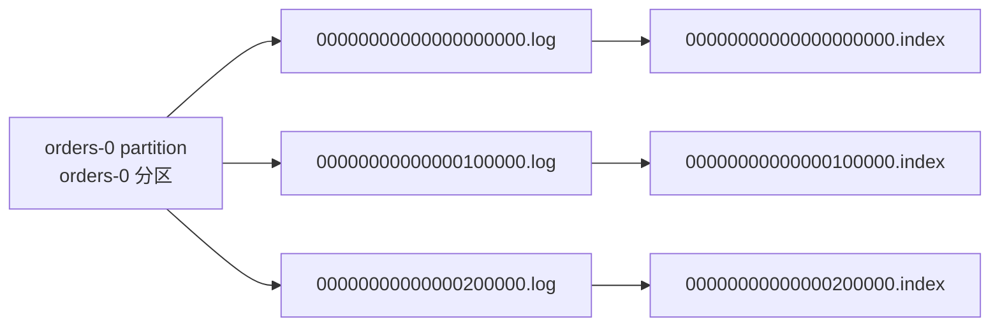
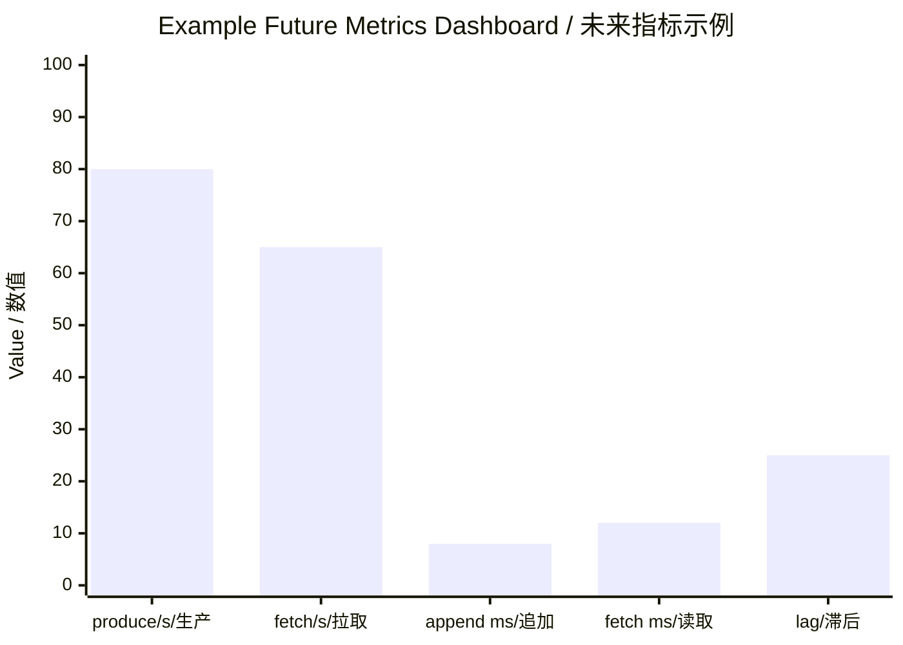

# MiniMQ TODO And Roadmap / MiniMQ 代办与后续版本功能文档

> This roadmap explains known limitations, recommended next tasks, and the production-grade version sequence from V1.3 through V4.
> 本路线图说明当前已知限制、推荐下一步任务，以及从 V1.3 到 V4 的生产级能力演进顺序。

## 1. Current State / 当前状态

MiniMQ has released V2.0 storage recovery as `v2.0.0`, tagged V2.1.2 maintenance observability as `v2.1.2-maintenance-observability`, released V2.2 zero-copy FETCH sendfile as `v2.2.0-read-performance` on `2.2.0`, released V2.3 replication as `v2.3.0-replication` on `2.3.0`, and is implementing V2.3.1 replication hardening on `2.3.1-SNAPSHOT`.

MiniMQ 已将 V2.0 存储恢复以 `v2.0.0` 发布，已将 V2.1.2 维护可观测性打为 `v2.1.2-maintenance-observability`，已将 V2.2 零拷贝 FETCH sendfile 以 `v2.2.0-read-performance` 发布为 `2.2.0`，已将 V2.3 副本机制以 `v2.3.0-replication` 发布为 `2.3.0`，并在 `2.3.1-SNAPSHOT` 上实现 V2.3.1 副本机制加固。

The most important remaining limitation is that replication still depends on a static controller and manual broker-offline operations. Automatic failure detection, ISR lag management, and controller HA remain future work.

当前最重要的剩余限制是副本机制仍依赖静态 Controller 与手动 `MARK_BROKER_OFFLINE` 运维操作。自动故障检测、ISR 滞后管理与 Controller 高可用仍属于后续工作。

## 2. Immediate TODOs / 近期代办

| Priority / 优先级 | Task / 任务 | Why it matters / 重要性 | Suggested tests / 建议测试 |
| --- | --- | --- | --- |
| P0 | Completed: Coverage enforcement in Maven build. / 已完成：Maven 构建覆盖率门禁。 | `mvn verify` now runs JaCoCo `check` with a 90% line threshold. / `mvn verify` 现在运行 JaCoCo `check`，行覆盖率门槛为 90%。 | Verified by `mvn verify`. / 已通过 `mvn verify` 验证。 |
| P0 | Completed: Clean `TcpSmokeTest` output. / 已完成：清理 `TcpSmokeTest` 输出。 | Smoke test output is now assertion-driven and quiet. / 冒烟测试现在由断言验证且输出干净。 | Verified by searching broker/client/protocol tests for `System.out`. / 已通过搜索 broker/client/protocol 测试中的 `System.out` 验证。 |
| P1 | Completed: Malformed collection count regression tests. / 已完成：畸形集合 count 回归测试。 | Protocol collection counts now have negative and over-limit regression cases. / 协议集合 count 现在有负数和超限回归用例。 | `ProtocolSerdesTest` now covers malformed request/response counts. / `ProtocolSerdesTest` 已覆盖畸形请求/响应 count。 |
| P1 | Completed: Client fixed-backoff connection retry. / 已完成：客户端固定退避连接重试。 | `NetworkClient` supports fixed-backoff connection retries. / `NetworkClient` 支持固定退避连接重试。 | `NetworkClientRetryTest` verifies retry budget and invalid policies. / `NetworkClientRetryTest` 验证重试预算与非法策略。 |
| P1 | Completed: Broker shutdown/resource cleanup tests. / 已完成：Broker 关闭和资源释放测试。 | Broker stop/start on the same port is covered. / 已覆盖 Broker 在同一端口停止后重启。 | `BrokerShutdownTest` verifies restart after stop. / `BrokerShutdownTest` 验证停止后重启。 |
| P1 | Completed: Web demo and local launcher. / 已完成：Web 演示与本地启动器。 | Browser testing now covers the user-facing create/produce/consume path without manually running separate broker and Web processes. / 浏览器测试现在覆盖用户可见的创建、生产、消费路径，不需要手动分别管理 Broker 和 Web 进程。 | `MiniMqWebAppTest` and `MiniMqWebDevMainTest` cover static assets, API flow, fallback, and launcher defaults. / `MiniMqWebAppTest` 和 `MiniMqWebDevMainTest` 覆盖静态资源、API 流程、fallback 和启动器默认值。 |
| P1 | Completed: Web runtime reuse and concurrency isolation. / 已完成：Web runtime 复用与并发隔离。 | Reusing admin, producer, and consumer connections removes repeated setup latency while preventing concurrent requests from consuming each other's messages. / 复用管理连接、Producer 和 Consumer 能降低重复初始化延迟，同时避免并发请求互相消费消息。 | `isolatesConcurrentRealFlowRequestsOnSharedRuntime` verifies same-runtime concurrent real requests receive their own messages. / `isolatesConcurrentRealFlowRequestsOnSharedRuntime` 验证同一 runtime 上的并发真实请求各自消费自己的消息。 |
| P1 | Completed: Web runtime rebuild and bounded cleanup. / 已完成：Web runtime 重建与有界回收。 | Failed runtimes are evicted and rebuilt, and the cache is capped to avoid unbounded sockets, event loops, and heartbeat threads. / 失败 runtime 会被驱逐并重建，缓存有上限，避免 socket、EventLoop 和心跳线程无界增长。 | `rebuildsCachedRuntimeAfterRuntimeFailure` and `evictsRuntimeCacheWhenLimitIsExceeded` cover rebuild and LRU eviction. / `rebuildsCachedRuntimeAfterRuntimeFailure` 和 `evictsRuntimeCacheWhenLimitIsExceeded` 覆盖重建和 LRU 淘汰。 |
| P1 | Completed: Client stale metadata / `NOT_LEADER` resilience. / 已完成：客户端过期元数据与 `NOT_LEADER` 韧性。 | V1.3 caches metadata per topic, invalidates stale metadata on `NOT_LEADER` or cache routing failure, refreshes once, and reports contextual errors when the retry budget is exhausted. / V1.3 按 Topic 缓存元数据，在 `NOT_LEADER` 或缓存路由失败时失效并刷新一次，重试预算耗尽后返回带上下文的错误。 | `ProducerNotLeaderRetryTest` and `ConsumerNotLeaderRetryTest` cover cache reuse, invalidation, retry budget, and error context. / `ProducerNotLeaderRetryTest` 与 `ConsumerNotLeaderRetryTest` 覆盖缓存复用、失效、重试预算和错误上下文。 |
| P1 | Completed: Metadata corruption recovery. / 已完成：元数据损坏恢复。 | Startup now validates JSON metadata shape and semantic consistency, fails clearly by default, and quarantines corrupt metadata only when recovery is explicitly enabled. / 启动现在校验 JSON 元数据结构和语义一致性，默认清晰失败；仅在显式启用恢复时隔离损坏元数据。 | `MetadataStoreTest` covers corrupt JSON, empty files, schema-incompatible documents, key mismatches, safe write, and quarantine behavior. / `MetadataStoreTest` 覆盖损坏 JSON、空文件、结构不兼容文档、key 不匹配、安全写入与隔离行为。 |
| P1 | Completed: Log corruption and truncated-record recovery. / 已完成：日志损坏与截断记录恢复。 | Partition-log startup keeps complete valid records, truncates only incomplete tail records, and rejects structural corruption with clear storage errors. / 分区日志启动时保留完整有效记录，只截断尾部半条记录，并对结构性损坏返回清晰存储错误。 | `FilePartitionLogTest` covers truncated header, truncated key/value payload, invalid negative length, impossible payload size, non-monotonic offset, and recovered `nextOffset`. / `FilePartitionLogTest` 覆盖截断 header、截断 key/value payload、非法负长度、异常 payload 大小、非单调 offset 与恢复后的 `nextOffset`。 |
| P0 | Implemented: V2.0 independent WAL design. / 已实现：V2.0 独立 WAL 设计。 | Durable write intent is now separated from partition-log layout, giving recovery one ordered source of truth before segment/index work. / 已将持久化写入意图与分区日志布局拆开，让恢复在分段/索引之前先有一个有序事实来源。 | `WriteAheadLogTest` covers WAL encode/decode, checksum mismatch, truncated-tail recovery, unknown-record rejection, and payload copy safety. / `WriteAheadLogTest` 覆盖 WAL 编解码、校验和不匹配、尾部截断恢复、未知记录拒绝与 payload 拷贝安全。 |
| P0 | Implemented: V2.0 checkpoint and broker startup replay. / 已实现：V2.0 checkpoint 与 Broker 启动重放。 | Startup loads checkpoint, verifies checkpointed partition high watermarks, falls back to WAL position 0 if a partition log is behind, and replays idempotently before request handling. / 启动会加载 checkpoint、校验 checkpoint 中分区高水位；如果分区日志落后则回退到 WAL position 0，并在开放请求处理前幂等重放。 | `CheckpointStoreTest` and `LogManagerRecoveryTest` cover save/load, corrupt checkpoint fallback, no temp-file leftovers, no-checkpoint replay, behind-checkpoint replay, and duplicate replay idempotence. / `CheckpointStoreTest` 与 `LogManagerRecoveryTest` 覆盖保存/加载、损坏 checkpoint 回退、无临时文件残留、无 checkpoint 重放、checkpoint 后分区落后重放和重复重放幂等。 |
| P0 | Implemented: V2.0 flush policy and checkpoint cadence. / 已实现：V2.0 刷盘策略与 checkpoint 节奏。 | Durability/latency tradeoffs are explicit while default behavior remains force-on-every-append. / 持久性与延迟权衡已显式化，同时默认行为仍保持每次 append 都刷盘。 | `FlushPolicyTest`, `LogManagerFlushPolicyTest`, and `BrokerConfigTest` cover policy decisions, invalid settings, append-count checkpointing, and CLI parsing. / `FlushPolicyTest`、`LogManagerFlushPolicyTest` 与 `BrokerConfigTest` 覆盖策略判断、非法配置、按 append 次数 checkpoint 和 CLI 解析。 |
| P0 | Implemented: V2.1.0 segmented log and sparse index. / 已实现：V2.1.0 分段日志与稀疏索引。 | Partition data now lives under `segments/{topic}-{partition}` with cataloged segment files and sparse offset indexes; old single files migrate on startup. / 分区数据现在位于 `segments/{topic}-{partition}`，包含 catalog 管理的 segment 文件和稀疏 offset 索引；旧单文件在启动时迁移。 | `SegmentedPartitionLogTest`, `SegmentFileTest`, `SparseOffsetIndexTest`, `SegmentCatalogStoreTest`, and `LogManagerSegmentRecoveryTest` cover rolling, reads, index rebuild, migration, staging cleanup, and corrupt recovery boundaries. / 这些测试覆盖滚动、读取、索引重建、迁移、staging 清理和损坏恢复边界。 |
| P0 | Implemented: V2.1.1 retention, compaction, and read snapshots. / 已实现：V2.1.1 保留策略、压缩与读快照。 | Sealed segments can now be deleted by time/size policy or compacted by latest key while in-flight reads keep a stable segment view. / sealed segment 现在可以按时间/容量策略删除，也可以按最新 key 压缩，同时进行中的读取保持稳定 segment 视图。 | `RetentionPlannerTest`, `SegmentedPartitionLogRetentionTest`, `SegmentCompactorTest`, `SegmentedPartitionLogCompactionTest`, `SegmentedPartitionLogSnapshotTest`, and `LogManagerMaintenanceTest` cover policy selection, file cleanup, compaction semantics, read-snapshot protection, append-count maintenance, checkpointing, and replay after retained offsets. / 这些测试覆盖策略选择、文件清理、压缩语义、读快照保护、按 append 次数维护、checkpoint 和保留 offset 后的重放。 |
| P0 | Implemented: V2.1.2 maintenance observability and controls. / 已实现：V2.1.2 维护可观测性与控制项。 | Operators can preview destructive maintenance, inspect counters, bound compaction bytes, use maintenance windows, and trigger maintenance manually. / 运维可以预览破坏性维护、查看计数器、限制压缩字节量、使用维护窗口并手动触发维护。 | `LogManagerMaintenanceTest`, `SegmentedPartitionLogCompactionTest`, and `BrokerConfigTest` cover dry-run reports, metrics, byte throttling, maintenance windows, and CLI parsing. / 这些测试覆盖 dry-run 报告、维护指标、字节限速、维护窗口和 CLI 解析。 |
| P0 | Implemented: V2.2 zero-copy FETCH sendfile path. / 已实现：V2.2 零拷贝 FETCH sendfile 路径。 | Broker FETCH can transfer segmented-log bytes with Netty `DefaultFileRegion` while preserving heap fallback and reader-lease safety. / Broker FETCH 可用 Netty `DefaultFileRegion` 传输分段日志字节，同时保留 heap 回退和读租约安全。 | `SegmentedPartitionLogFetchPlanTest`, `FetchResponseWriterTest`, `ZeroCopyFetchIntegrationTest`, and `FetchBenchmarkTest` cover planning, writer selection, real TCP, and metrics. / 这些测试覆盖规划、writer 选择、真实 TCP 与指标。 |
| P0 | Implemented: V2.3 replication foundation. / 已实现：V2.3 副本机制基础。 | Partitions now carry replica and ISR lists, followers pull with `REPLICA_FETCH`, leaders expose replication-aware high watermarks, and the controller can mark brokers offline to elect a new leader. / 分区现在带有 replica 与 ISR 列表，Follower 通过 `REPLICA_FETCH` 拉取，Leader 暴露复制感知的 high watermark，Controller 可标记 Broker 离线并选举新 Leader。 | `ClusterControllerTest`, `ReplicaStateManagerTest`, and `ReplicationIntegrationTest` cover metadata assignment, ISR high watermark math, follower catch-up, leader failover, and `NOT_LEADER` redirects. / 这些测试覆盖元数据分配、ISR high watermark 计算、Follower 追平、Leader 故障转移与 `NOT_LEADER` 重定向。 |
| P0 | Completed: V2.3 replication P0 code-review fixes. / 已完成：V2.3 副本机制 P0 代码审查修复。 | Client/sendfile FETCH now honor replication HW; replica fetch catch-up is uncapped; offline election is atomic; failover read grace and monotonic LEO updates are in place. / 客户端/sendfile FETCH 遵守 replication HW；副本追平不再被错误截断；离线选举原子化；failover 读宽限期与单调 LEO 更新已落地。 | See `docs/code-review-2026-07-17-v2.3-replication.md` and `docs/test-report-2026-07-17-v2.3-replication.md`. / 见 `docs/code-review-2026-07-17-v2.3-replication.md` 与 `docs/test-report-2026-07-17-v2.3-replication.md`。 |
| P1 | Completed: V2.3.1 replication hardening core P1s. | Preferred-order and LEO-aware election, persisted follower LEO, ISR lag shrink/re-expand, sendfile concurrency/failure safety, and focused replica-fetch tests are complete; connection pooling remains deferred. | Covered by `ClusterControllerTest`, `SegmentFileTest`, `FetchResponseWriterTest`, `LeaderReplicaClientTest`, `ReplicaFetcherTest`, and `EmbeddedBrokerChannelTest`. |

## 3. Version Roadmap / 版本路线图

```mermaid
timeline
    title MiniMQ Roadmap / MiniMQ 路线图
    V1 Baseline / V1 基线 : Single leader partitions / 单 leader 分区
                           : Custom binary protocol / 自定义二进制协议
                           : Append-only local log / 本地追加写日志
                           : Consumer group assignment / 消费组分配
    V1.1 Quality / V1.1 质量 : Coverage gate / 覆盖率门禁
                             : Cleaner test output / 更干净的测试输出
                             : Better malformed input tests / 更完整的畸形输入测试
                             : Client retry/backoff / 客户端重试与退避
    V1.2 Web Runtime / V1.2 Web Runtime : Browser Web demo / 浏览器 Web 演示
                                         : Local dev launcher / 本地开发启动器
                                         : Runtime reuse / Runtime 复用
                                         : Concurrency isolation / 并发隔离
                                         : Failure rebuild and LRU cleanup / 异常重建与 LRU 回收
    V1.3 Client Resilience / V1.3 客户端韧性 : NOT_LEADER retry / NOT_LEADER 重试
                                             : Metadata refresh / 元数据刷新
                                             : Request timeout / 请求超时
    V1.3 Recovery Hardening / V1.3 恢复加固 : Metadata corruption recovery / 元数据损坏恢复
                                             : Truncated log tail recovery / 日志尾部截断恢复
    V2.0 Storage Foundation / V2.0 存储基础 : Independent WAL / 独立 WAL
                                             : Checkpoint recovery / Checkpoint 恢复
                                             : Flush policy / 刷盘策略
    V2.1.0 Segmented Log / V2.1.0 分段日志 : Log segments / 日志分段
                                           : Sparse index / 稀疏索引
                                           : Legacy migration / 旧日志迁移
    V2.1.1 Retention And Compaction / V2.1.1 保留与压缩 : Retention / 保留策略
                                                         : Compaction / 压缩
                                                         : Read snapshots / 读快照
    V2.1.2 Maintenance Observability / V2.1.2 维护可观测性 : Dry-run reports / Dry-run 报告
                                                           : Maintenance metrics / 维护指标
                                                           : Windows and throttling / 窗口与限速
    V2.2 Read Performance / V2.2 读取性能 : mmap or sendfile / mmap 或 sendfile
                                           : Zero-copy experiment / 零拷贝实验
    V2.3 Replication / V2.3 副本机制 : Partition replicas / 分区副本
                                      : ISR tracking / ISR 跟踪
                                      : Leader failover / Leader 故障转移
                                      : Replica fetch protocol / 副本拉取协议
    V3.0 Control Plane HA / V3.0 控制面高可用 : Zookeeper or etcd discovery / Zookeeper 或 etcd 服务发现
                                                : Controller election / Controller 选举
                                                : Epoch fencing / Epoch 防旧主写入
    V3.1 Operations Resilience / V3.1 运行时韧性 : Metrics / 指标
                                                  : Circuit breaker / 熔断
                                                  : Degradation and throttling / 降级与限流
    V3.2 Network Performance / V3.2 网络性能 : Netty Epoll transport / Netty Epoll 传输
                                              : NIO fallback / NIO 回退
    V4 Experimental Storage / V4 实验性存储 : Optional LSM state store / 可选 LSM 状态存储
```

### 3.1 V1.3 Client Resilience / V1.3 客户端韧性

V1.3 finished the client-side correctness work before changing storage or cluster architecture. The main goal is to make clients recover from stale metadata and leader mismatch without hiding real errors.

V1.3 已先补齐客户端正确性，再进入存储或集群架构重构。核心目标是在元数据过期、Leader 不匹配时自动恢复，同时不掩盖真实错误。

Implemented scope / 已实现范围：

1. Implemented: cache metadata per topic and invalidate stale cache entries on `NOT_LEADER` or cache routing failure. / 已实现：按 Topic 缓存元数据，并在 `NOT_LEADER` 或缓存路由失败时失效过期缓存。
2. Implemented: cap data-plane stale-metadata recovery at initial request plus one metadata refresh retry. / 已实现：数据面过期元数据恢复预算固定为初始请求 + 一次元数据刷新重试。
3. Implemented: add request timeout configuration for synchronous sends. / 已实现：为同步请求增加超时配置。
4. Implemented: replace generic client failures with a clearer exception hierarchy and user-facing operation context. / 已实现：用更清晰的异常层次替代通用客户端异常，并补充用户可见操作上下文。
5. Keep fixed-backoff connection retry as the default baseline. / 保留固定退避连接重试作为默认基线。

### 3.2 V1.3 Metadata And Log Corruption Recovery / V1.3 元数据与日志损坏恢复

This V1.3 follow-up track hardens current local persistence before the V2 storage redesign. It should not introduce the independent WAL yet. The goal is to make existing JSON metadata and single-file partition logs fail predictably, preserve valid data, and give operators a clear recovery path.

这个 V1.3 后续阶段先加固当前本地持久化，不提前引入 V2 独立 WAL。目标是让现有 JSON 元数据和单文件分区日志在损坏时行为可预测：尽量保留有效数据，并给运维/开发者清晰的恢复路径。

Suggested scope / 建议范围：

1. Implemented: metadata load validation detects empty, malformed, partially written, or schema-incompatible `cluster-metadata.json`. / 已实现：元数据加载校验可识别空文件、畸形 JSON、半截写入或结构不兼容的 `cluster-metadata.json`。
2. Implemented: metadata safe-write path writes to a temp file, forces it, then atomically replaces the live metadata file where supported. / 已实现：元数据安全写入先写临时文件并刷盘，再在支持的平台上原子替换正式元数据文件。
3. Implemented: metadata quarantine moves unreadable metadata to a timestamped `.corrupt` file and starts with empty controller state only when explicitly allowed. / 已实现：元数据隔离会把无法读取的元数据移动到带时间戳的 `.corrupt` 文件，且只有显式允许时才以空 Controller 状态启动。
4. Implemented: partition log tail recovery stops at the last complete valid record and truncates the damaged tail. / 已实现：分区日志尾部恢复会停在最后一条完整有效记录，并截断损坏尾部。
5. Implemented: partition log structural validation rejects negative lengths, impossible payload sizes, and non-monotonic offsets with clear storage errors. / 已实现：分区日志结构校验会对负长度、异常 payload 大小和非单调 offset 返回清晰存储错误。
6. Verified: targeted recovery tests pass with `mvn -o -Dmaven.repo.local=.m2\repository -pl mq-storage,mq-broker -am -Dtest=FilePartitionLogTest,MetadataStoreTest -DfailIfNoTests=false -Dsurefire.failIfNoSpecifiedTests=false test`. / 已验证：目标恢复测试已通过上述 Maven 命令。

Out of scope for this V1.3 track / 本阶段暂不包含：

1. Independent WAL, checkpoints, and WAL replay. / 独立 WAL、checkpoint 与 WAL 重放。
2. Segment files, sparse indexes, retention, and compaction. / Segment 文件、稀疏索引、保留策略与压缩。
3. Replication-aware recovery, ISR, and leader failover. / 副本感知恢复、ISR 与 Leader 故障转移。

### 3.3 V2.0 Storage Recovery Foundation / V2.0 存储恢复基础

V2.0 should separate durable intent from log layout by introducing an independent WAL and checkpointed recovery. This gives later segmented logs, indexes, and replication a stable recovery contract.

V2.0 应通过独立 WAL 与 checkpoint 恢复，把“持久化意图”和“日志文件布局”拆开。这样后续日志分段、索引、副本同步都能依赖稳定的恢复语义。

Design proposal / 设计方案：

1. Implemented: WAL ownership adds `WriteAheadLog` under `mq-storage` and keeps it independent from `FilePartitionLog`. The broker append path first appends durable intent to WAL, then applies the record to the partition log. / 已实现：WAL 归属在 `mq-storage` 增加 `WriteAheadLog`，并保持它独立于 `FilePartitionLog`。Broker append 路径先把持久化意图写入 WAL，再应用到分区日志。
2. Implemented: WAL file layout stores records in `{dataDir}/wal/minimq.wal` for V2.0, with future rolling left to V2.1. Each record starts with magic, version, record type, body length, body bytes, and CRC32 checksum; `DATA_APPEND` body contains topic, partition, offset, key, and value. / 已实现：V2.0 WAL 文件使用 `{dataDir}/wal/minimq.wal`，WAL 滚动留到 V2.1。每条记录包含 magic、version、record type、body 长度、body 字节和 CRC32 校验和；`DATA_APPEND` body 包含 topic、partition、offset、key 和 value。
3. Implemented: WAL record types start with `DATA_APPEND`; reserved/unknown record types are rejected during replay. / 已实现：WAL 记录类型先从 `DATA_APPEND` 开始；预留或未知类型在重放时拒绝。
4. Implemented: Replay contract loads checkpoint first, verifies checkpointed partition high watermarks, replays after the checkpointed WAL position only when partition logs are caught up, otherwise replays from WAL position 0, and applies each record idempotently by topic-partition offset. Duplicate offsets already present in the partition log are skipped; gaps fail fast. / 已实现：重放契约先加载 checkpoint 并校验 checkpoint 中分区高水位；只有分区日志已追上时才从 checkpoint 记录的 WAL 位置之后重放，否则从 WAL position 0 重放，并按 topic-partition offset 幂等应用记录。分区日志里已存在的重复 offset 跳过；出现 offset 空洞则快速失败。
5. Implemented: checkpoint file persists `{dataDir}/checkpoint/recovery-checkpoint.json` using temp-file write, force, and atomic replace. The checkpoint stores WAL byte position, per-partition high watermark, and creation time. / 已实现：checkpoint 文件使用临时文件写入、刷盘和原子替换持久化 `{dataDir}/checkpoint/recovery-checkpoint.json`。checkpoint 保存 WAL 字节位置、每分区高水位和创建时间。
6. Implemented: checkpoint is created on clean broker shutdown, during `LogManager` startup after replay, on explicit `checkpoint()`, and after every configured number of successful appends. / 已实现：Broker 正常关闭时、`LogManager` 启动重放后、显式 `checkpoint()`，以及达到配置的成功 append 次数后都会创建 checkpoint。
7. Implemented: flush policies include `ALWAYS`, `EVERY_N_APPENDS`, `INTERVAL_MS`, and `MANUAL_ON_CLOSE`. Default V2.0 policy remains `ALWAYS` for safety, while tests cover the other modes. / 已实现：刷盘策略包含 `ALWAYS`、`EVERY_N_APPENDS`、`INTERVAL_MS` 和 `MANUAL_ON_CLOSE`。V2.0 默认仍使用 `ALWAYS` 保守保证安全，同时测试覆盖其他模式。
8. Failure handling: incomplete WAL tail records are truncated like V1.3 log tails; checksum mismatch, negative lengths, impossible payload sizes, non-monotonic replay gaps, or unknown versions fail clearly. / 失败处理：WAL 尾部半条记录像 V1.3 日志尾部一样截断；校验和不匹配、负长度、异常 payload 大小、重放 offset 空洞或未知版本都清晰失败。

Implementation sequence / 实现顺序：

1. Implemented: define `WalRecord`, `WalRecordType`, `WriteAheadLog`, and WAL serde tests. / 已实现：定义 `WalRecord`、`WalRecordType`、`WriteAheadLog` 和 WAL 编解码测试。
2. Implemented: add `RecoveryCheckpoint`, `CheckpointStore`, and safe-write/corrupt-checkpoint tests. / 已实现：增加 `RecoveryCheckpoint`、`CheckpointStore` 与安全写入/损坏 checkpoint 测试。
3. Implemented: introduce `FlushPolicy` and make `FilePartitionLog`/WAL flush behavior configurable without changing default safety. / 已实现：引入 `FlushPolicy`，让 `FilePartitionLog`/WAL 刷盘行为可配置，同时不改变默认安全性。
4. Implemented: wire broker startup recovery by loading checkpoint, replaying WAL, and exposing recovered partition logs to request handling. / 已实现：串接 Broker 启动恢复，加载 checkpoint、重放 WAL，然后再向请求处理开放已恢复的分区日志。
5. Implemented for V2.0 scope: crash-style tests cover truncated WAL, duplicate replay, checkpoint recovery, and invalid policy config. / V2.0 范围内已实现：崩溃风格测试覆盖 WAL 截断、重复重放、checkpoint 恢复和非法策略配置。

### 3.4 V2.1 Segmented Log, Index, Retention, And Compaction / V2.1 分段日志、索引、保留与压缩

V2.1.0 has switched the active broker storage path from one file per partition to a segmented directory per partition. Each partition now has a `catalog.json`, ordered `.log` files, and sparse `.index` files. The old single-file layout is treated as a legacy migration source.

V2.1.0 已把活跃 Broker 存储路径从每分区一个文件切换为每分区一个分段目录。每个分区现在包含 `catalog.json`、有序 `.log` 文件和稀疏 `.index` 文件。旧单文件布局作为迁移来源处理。

V2.1.1 builds on that layout with sealed-segment retention, sealed-segment compaction, atomic catalog switching, read-snapshot deletion protection, and append-count maintenance triggers. Replication, service discovery, circuit breakers, Epoll, and zero-copy remain in later productionization versions.

V2.1.1 在该布局上补齐 sealed segment 保留策略、sealed segment 压缩、原子 catalog 切换、读快照删除保护和按 append 次数触发维护。副本、服务发现、熔断降级、Epoll 与零拷贝继续放在后续生产化版本。

Benefits / 收益：

- Faster recovery by scanning only active segment plus checkpoints. / 只扫描活跃 segment 和 checkpoint，恢复更快。
- Retention can delete whole old segments. / 保留策略可以整段删除旧 segment。
- Index files can map offset to file position. / 索引文件可以把 offset 映射到文件位置。
- Compaction can run segment by segment. / 压缩可以按 segment 分段执行。

V2.1.0 implemented scope / V2.1.0 已实现范围：

1. `SegmentedLogConfig` controls segment max bytes and sparse index interval. / `SegmentedLogConfig` 控制 segment 最大字节数和稀疏索引间隔。
2. `SegmentedPartitionLog` rolls active segments by size and reads across segment boundaries. / `SegmentedPartitionLog` 按大小滚动活跃 segment，并支持跨 segment 读取。
3. `SegmentCatalogStore` persists `catalog.json` safely and rebuilds missing indexes from segment logs. / `SegmentCatalogStore` 安全持久化 `catalog.json`，缺失索引可从 segment log 重建。
4. `LogManager` stores new partitions under `{dataDir}/segments/{topic}-{partition}`, migrates old `{topic}-{partition}.log` files, cleans interrupted `.migrating` staging directories, and keeps WAL/checkpoint replay on the new layout. / `LogManager` 将新分区存储到 `{dataDir}/segments/{topic}-{partition}`，迁移旧 `{topic}-{partition}.log` 文件，清理中断遗留的 `.migrating` staging 目录，并把 WAL/checkpoint 重放串到新布局。
5. Broker CLI exposes `--segment-max-bytes` and `--sparse-index-interval-records`. / Broker CLI 暴露 `--segment-max-bytes` 与 `--sparse-index-interval-records`。

V2.1.1 implemented scope / V2.1.1 已实现范围：

1. Retention policy by time and/or size deletes only fully sealed old segments and advances `logStartOffset`. / 按时间和/或大小实现保留策略，只删除完整 sealed old segment，并推进 `logStartOffset`。
2. Compaction rewrites sealed segments by latest non-null key, preserves null-key records, and keeps logical offset semantics. / 压缩按非 null key 最新值重写 sealed segment，保留 null-key 记录，并保持逻辑 offset 语义。
3. Atomic catalog switching and startup cleanup handle interrupted `.cleaned`, `.obsolete`, and temporary catalog files. / 原子 catalog 切换与启动清理会处理中断遗留的 `.cleaned`、`.obsolete` 和临时 catalog 文件。
4. Read snapshots delay physical deletion until in-flight reads complete, and WAL replay skips records below `logStartOffset`. / 读快照会延迟物理删除直到正在进行的读取完成，WAL replay 会跳过低于 `logStartOffset` 的记录。
5. Broker CLI exposes retention, compaction, and maintenance cadence settings. / Broker CLI 暴露保留策略、压缩和维护节奏配置。

V2.1.2 implemented scope / V2.1.2 已实现范围：

1. `LogManager.dryRunMaintenance()` reports the retention and compaction segment actions, bytes, and offset ranges without mutating files. / `LogManager.dryRunMaintenance()` 在不修改文件的前提下报告保留策略和压缩会影响的 segment、字节数和 offset 范围。
2. `LogMaintenanceMetrics` tracks real runs, dry-runs, deleted bytes/segments, compacted bytes/segments, cleanup failures, maintenance attempts skipped by active readers, and last real run status. / `LogMaintenanceMetrics` 跟踪真实执行次数、dry-run 次数、删除字节/segment、压缩字节/segment、清理失败、因活跃 reader 跳过的维护尝试数和最近真实状态。
3. Compaction can be limited by segment count and bytes per run, and append-triggered maintenance can be constrained to an hourly UTC window. / 压缩可同时按 segment 数和单次字节数限速，按 append 触发的维护也可限制在 UTC 小时窗口内。
4. `PartitionManager` exposes manual maintenance, dry-run, and metrics entrypoints for future operator APIs. / `PartitionManager` 暴露手动维护、dry-run 和指标入口，便于后续接入运维 API。

Retention deletes old data by time or size. Compaction keeps the latest value for each key. They solve different problems:

Retention 根据时间或大小删除旧数据。Compaction 保留每个 key 的最新值。二者解决的问题不同：

| Feature / 功能 | Purpose / 目的 | Example / 示例 |
| --- | --- | --- |
| Retention / 保留策略 | Bound disk usage. / 控制磁盘用量上界。 | Delete segments older than 7 days. / 删除超过 7 天的 segment。 |
| Compaction / 压缩 | Preserve latest state by key. / 按 key 保留最新状态。 | Keep latest user profile update per user id. / 为每个用户 id 保留最新用户资料更新。 |

### 3.5 V2.2 Zero-Copy Read Performance / V2.2 零拷贝读取性能

V2.2 implemented an end-to-end Broker FETCH sendfile path on the stable segmented-log, sparse-index, retention, and compaction foundation. The heap ByteBuf path remains the compatibility fallback.

V2.2 已在稳定的分段日志、稀疏索引、保留策略和压缩基础上实现端到端 Broker FETCH sendfile 路径，并保留堆内 ByteBuf 作为兼容回退。

Implemented scope / 已实现范围：

1. Implemented: `PartitionLogRecordCodec.scan` and `FileRegionSlice` plan contiguous transferable ranges without materializing payloads. / 已实现：`PartitionLogRecordCodec.scan` 与 `FileRegionSlice` 在不实例化 payload 的前提下规划可传输区间。
2. Implemented: `SegmentedPartitionLog.planFetch` uses sparse-index floors, metadata scanning, high-watermark snapshots, and reader leases. / 已实现：`SegmentedPartitionLog.planFetch` 使用稀疏索引定位、元数据扫描、high watermark 快照和读租约。
3. Implemented: `ProtocolSerdes.encodeFetchResponsePrefix` accounts for trailing file-region bytes in the frame length. / 已实现：`ProtocolSerdes.encodeFetchResponsePrefix` 在帧长度中计入后续 file-region 字节。
4. Implemented: `FetchResponseWriter` selects `AUTO`/`HEAP`, emits Netty `DefaultFileRegion` objects, times out stalled transfers, and records path metrics. / 已实现：`FetchResponseWriter` 选择 `AUTO`/`HEAP`，写出 Netty `DefaultFileRegion`，超时关闭停滞传输，并记录路径指标。
5. Verified: `SegmentedPartitionLogFetchPlanTest`, `FetchResponseWriterTest`, `ZeroCopyFetchIntegrationTest`, `FetchBenchmarkTest`, and `docs/test-report-2026-07-17-v2.2-read-performance.md`. / 已验证：上述测试类与 V2.2 测试报告。

Out of scope for V2.2 / 本阶段不包含：

1. mmap indexed local reads. / mmap 索引本地读取。
2. TLS zero-copy, Epoll, replication, and service discovery. / TLS 零拷贝、Epoll、副本与服务发现。
3. Persistent metrics or a new admin protocol. / 持久化指标或新的管理协议。

### 3.6 V2.3 Replication / V2.3 副本机制

Replication means each partition has multiple copies across brokers. One broker is leader; others are followers. Followers fetch records from the leader. If the leader fails, a follower can become the new leader.

副本机制指每个分区在多个 Broker 上保留多份数据。一个 Broker 是 Leader，其他 Broker 是 Follower。Follower 从 Leader 拉取日志。如果 Leader 故障，Follower 可以成为新的 Leader。

Key concepts / 关键概念：

| Term / 术语 | 中文解释 | English explanation / 英文解释 |
| --- | --- | --- |
| Replica | 分区的一份数据副本。 | A copy of a partition's data. |
| Leader replica | 负责客户端读写的副本。 | The replica serving client reads/writes. |
| Follower replica | 从 leader 同步数据的副本。 | A replica that fetches from the leader. |
| ISR | In-Sync Replicas，同步进度足够接近 leader 的副本集合。 | Replicas that are sufficiently caught up with the leader. |
| Acknowledgement | 写入成功确认策略，例如只等 leader 或等 ISR。 | The write success policy, such as leader-only or ISR quorum. |

Suggested implementation steps / 建议实现步骤：

1. Extend metadata with replica list and ISR list per partition. / 为每个分区在元数据中增加 replica 列表和 ISR 列表。
2. Add replica fetch API for follower brokers. / 为 Follower Broker 增加副本拉取 API。
3. Add high watermark based on replicated offsets. / 基于副本同步 offset 计算 high watermark。
4. Add leader election logic within static controller. / 在静态 Controller 中加入 leader 选举逻辑。
5. Add tests for leader crash, follower promotion, and not-leader redirect behavior. / 增加 leader 崩溃、follower 提升、not-leader 重定向测试。

Implemented scope / 已实现范围：

1. Implemented: `ClusterMetadata` and `METADATA` responses expose `replicaBrokerIds` and `isrBrokerIds`; `CreateTopicRequest` accepts `replicationFactor`. / 已实现：`ClusterMetadata` 与 `METADATA` 响应暴露 `replicaBrokerIds` 与 `isrBrokerIds`；`CreateTopicRequest` 接受 `replicationFactor`。
2. Implemented: `REPLICA_FETCH` lets follower brokers pull leader log bytes and append them locally without WAL. / 已实现：`REPLICA_FETCH` 让 Follower Broker 从 Leader 拉取日志字节并在本地无 WAL 追加。
3. Implemented: `ReplicaStateManager` computes replication-aware high watermarks from ISR replica log-end offsets. / 已实现：`ReplicaStateManager` 根据 ISR 副本 log-end offset 计算复制感知的 high watermark。
4. Implemented: `MARK_BROKER_OFFLINE` removes a broker from ISR and elects the next ISR leader on the static controller. / 已实现：`MARK_BROKER_OFFLINE` 将 Broker 移出 ISR，并在静态 Controller 上选举下一个 ISR Leader。
5. Verified: `ClusterControllerTest`, `ReplicaStateManagerTest`, and `ReplicationIntegrationTest`. / 已验证：上述测试类。
6. Released as `2.3.0` with P0 review fixes documented in `docs/code-review-2026-07-17-v2.3-replication.md`. / 以 `2.3.0` 发布，P0 审查修复记录在 `docs/code-review-2026-07-17-v2.3-replication.md`。

### 3.6.1 V2.3.1 Replication Hardening / V2.3.1 副本机制加固

`2.3.1-SNAPSHOT` tracks the remaining P1 replication backlog:

`2.3.1-SNAPSHOT` 跟踪剩余 P1 副本待办：

1. Completed in `2.3.1-SNAPSHOT`: preferred and LEO-aware leader election, persisted replica LEO, ISR lag shrink/re-expand, sendfile append/read-plan synchronization, sendfile prefix-failure close, and focused replica-fetch tests.
2. Deferred after `2.3.1`: R3-P1-05 connection pooling for `ReplicaFetcher` / `LeaderReplicaClient`.

Reference: `docs/code-review-2026-07-17-v2.3-replication.md` (R3-P1-01/02/03/04/06/07/08 complete; R3-P1-05 deferred).

Out of scope for V2.3 / 本阶段不包含：

1. Automatic broker failure detection or heartbeat leases. / 自动 Broker 故障检测或心跳 lease。
2. Producer acknowledgement policies beyond replication-aware high watermarks. / 除复制感知 high watermark 之外的 Producer 确认策略。
3. Replica fetch zero-copy or TLS transport. / 副本拉取零拷贝或 TLS 传输。

### 3.7 V3.0 Control Plane HA And Service Discovery / V3.0 控制面高可用与服务发现

The current controller is static. V3.0 should introduce a production-style discovery and election layer after replicas and leader failover exist. Prefer one backend first, such as etcd or Zookeeper, instead of implementing both at the same time.

当前 Controller 是静态的。V3.0 应在副本与 Leader 故障转移完成后，引入更接近生产系统的发现与选举层。建议先选择 etcd 或 Zookeeper 其中一个，不要两个同时实现。

Professional term: **epoch** means a monotonically increasing generation number used to reject stale decisions.
专业名词：**epoch** 是单调递增的代数编号，用于拒绝旧 Controller 或旧 Leader 的过期决策。

Suggested scope / 建议范围：

1. Store broker leases, controller identity, and controller epoch in the discovery backend. / 在服务发现后端保存 Broker lease、Controller 身份与 controller epoch。
2. Watch membership changes and trigger metadata refresh or leader election. / 监听成员变化并触发元数据刷新或 Leader 选举。
3. Add fencing so stale controllers or leaders cannot commit newer metadata. / 增加 fencing，避免旧 Controller 或旧 Leader 提交新元数据。
4. Keep a local in-memory fallback only for single-process demos. / 仅为单进程 demo 保留本地内存回退路径。

### 3.8 V3.1 Operational Resilience / V3.1 运行时韧性

V3.1 should add production protection mechanisms around the existing protocol and runtime: metrics, circuit breaker, degradation, throttling, and fault-injection tests.

V3.1 应围绕现有协议与运行时补充生产保护机制：指标、熔断、降级、限流和故障注入测试。

Suggested scope / 建议范围：

1. Expose runtime metrics for produce, fetch, append latency, fetch latency, lag, and metadata save failures. / 暴露生产、拉取、追加延迟、读取延迟、滞后与元数据保存失败等指标。
2. Add circuit breakers for repeated broker connection failures and repeated controller failures. / 为 Broker 连接连续失败与 Controller 连续失败增加熔断。
3. Add degradation behavior for read-only metadata or temporary produce rejection when storage is unhealthy. / 存储不健康时支持只读元数据或临时拒绝生产的降级行为。
4. Add throttling to prevent one client or topic from exhausting broker resources. / 增加限流，避免单个客户端或 Topic 耗尽 Broker 资源。

### 3.9 V3.2 Network Performance / V3.2 网络性能

V3.2 should add Netty native transport only after correctness and operational resilience are in place. Epoll should be optional and Linux-only; the default NIO path must remain supported for Windows and macOS development.

V3.2 应在正确性与运行时韧性完成后再加入 Netty native transport。Epoll 应作为 Linux-only 可选能力；默认 NIO 路径仍需支持 Windows 与 macOS 开发。

Suggested scope / 建议范围：

1. Detect Linux native transport availability at startup. / 启动时检测 Linux native transport 是否可用。
2. Use EpollEventLoopGroup and EpollServerSocketChannel only when explicitly enabled or auto-detected safely. / 仅在显式启用或安全自动检测时使用 EpollEventLoopGroup 与 EpollServerSocketChannel。
3. Preserve the existing NIO implementation as the fallback. / 保留现有 NIO 实现作为回退。
4. Add smoke tests that prove both NIO and fallback selection work. / 增加冒烟测试证明 NIO 与回退选择可用。

### 3.10 V4 Experimental LSM State Store / V4 实验性 LSM 状态存储

LSM-Tree should not replace the main message log. MiniMQ's core storage is closer to Kafka-style append-only segmented logs. If LSM-Tree is needed for learning or interview coverage, add it as an optional state-store module for compacted-topic lookup or secondary index experiments.

LSM-Tree 不建议替换主消息日志。MiniMQ 的核心存储更接近 Kafka 风格的 append-only segmented log。如果需要覆盖 LSM-Tree 学习或面试点，建议把它作为可选 state-store 模块，用于 compacted topic 查询或二级索引实验。

Suggested scope / 建议范围：

1. Add MemTable, SSTable, and manifest files in a separate experimental module. / 在独立实验模块中增加 MemTable、SSTable 与 manifest 文件。
2. Use WAL from V2.0 only as a reusable durability primitive, not as a replacement for segmented logs. / 仅复用 V2.0 WAL 作为持久化基础，不替换分段日志。
3. Use the state store for compacted key lookup or secondary index demos. / 用 state store 支持 compacted key 查询或二级索引 demo。
4. Keep this outside the default broker write path until benchmarks justify it. / 在性能验证前，不把它放入默认 Broker 写入路径。

### 3.11 Client Improvements / 客户端增强

Current clients are synchronous and simple. Useful next features:
当前客户端是同步且简单的。可考虑的后续功能：

1. Reconnect with exponential backoff. / 使用指数退避重连。
2. Completed in V1.3: metadata cache invalidation and one refresh retry on `NOT_LEADER`. / V1.3 已完成：遇到 `NOT_LEADER` 时失效元数据缓存并刷新重试一次。
3. Producer batching. / Producer 批量发送。
4. Producer send timeout configuration. / Producer 发送超时配置。
5. Consumer pause/resume partitions. / Consumer 暂停/恢复分区消费。
6. Consumer auto-commit option. / Consumer 自动提交选项。
7. Better exception hierarchy instead of generic `IllegalStateException`. / 使用更清晰的异常层次替代通用 `IllegalStateException`。

### 3.12 Observability / 可观测性

MiniMQ should expose runtime metrics. Suggested metrics:

MiniMQ 应该暴露运行时指标，建议包括：

| Metric / 指标 | Meaning / 含义 |
| --- | --- |
| produce requests/sec | Producer write throughput. / Producer 写入吞吐。 |
| fetch requests/sec | Consumer fetch throughput. / Consumer 拉取吞吐。 |
| append latency | Storage write latency. / 存储写入延迟。 |
| fetch latency | Storage read latency. / 存储读取延迟。 |
| log size by partition | Disk usage by partition. / 按分区统计的磁盘用量。 |
| consumer lag | High watermark minus committed offset. / 高水位减去已提交 offset。 |
| metadata save failures | Controller metadata persistence failures. / Controller 元数据持久化失败次数。 |

## 4. Documentation TODOs / 文档代办

1. Keep API table in `design.md` synchronized with `ApiKeys`. / 保持 `design.md` 中的 API 表与 `ApiKeys` 同步。
2. Keep coverage table in `testing.md` synchronized after major test changes. / 大规模测试变更后同步 `testing.md` 覆盖率表。
3. Keep `docs/troubleshooting.md` synchronized when build, test, port, Windows, or GitHub/SSH workflows change. / 当构建、测试、端口、Windows 或 GitHub/SSH 流程变化时，同步维护 `docs/troubleshooting.md`。
4. Add examples for writing a custom producer/consumer application. / 增加自定义 producer/consumer 应用示例。
5. Add a protocol compatibility section when V2 fields are introduced. / 引入 V2 字段时增加协议兼容性章节。

## 5. Recommended Next Agent Tasks / 推荐新 Agent 任务

For a new agent session, the most productive next tasks are:

对新 agent 会话，最建议继续做：

1. Prepare the V2.3.1 release decision; R3-P1-05 connection pooling is the only remaining deferred P1 from the replication review.
2. Add an operator-facing maintenance API or CLI command that renders `LogMaintenanceReport` and `LogMaintenanceMetrics`. / 增加面向运维的维护 API 或 CLI 命令，用来输出 `LogMaintenanceReport` 和 `LogMaintenanceMetrics`。
3. Keep service discovery, circuit breaker, Epoll, and mmap in later productionization versions. / 服务发现、熔断、Epoll 与 mmap 继续放在后续生产化版本。

## 6. Risk Register / 风险登记表

| Risk / 风险 | Impact / 影响 | Mitigation / 缓解 |
| --- | --- | --- |
| Static controller failure / 静态 Controller 故障 | Cluster control-plane unavailable. / 集群控制面不可用。 | Add controller election. / 增加 Controller 选举。 |
| Single replica partition / 单副本分区 | Data unavailable/lost if broker fails. / Broker 故障时数据不可用或丢失。 | Add replication and ISR. / 增加副本与 ISR。 |
| Operator access to maintenance reports is still limited / 维护报告的运维入口仍有限 | Storage exposes dry-run reports and metrics, but no external API or CLI renders them yet. / 存储层已暴露 dry-run 报告和指标，但还没有外部 API 或 CLI 直接输出。 | Add an operator-facing command or admin endpoint before enabling aggressive defaults. / 在启用更激进默认值前增加运维命令或管理端点。 |
| Synchronous clients / 同步客户端 | Limited throughput. / 吞吐受限。 | Add batching and async APIs. / 增加批量发送和异步 API。 |
| JSON metadata overwrite / JSON 元数据覆盖写 | Possible corruption on crash. / 崩溃时可能损坏。 | Write temp file then atomic move; add checksums. / 先写临时文件再原子移动，并增加校验和。 |
| Simplified rebalance / 简化 rebalance | Group behavior differs from production Kafka. / 消费组行为与生产级 Kafka 有差异。 | Add explicit rebalance states and member protocols. / 增加显式 rebalance 状态和成员协议。 |

## 7. Definition Of Done / 完成标准

A future feature should be considered done only when:

后续功能满足以下条件才算完成：

1. Source code is implemented with module boundaries respected. / 源码实现遵守模块边界。
2. Unit or integration tests cover success and failure paths. / 单元测试或集成测试覆盖成功与失败路径。
3. Overall line coverage remains >= 90%. / 总体行覆盖率保持不低于 90%。
4. Public docs are updated if API, storage, metadata, CLI, or behavior changes. / 如果 API、存储、元数据、CLI 或行为变化，同步更新公开文档。
5. The full Maven test command passes. / 完整 Maven 测试命令通过。
6. Any new professional terms are explained in Chinese and English. / 所有新增专业名词都提供中英文解释。
