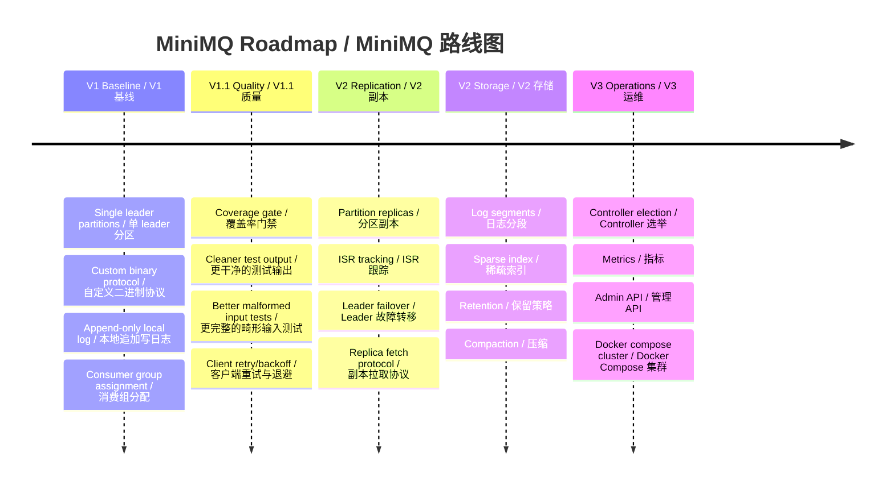
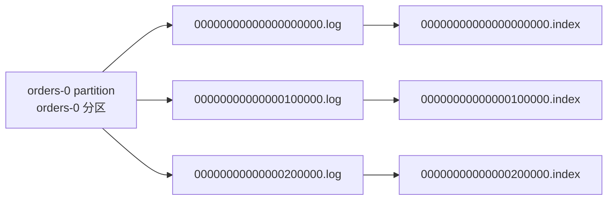
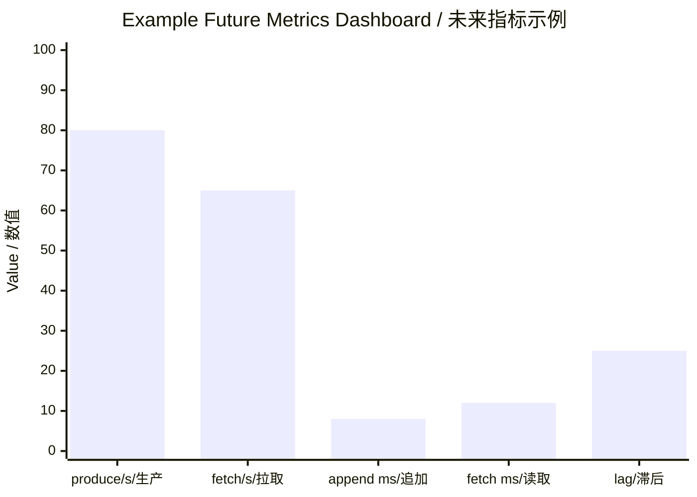

# MiniMQ TODO And Roadmap / MiniMQ 代办与后续版本功能文档

> This roadmap explains known limitations, recommended next tasks, and larger V2 features.
> 本路线图说明当前已知限制、推荐下一步任务，以及后续 V2 功能方向。

## 1. Current State / 当前状态

MiniMQ currently has a readable, tested V1.1 baseline. The core flows work: create topic, register brokers, fetch metadata, produce records, fetch records, join consumer group, sync assignment, heartbeat, commit offset, fetch offset, run a CLI demo, enforce per-module JaCoCo line coverage in `mvn verify`, reject malformed protocol collection counts, retry failed client connects with fixed backoff, and verify broker restart cleanup. Overall line coverage is above 90%.

MiniMQ 当前已经有一个可读、可测、可演示的 V1.1 基线版本。核心流程可用：创建 Topic、Broker 注册、拉取元数据、生产消息、拉取消息、加入消费组、同步分配、心跳、提交 offset、拉取 offset、CLI 演示，并且已在 `mvn verify` 中加入逐模块 JaCoCo 行覆盖率门禁，补充畸形协议集合 count 测试，支持客户端连接失败后的固定退避重试，并验证 Broker 重启资源释放。总体行覆盖率已超过 90%。

The most important limitation is that the system is still single-replica and controller-static. This keeps the design compact, but it means broker failures can lose availability and data for affected partitions.

最重要的限制是系统仍然是单副本、静态 Controller。这样设计紧凑，但意味着 Broker 故障会导致对应分区不可用，甚至丢失数据。

## 2. Immediate TODOs / 近期代办

| Priority / 优先级 | Task / 任务 | Why it matters / 重要性 | Suggested tests / 建议测试 |
| --- | --- | --- | --- |
| P0 | Completed: Coverage enforcement in Maven build. / 已完成：Maven 构建覆盖率门禁。 | `mvn verify` now runs JaCoCo `check` with a 90% line threshold. / `mvn verify` 现在运行 JaCoCo `check`，行覆盖率门槛为 90%。 | Verified by `mvn verify`. / 已通过 `mvn verify` 验证。 |
| P0 | Completed: Clean `TcpSmokeTest` output. / 已完成：清理 `TcpSmokeTest` 输出。 | Smoke test output is now assertion-driven and quiet. / 冒烟测试现在由断言验证且输出干净。 | Verified by searching broker/client/protocol tests for `System.out`. / 已通过搜索 broker/client/protocol 测试中的 `System.out` 验证。 |
| P1 | Completed: Malformed collection count regression tests. / 已完成：畸形集合 count 回归测试。 | Protocol collection counts now have negative and over-limit regression cases. / 协议集合 count 现在有负数和超限回归用例。 | `ProtocolSerdesTest` now covers malformed request/response counts. / `ProtocolSerdesTest` 已覆盖畸形请求/响应 count。 |
| P1 | Completed: Client fixed-backoff connection retry. / 已完成：客户端固定退避连接重试。 | `NetworkClient` supports fixed-backoff connection retries. / `NetworkClient` 支持固定退避连接重试。 | `NetworkClientRetryTest` verifies retry budget and invalid policies. / `NetworkClientRetryTest` 验证重试预算与非法策略。 |
| P1 | Completed: Broker shutdown/resource cleanup tests. / 已完成：Broker 关闭和资源释放测试。 | Broker stop/start on the same port is covered. / 已覆盖 Broker 在同一端口停止后重启。 | `BrokerShutdownTest` verifies restart after stop. / `BrokerShutdownTest` 验证停止后重启。 |
| P1 | Add client retry on stale metadata / `NOT_LEADER`. / 为过期元数据或 `NOT_LEADER` 增加客户端重试。 | V1.1 covers connection retry; metadata refresh retry is still open. / V1.1 已覆盖连接重试，元数据刷新重试仍待实现。 | Simulated leader mismatch tests. / 模拟 leader 不匹配测试。 |
| P2 | Add metadata corruption handling. / 增加元数据损坏处理。 | JSON metadata file can be invalid or partially written. / JSON 元数据文件可能非法或只写入了一部分。 | Corrupt metadata file test. / 损坏元数据文件测试。 |
| P2 | Add log corruption handling. / 增加日志损坏处理。 | Partial records after crash should not break all recovery. / 崩溃后的半条记录不应破坏全部恢复。 | Truncated log recovery test. / 截断日志恢复测试。 |

## 3. V2 Feature Roadmap / V2 功能路线图

### 3.1 Replication / 副本机制

Replication means each partition has multiple copies across brokers. One broker is leader; others are followers. Followers fetch records from the leader. If the leader fails, a follower can become the new leader.

副本机制指每个分区在多个 Broker 上保留多份数据。一个 Broker 是 Leader，其他 Broker 是 Follower。Follower 从 Leader 拉取日志。如果 Leader 故障，Follower 可以成为新的 Leader。

Key concepts / 关键概念：

| Term / 术语 | 中文解释 | English explanation / 英文解释 |
| --- | --- | --- |
| Replica | 分区的一份数据副本。 | A copy of a partition's data. |
| Leader replica | 负责客户端读写的副本。 | The replica serving client reads/writes. |
| Follower replica | 从 leader 同步数据的副本。 | A replica that fetches from the leader. |
| ISR | In-Sync Replicas，同步进度足够接近 leader 的副本集合。 | Replicas that are sufficiently caught up with the leader. |
| Acknowledgement | 写入成功确认策略，例如只等 leader 或等 ISR。 | The write success policy, such as leader-only or ISR quorum. |

Suggested implementation steps / 建议实现步骤：

1. Extend metadata with replica list and ISR list per partition. / 为每个分区在元数据中增加 replica 列表和 ISR 列表。
2. Add replica fetch API for follower brokers. / 为 Follower Broker 增加副本拉取 API。
3. Add high watermark based on replicated offsets. / 基于副本同步 offset 计算 high watermark。
4. Add leader election logic within static controller. / 在静态 Controller 中加入 leader 选举逻辑。
5. Add tests for leader crash, follower promotion, and not-leader redirect behavior. / 增加 leader 崩溃、follower 提升、not-leader 重定向测试。

### 3.2 Controller Election / Controller 选举

The current controller is static. V2 can introduce a simple election mechanism before moving to a full consensus system. A lightweight first step is to designate the lowest online broker id as controller and persist controller epoch.

当前 Controller 是静态的。V2 可以先引入简单选举机制，再考虑完整一致性协议。轻量第一步可以是：在线 Broker 中 id 最小者成为 Controller，并持久化 controller epoch。

Professional term: **epoch** means a monotonically increasing generation number used to reject stale decisions.
专业名词：**epoch** 是单调递增的代数编号，用于拒绝旧 Controller 或旧 Leader 的过期决策。

### 3.3 Segmented Log / 分段日志

The current storage writes one file per partition. Segmented logs split a partition log into multiple files, often by size or time.

当前存储是每分区一个文件。分段日志会按大小或时间把一个分区日志拆成多个文件。

Benefits / 收益：

- Faster recovery by scanning only active segment plus checkpoints. / 只扫描活跃 segment 和 checkpoint，恢复更快。
- Retention can delete whole old segments. / 保留策略可以整段删除旧 segment。
- Index files can map offset to file position. / 索引文件可以把 offset 映射到文件位置。
- Compaction can run segment by segment. / 压缩可以按 segment 分段执行。

### 3.4 Retention And Compaction / 保留策略与压缩

Retention deletes old data by time or size. Compaction keeps the latest value for each key. They solve different problems:

Retention 根据时间或大小删除旧数据。Compaction 保留每个 key 的最新值。二者解决的问题不同：

| Feature / 功能 | Purpose / 目的 | Example / 示例 |
| --- | --- | --- |
| Retention / 保留策略 | Bound disk usage. / 控制磁盘用量上界。 | Delete segments older than 7 days. / 删除超过 7 天的 segment。 |
| Compaction / 压缩 | Preserve latest state by key. / 按 key 保留最新状态。 | Keep latest user profile update per user id. / 为每个用户 id 保留最新用户资料更新。 |

### 3.5 Client Improvements / 客户端增强

Current clients are synchronous and simple. Useful next features:
当前客户端是同步且简单的。可考虑的后续功能：

1. Reconnect with exponential backoff. / 使用指数退避重连。
2. Metadata refresh on `NOT_LEADER`. / 遇到 `NOT_LEADER` 时刷新元数据。
3. Producer batching. / Producer 批量发送。
4. Producer send timeout configuration. / Producer 发送超时配置。
5. Consumer pause/resume partitions. / Consumer 暂停/恢复分区消费。
6. Consumer auto-commit option. / Consumer 自动提交选项。
7. Better exception hierarchy instead of generic `IllegalStateException`. / 使用更清晰的异常层次替代通用 `IllegalStateException`。

### 3.6 Observability / 可观测性

MiniMQ should expose runtime metrics. Suggested metrics:

MiniMQ 应该暴露运行时指标，建议包括：

| Metric / 指标 | Meaning / 含义 |
| --- | --- |
| produce requests/sec | Producer write throughput. / Producer 写入吞吐。 |
| fetch requests/sec | Consumer fetch throughput. / Consumer 拉取吞吐。 |
| append latency | Storage write latency. / 存储写入延迟。 |
| fetch latency | Storage read latency. / 存储读取延迟。 |
| log size by partition | Disk usage by partition. / 按分区统计的磁盘用量。 |
| consumer lag | High watermark minus committed offset. / 高水位减去已提交 offset。 |
| metadata save failures | Controller metadata persistence failures. / Controller 元数据持久化失败次数。 |

## 4. Documentation TODOs / 文档代办

1. Keep API table in `design.md` synchronized with `ApiKeys`. / 保持 `design.md` 中的 API 表与 `ApiKeys` 同步。
2. Keep coverage table in `testing.md` synchronized after major test changes. / 大规模测试变更后同步 `testing.md` 覆盖率表。
3. Keep `docs/troubleshooting.md` synchronized when build, test, port, Windows, or GitHub/SSH workflows change. / 当构建、测试、端口、Windows 或 GitHub/SSH 流程变化时，同步维护 `docs/troubleshooting.md`。
4. Add examples for writing a custom producer/consumer application. / 增加自定义 producer/consumer 应用示例。
5. Add a protocol compatibility section when V2 fields are introduced. / 引入 V2 字段时增加协议兼容性章节。

## 5. Recommended Next Agent Tasks / 推荐新 Agent 任务

For a new agent session, the most productive next tasks are:

对新 agent 会话，最建议继续做：

1. Add client retry on stale metadata / `NOT_LEADER`. / 为过期元数据或 `NOT_LEADER` 增加客户端重试。
2. Add metadata corruption handling. / 增加元数据损坏处理。
3. Add log corruption handling and truncated log recovery. / 增加日志损坏处理与截断日志恢复。
4. Add protocol compatibility notes for future V2 fields. / 为后续 V2 字段增加协议兼容性说明。
5. Start V2 metadata model for replicas without implementing full replication yet. / 先启动副本相关 V2 元数据模型，不急于实现完整副本机制。

## 6. Risk Register / 风险登记表

| Risk / 风险 | Impact / 影响 | Mitigation / 缓解 |
| --- | --- | --- |
| Static controller failure / 静态 Controller 故障 | Cluster control-plane unavailable. / 集群控制面不可用。 | Add controller election. / 增加 Controller 选举。 |
| Single replica partition / 单副本分区 | Data unavailable/lost if broker fails. / Broker 故障时数据不可用或丢失。 | Add replication and ISR. / 增加副本与 ISR。 |
| One file per partition / 每分区一个文件 | Slow recovery and no retention. / 恢复慢且没有保留策略。 | Add segmented logs. / 增加分段日志。 |
| Synchronous clients / 同步客户端 | Limited throughput. / 吞吐受限。 | Add batching and async APIs. / 增加批量发送和异步 API。 |
| JSON metadata overwrite / JSON 元数据覆盖写 | Possible corruption on crash. / 崩溃时可能损坏。 | Write temp file then atomic move; add checksums. / 先写临时文件再原子移动，并增加校验和。 |
| Simplified rebalance / 简化 rebalance | Group behavior differs from production Kafka. / 消费组行为与生产级 Kafka 有差异。 | Add explicit rebalance states and member protocols. / 增加显式 rebalance 状态和成员协议。 |

## 7. Definition Of Done / 完成标准

A future feature should be considered done only when:

后续功能满足以下条件才算完成：

1. Source code is implemented with module boundaries respected. / 源码实现遵守模块边界。
2. Unit or integration tests cover success and failure paths. / 单元测试或集成测试覆盖成功与失败路径。
3. Overall line coverage remains >= 90%. / 总体行覆盖率保持不低于 90%。
4. Public docs are updated if API, storage, metadata, CLI, or behavior changes. / 如果 API、存储、元数据、CLI 或行为变化，同步更新公开文档。
5. The full Maven test command passes. / 完整 Maven 测试命令通过。
6. Any new professional terms are explained in Chinese and English. / 所有新增专业名词都提供中英文解释。
