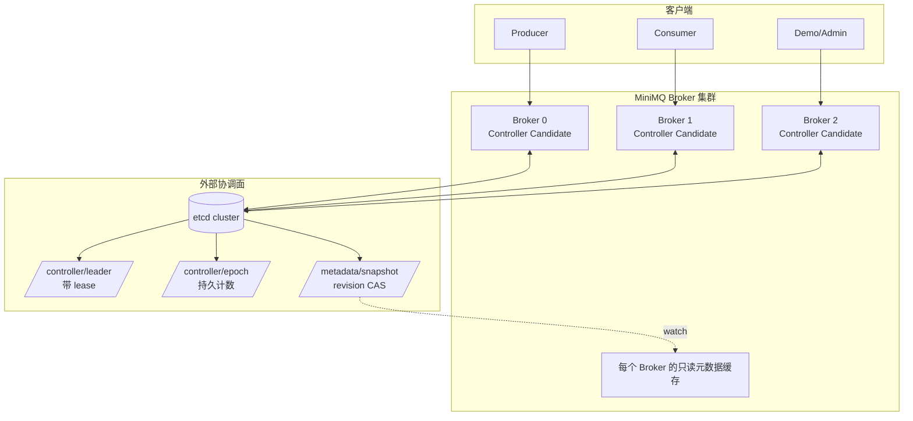

# MiniMQ 后续路线图与 3.0.0 控制面高可用设计实施计划

> 日期：2026-07-20
>
> 基线：`origin/main`，合并提交 `d4623f1`，项目版本 `2.5.0`
>
> 规划分支：`dev/v3.0.0-control-plane-ha-plan`
>
> 用途：这是后续版本路线图、3.0.0 架构设计、TDD 实施计划和新会话接手说明的唯一来源。

## 1. 当前基线

2.5.0 已完成 Broker 心跳租约、单调 `brokerEpoch`、Broker 自我 fencing、LEO 感知的 ISR 内自动 Leader 故障转移、无可用副本时冻结分区，以及客户端针对 `NOT_LEADER` / `BROKER_FENCED` 的一次元数据刷新重试。

2.5.0 最终验证为 323 个测试、0 失败、0 错误，JaCoCo 行覆盖率 91.62%。从此版本开始只修复会造成数据丢失、数据损坏、安全问题、进程无法启动或主流程不可用的严重缺陷，不再往 2.5.0 增加普通功能。

当前架构仍有四个明确缺口：

1. Controller 由启动参数静态指定，退出后没有替代者。
2. 元数据以 Controller 本地 JSON 为唯一事实来源，旧 Controller 恢复后缺少跨进程写入 fencing。
3. 分区只有 `leaderBrokerId`，没有持久化的 `leaderEpoch`，旧 Leader 仍可能处理过时请求。
4. 日志没有安全尾部截断，发生 Leader 切换后无法自动校正旧 Leader 的分叉尾部。

## 2. 后续版本路线图

| 版本 | 主题 | 交付结果 | 明确不包含 |
| --- | --- | --- | --- |
| `3.0.0` | 控制面高可用与 epoch fencing | etcd Controller 选举、`controllerEpoch`、共享元数据 CAS、Broker 与客户端服务发现、`leaderEpoch`、安全日志尾部截断、Controller/Leader 自动切换集成测试 | unclean election、限流、熔断、批量发送、Epoll 优化 |
| `3.1.0` | 可观测性与运行时韧性 | 指标导出、存活/就绪检查、请求限流、熔断、降级、故障注入和故障演练文档 | 改写存储引擎、改变消息协议语义 |
| `3.2.0` | 客户端吞吐与网络性能 | Producer batching、异步发送、指数退避与抖动、连接复用优化、可选 Epoll、NIO 回退和基准报告 | 控制面重构、LSM 存储 |
| `4.0.0` | 实验性状态存储 | 独立的 LSM State Store 模块，用于消费组、索引或派生状态实验 | 替换现有分段消息日志；消息日志继续保持顺序追加模型 |

版本发布规则：

- 同一主题的小改动积累到一个版本完成，不为零散代码改动单独创建版本。
- `3.0.0` 合并后，普通改进进入 `3.1.0`；只有严重回归才发布 `3.0.x`。
- 每个版本必须有清晰主题、完整验收标准、全量验证记录和一次合并前代码审查。
- 不在一个版本中同时推进控制面、存储引擎和客户端性能三条主线。

## 3. 3.0.0 目标与范围

### 3.1 必须交付

- 所有 Broker 使用同一个 etcd 集群竞争 Controller，Controller 退出后自动选出新 Controller。
- 每次 Controller 当选获得严格单调递增的 `controllerEpoch`。
- 所有共享元数据写入同时校验 Controller 身份和 etcd `modRevision`；失去租约的旧 Controller 不能提交写入。
- etcd 是 3.0.0 唯一协调后端，不同时实现 ZooKeeper 适配器，也不实现 Broker 自建 Raft quorum。
- SDK 不连接 etcd。Producer、Consumer 和管理命令通过任意 Broker 发现当前 Controller。
- 每个分区持久化 `leaderEpoch`、`leaderEpochStartOffset` 和 `leaderReady`。
- `PRODUCE`、`FETCH`、`REPLICA_FETCH` 必须携带并校验 `leaderEpoch`。
- Leader 切换时先冻结分区，候选 Leader 把日志截断到安全恢复 offset，确认完成后再开放读写。
- Broker、Controller、客户端均保留 2.5.0 已有的 bounded retry、Broker 自我 fencing 和资源关闭规则。
- 真实 etcd + 三 Broker 集成测试证明 Controller 切换、旧 Controller fencing、Leader epoch fencing、日志校正和客户端恢复。

### 3.2 明确排除

- 不做 unclean election。ISR 中没有可用副本时仍冻结分区，不从 ISR 外强行选 Leader。
- 不实现 ZooKeeper、Consul 或可插拔多协调后端。
- 不把消息正文、分段日志或 WAL 存入 etcd。
- 不把 Producer、Consumer SDK 与 jetcd 绑定。
- 不在 3.0.0 引入熔断、限流、降级、动态配额、batching、异步 Producer 或 Epoll。
- 不改变消费组分配算法，不实现 Kafka 完整 cooperative rebalance。
- 不把 4.0.0 的 LSM State Store 提前用于消息日志。

## 4. 方案选择

### 4.1 候选方案

| 方案 | 优点 | 代价 | 结论 |
| --- | --- | --- | --- |
| etcd v3 | 原生 lease、watch、事务 CAS；状态模型与 `controllerEpoch` fencing 直接匹配；运维与故障语义清楚 | 新增外部依赖；生产高可用需要 3 个 etcd 成员 | 采用 |
| ZooKeeper | 成熟的临时节点和选举模型 | Java API 与数据版本处理更繁琐；同时维护两套实现会扩大测试面 | 不采用 |
| Broker 内自建 Raft | 完全自包含，教学价值高 | 需要先正确实现共识、日志复制、成员变更和快照，风险远大于当前版本目标 | 不采用 |
| 共享文件或数据库锁 | 实现快 | 无法可靠覆盖租约、网络分区、watch 和严格 fencing | 不采用 |

### 4.2 依赖与运行环境

- Java 17 保持不变。
- 生产客户端使用 `io.etcd:jetcd-core:0.8.5`。
- 集成测试使用 `org.testcontainers:junit-jupiter:1.21.3` 和 `org.testcontainers:testcontainers:1.21.3`。
- 固定测试镜像为 `quay.io/coreos/etcd:v3.5.21`。
- 本地开发提供 `deploy/etcd/docker-compose.yml`，启动 3 成员 etcd；单节点容器只用于自动化测试。
- 生产部署至少使用 3 个 etcd 成员。一个成员不能宣称具备控制面高可用。
- 从 2.5 升级时必须先备份原静态 Controller 的 `cluster-metadata.json` 和所有 Broker 数据目录；3.0 写入新 metadata/leader epoch 后不支持原地降级回 2.5。

## 5. 总体架构



每个 Broker 都连接 etcd，但只有一个 Broker 持有 Controller leadership。Broker 内部通过 etcd watch 获得 Controller 身份和共享元数据；SDK 只与 Broker 协议交互。Controller 本地 JSON 从事实来源降级为可检查的缓存，Broker 启动时可以读取它，但在收到 etcd 当前 revision 前不能进入 `ACTIVE`。

## 6. etcd 数据模型

设 `clusterId` 经过校验，只允许 `[a-zA-Z0-9._-]+`。所有键位于 `/minimq/{clusterId}`：

| Key | 生命周期 | Value | 写入规则 |
| --- | --- | --- | --- |
| `/controller/election/` | jetcd election session | 候选 Broker 身份 | 由 jetcd `Election` 管理 |
| `/controller/leader` | 绑定 Controller lease | `ControllerIdentity` JSON | 仅当选者以 `createRevision == 0` 事务创建；失去 lease 后自动删除 |
| `/controller/epoch` | 永久 | 十进制 `long` | 当选者读取后以 `modRevision` CAS 写入 `old + 1` |
| `/metadata/snapshot` | 永久 | `ClusterMetadata` JSON | 同一事务比较 leader value 与 snapshot `modRevision` 后写入 |

`ControllerIdentity` 字段固定为：

```java
public record ControllerIdentity(
        int brokerId,
        String host,
        int port,
        long controllerEpoch,
        String sessionId) {
}
```

`sessionId` 使用每次竞选生成的 UUID。即使 Broker ID 和地址相同，新会话的 leader value 也不同，因此旧 Controller 不能通过只比较 Broker ID 绕过 fencing。

Controller 当选顺序：

1. 创建 TTL 为 `controllerSessionTtlSeconds` 的 etcd lease，并启动 keepalive。
2. 使用 jetcd `Election.campaign` 竞争 leadership。
3. CAS 增加 `/controller/epoch`，获得新的 `controllerEpoch`。
4. 以当前 lease 创建 `/controller/leader`；若键已存在则放弃本次 leadership 并重新竞选。
5. 读取 `/metadata/snapshot` 及其 `modRevision`，把顶层 `controllerEpoch` 更新为本轮 epoch，并通过带 leader value 比较的 CAS 提交。
6. 进入 `RECOVERING`，在恢复宽限期内等待 Broker 重新注册。
7. 恢复宽限结束后才能把未重新注册的 Broker 标记离线并触发分区选举。

### 6.1 首次初始化与 2.5 升级

`/metadata/snapshot` 不存在时禁止根据任意 Broker 的本地缓存自动选一份上传。首次启动必须且只能选择以下显式模式之一：

- 新集群：在一个 Broker 上使用 `--initialize-empty-cluster`，以 `createRevision == 0` 创建空快照。
- 2.5 升级：在原 2.5 静态 Controller 数据目录对应的 Broker 上使用 `--initialize-cluster-from-local`，校验并迁移该目录的 `cluster-metadata.json` 后，以 `createRevision == 0` 创建快照。

两个参数互斥。未指定初始化参数且快照不存在时，Broker 启动失败并指出所需参数；快照已经存在时仍携带任一初始化参数也启动失败，防止误以为本地文件能覆盖 etcd。并发初始化由 `createRevision == 0` CAS 决定唯一成功者，失败者重新读取已创建快照，只有内容摘要完全一致时才继续启动，否则退出并报告冲突。

迁移前读取 JSON 树判断格式：缺少 `metadataFormatVersion` 表示 2.5 格式。迁移器写入 `metadataFormatVersion = 3`、`controllerEpoch = 0`、`metadataVersion = 0`，并为每个旧分区写入 `leaderEpoch = 0`、`leaderEpochStartOffset = 0`、`leaderReady = !frozen`。未知格式版本直接拒绝，不做猜测性转换。

共享元数据写事务必须同时满足：

```text
value(/controller/leader) == serialized(current ControllerIdentity)
AND modRevision(/metadata/snapshot) == locallyObservedRevision
```

任一比较失败都返回 `CONTROLLER_FENCED`，立即把本地 Controller 状态降为 `FOLLOWER`，停止 Broker 到期扫描和所有元数据变更。禁止在 CAS 失败后覆盖写或无限重试；新的 Leader watch 事件到达后才可继续。

## 7. 元数据与协议模型

### 7.1 持久化模型

`ClusterMetadata` 顶层新增：

```java
public int metadataFormatVersion;
public long controllerEpoch;
public long metadataVersion;
```

`PartitionEntry` 新增：

```java
public long leaderEpoch;
public long leaderEpochStartOffset;
public boolean leaderReady;
```

约束如下：

- `controllerEpoch >= 0`，每次 Controller 当选严格增加。
- `metadataFormatVersion` 在 3.0 中必须等于 3。
- `metadataVersion >= 0`，每次成功 CAS 增加 1；etcd `modRevision` 只用于 CAS，不替代协议中的逻辑版本。
- 新建分区初始 `leaderEpoch = 0`，`leaderEpochStartOffset = 0`，`leaderReady = true`。
- Leader 不变时不得增加 `leaderEpoch`。
- Leader 变化时在同一元数据事务中执行 `leaderEpoch + 1`、写入安全恢复 offset、设置 `leaderReady = false`。
- 只有候选 Leader 完成截断并发送精确匹配的 `LEADER_READY` 后，Controller 才能设置 `leaderReady = true`。
- `frozen = true` 时 `leaderReady` 必须为 `false`，ISR 必须为空。

### 7.2 协议变更

3.0.0 是主版本，可以修改 record 字段并同步升级所有模块，不提供 2.x/3.x 混合版本兼容。

新增 API：

| API | 编号 | 用途 |
| --- | ---: | --- |
| `DISCOVER_CONTROLLER` | 17 | 任意 Broker 返回当前 Controller 身份、epoch 和已观察元数据版本 |
| `LEADER_READY` | 18 | 新 Leader 完成 epoch 校正后向当前 Controller 确认 |

新增错误码：

| ErrorCode | 编号 | 语义 |
| --- | ---: | --- |
| `CONTROLLER_FENCED` | 11 | Controller lease、身份或 revision 已失效 |
| `NOT_CONTROLLER` | 12 | 控制面请求发给了非 Controller Broker |
| `STALE_LEADER_EPOCH` | 13 | 数据请求携带的 `leaderEpoch` 不是当前值 |
| `LEADER_NOT_READY` | 14 | Leader 已分配但尚未完成日志校正 |
| `CONTROLLER_NOT_READY` | 15 | Controller 正在竞选、恢复或暂时不可发现 |

协议 record 调整：

- `ControllerMetadata(brokerId, host, port, controllerEpoch)`。
- `DiscoverControllerRequest()`。
- `DiscoverControllerResponse(ControllerMetadata controller, long metadataVersion)`。
- `MetadataResponse` 增加 `ControllerMetadata controller`、`long metadataVersion`。
- `PartitionMetadata` 增加 `long leaderEpoch`、`long leaderEpochStartOffset`、`boolean leaderReady`。
- `ProduceRequest` 增加 `long leaderEpoch`。
- `FetchRequest` 增加 `long leaderEpoch`。
- `ReplicaFetchRequest` 增加 `long leaderEpoch`。
- `ReplicaFetchResponse` 增加 `long leaderEpoch`、`long leaderLogEndOffset`。
- `RegisterBrokerRequest`、`BrokerHeartbeatRequest`、`UpdateReplicaLeoRequest` 增加客户端观察到的 `controllerEpoch`。
- `LeaderReadyRequest(topicName, partitionId, brokerId, brokerEpoch, controllerEpoch, leaderEpoch, logEndOffset)`。
- `LeaderReadyResponse()`。

所有协议编解码测试都必须断言字段顺序、空集合、负 epoch 拒绝和最大值 round trip。不得只依赖 Java record 构造成功。

## 8. 状态机

### 8.1 Controller 状态

```text
FOLLOWER
  -> CAMPAIGNING      开始竞选
  -> RECOVERING       已获 leadership、epoch 和共享元数据，等待 Broker 重注册
  -> ACTIVE           恢复宽限完成，可处理全部控制面写入
  -> FENCED           lease/keepalive/CAS/watch 证明身份失效
  -> FOLLOWER         清理本轮资源后重新竞选
```

`RECOVERING` 期间允许 `DISCOVER_CONTROLLER`、`METADATA`、`REGISTER_BROKER` 和 `BROKER_HEARTBEAT`；创建 Topic、消费组变更、offset 提交、Leader 选举和人工维护写入返回 `CONTROLLER_NOT_READY`。这样新 Controller 不会在 Broker 尚未重新建立租约时错误地批量下线节点。

### 8.2 Broker 可用状态

沿用 2.5.0 的 `STARTING / ACTIVE / FENCED / RECOVERING`：

- Broker 启动后先监听端口，但必须完成 etcd 当前 leader 与 metadata revision 同步、向当前 Controller 注册并确认 `brokerEpoch` 后才进入 `ACTIVE`。
- Controller identity 变化时立即进入 `RECOVERING`，停止数据面写入和副本拉取，向新 Controller 重新注册；成功后回到 `ACTIVE`。
- 在 `brokerSelfFenceTimeoutMs` 内无法发现并联系有效 Controller 时进入 `FENCED`。
- Broker 恢复不得复用已被新注册替代的 `brokerEpoch`。

时间关系固定为：

```text
brokerHeartbeatIntervalMs
  < brokerSelfFenceTimeoutMs
  < controllerBrokerLeaseTimeoutMs
  <= controllerFailoverGraceMs
  < controllerSessionTtlSeconds * 1000
```

默认值为 `1000 < 3000 < 5000 <= 10000 < 15000`。

Leader 激活另设 `leaderActivationTimeoutMs = 5000`。候选 Leader 未在时限内完成 `LEADER_READY` 时分区冻结并保持 `leaderReady = false`；Controller 不根据未经验证的 LEO 自动换第二个候选者。

### 8.3 分区 Leader 状态

```text
READY(epoch=N)
  -> RECOVERING(epoch=N+1, ready=false)  Controller 选择 ISR 内新 Leader
  -> READY(epoch=N+1)                    新 Leader 截断并 LEADER_READY

READY(epoch=N)
  -> FROZEN(epoch=N, ready=false)        ISR 无可用副本
  -> READY(epoch=N)                      原副本恢复；没有发生 Leader 变更
```

只有 `READY` 分区处理 PRODUCE/FETCH/REPLICA_FETCH。请求 epoch 小于或大于当前值都返回 `STALE_LEADER_EPOCH`；不允许把“更大 epoch”当成自动升级信号。

## 9. Leader 切换与日志校正

### 9.1 安全恢复 offset

发生 clean election 时，只从旧 ISR 的在线成员中选择候选者。安全恢复 offset 取故障发生前旧 ISR 已报告 LEO 的最小值：

```text
recoveryOffset = min(replicaLogEndOffsets[brokerId] for brokerId in oldIsr)
```

如果旧 ISR 中任何成员没有合法 LEO，或没有在线候选者，分区冻结，不猜测 offset，不执行 unclean election。候选 Leader 按 LEO 最大、Broker ID 最小的稳定顺序选择。

Controller 在一个 CAS 中写入新 Leader、`leaderEpoch + 1`、`leaderEpochStartOffset = recoveryOffset` 和 `leaderReady = false`。此时客户端能看到新 Leader，但所有数据请求得到 `LEADER_NOT_READY`。

候选 Leader 激活时必须先证明本地 `highWatermark >= recoveryOffset`。小于 recovery offset 表示 Controller 保存的 LEO 与本地数据不一致，候选者不得补空洞、不得确认 ready；激活超时后 Controller 冻结分区。该场景需要人工恢复数据，不降级为 unclean election。

### 9.2 本地 epoch 状态

每个 Broker 在下列文件保存已校正 epoch：

```text
{dataDir}/replication-epochs/{topic}-{partitionId}.json
```

内容为 `LeaderEpochState(topicName, partitionId, leaderEpoch, startOffset, reconciledAtEpochMs)`，使用临时文件、fsync、原子替换和目录 fsync。Broker 只接受更大的 epoch；相同 epoch 的重复事件必须幂等；更小 epoch 必须忽略并记录告警。

### 9.3 WAL 与截断顺序

现有 `PartitionLog` 只有 append/read/highWatermark/flush/close，现有 WAL 重放也只接受 `DATA_APPEND`。3.0.0 必须增加以下能力：

```java
public interface PartitionLog extends AutoCloseable {
    // existing methods
    void truncateTo(long endOffsetExclusive);
}
```

`WalRecordType.CONTROL_MARKER` 固定用于 `LOG_TRUNCATE`，其 `offset` 表示截断后的 exclusive end offset，key/value 必须为 `null`。禁止新增一个只写日志文件、不写 WAL 的快捷截断入口。

崩溃安全顺序固定为：

1. 校验 `logStartOffset <= endOffsetExclusive <= highWatermark`。
2. 获取该分区 reader quiescence；有在途 zero-copy/read snapshot 时在 bounded timeout 后失败，分区继续保持 not ready。
3. 向 WAL 追加并强制落盘 `LOG_TRUNCATE(topic, partition, endOffsetExclusive)`。
4. 截断包含目标 offset 的 segment，删除目标之后的 segment，重建稀疏索引并原子更新 catalog。
5. flush 分区日志，保存包含新 high watermark 和 WAL position 的 checkpoint。
6. 原子保存 `LeaderEpochState`。
7. 发送 `LEADER_READY`；只有响应成功后本地数据面才对该 epoch 开放。

WAL replay 必须按原顺序处理 `DATA_APPEND` 与 `LOG_TRUNCATE`。因此即使进程在步骤 3 到 6 任一点退出，重启也不会把已裁掉的旧 Leader 尾部恢复出来。

### 9.4 副本拉取

- `ReplicaFetcher` 观察到更大 `leaderEpoch` 时，先执行同样的截断流程到 `leaderEpochStartOffset`，再从该 offset 拉取。
- `REPLICA_FETCH` 的 epoch 必须精确匹配 Leader 当前 epoch。
- Leader 响应包含自己的 `leaderLogEndOffset`。Follower 的 fetch offset 大于该值时再次截断到该值，并持久化控制标记。
- Follower 完成追加后继续使用现有 `UPDATE_REPLICA_LEO` 上报，但请求必须携带 `brokerEpoch` 与 `controllerEpoch`。
- 旧 Leader 恢复时按 Follower 路径校正，不保留其未提交分叉尾部。

## 10. 服务发现与客户端行为

任意 Broker 都从本地 watch 缓存响应 `DISCOVER_CONTROLLER`。当缓存尚未同步、leader key 暂时为空或 Controller 处于竞选窗口时，返回 `CONTROLLER_NOT_READY`，不返回静态启动地址。

客户端保存用户传入的完整 bootstrap server 列表，不再只取第一个地址。发现顺序为：

1. 从上次成功的 bootstrap Broker 请求 `DISCOVER_CONTROLLER`。
2. 连接返回的 Controller，并记录 `controllerEpoch`。
3. 控制面请求收到 `NOT_CONTROLLER`、`CONTROLLER_FENCED`、`CONTROLLER_NOT_READY`、连接关闭或更大的 Controller epoch 时，关闭旧连接，按 bootstrap 列表轮询重新发现。
4. 每个用户操作最多重新发现一次并重试一次；连接层自身仍使用 bounded retry，不叠加成无上限循环。
5. PRODUCE/FETCH 收到 `STALE_LEADER_EPOCH` 或 `LEADER_NOT_READY` 时清除 Topic 元数据，刷新一次后重试；第二次失败返回包含 API、Topic、Partition、Broker、epoch 和 `attempt=2/2` 的异常。

SDK 不读取 etcd endpoint、不引入 jetcd 依赖。Demo 管理命令使用 `mq-client` 中共享的 Controller-aware 客户端，不保留直接连接“第一个地址就是 Controller”的特殊实现。

## 11. 故障语义与必须保持的不变量

| 场景 | 预期行为 |
| --- | --- |
| Controller 正常退出 | lease 撤销，其他 Broker 竞选，新 epoch 严格增加；Broker 在恢复窗口内重新注册 |
| Controller 进程暂停或网络隔离 | lease 过期后旧 Controller CAS 失败并 fencing；新 Controller 接管；同一时刻最多一个身份能成功写元数据 |
| etcd 短暂不可达 | Controller 和 Broker 在本地 deadline 前尝试恢复；超过 deadline 后 fencing；不得基于旧缓存继续写 |
| etcd quorum 丢失 | 不产生新 Controller，不接受元数据写；Broker 按自我 fencing 规则停止数据面变更 |
| 新 Leader 截断中退出 | 分区保持 not ready；重启通过 WAL 控制标记重复完成截断 |
| 旧 Leader 恢复 | 拒绝旧 epoch 请求，按当前 epoch start offset 校正后作为 Follower 加入 |
| Controller 切换与 Broker 到期同时发生 | 新 Controller 的恢复宽限优先，宽限结束前不执行 Broker 到期选举 |
| 客户端连接到非 Controller | 通过发现 API 重连；最多一次重新发现重试 |
| ISR 无在线副本 | 分区冻结；Leader epoch 不增加；不执行 unclean election |

代码审查必须逐项证明：

1. 任何元数据写都不能绕过 Controller identity + revision CAS。
2. 任何数据面请求都不能绕过 Broker guard、`leaderReady` 和精确 `leaderEpoch` 校验。
3. Controller watch、metadata watch、lease keepalive、Netty channel、scheduler 和 Testcontainer 都有 bounded close。
4. watch 事件只能按 revision 单调安装，旧事件不能覆盖新快照。
5. 日志截断不会被 WAL replay 逆转，也不会删除 `logStartOffset` 之前的数据模型边界。
6. 所有等待都有 deadline 和包含最终状态、epoch、revision 的失败消息。
7. 任何自动重试都有明确次数，不存在无限循环或递归重试。

## 12. 模块和文件布局

主要新增文件：

```text
mq-broker/src/main/java/com/minimq/broker/coordination/
  ControllerIdentity.java
  ControllerState.java
  ControllerCoordinationStore.java
  EtcdControllerCoordinationStore.java
  ControllerElectionService.java
  EtcdClientFactory.java

mq-broker/src/main/java/com/minimq/broker/metadata/
  VersionedClusterMetadata.java
  ClusterMetadataRepository.java
  EtcdClusterMetadataRepository.java
  MetadataWatchService.java

mq-broker/src/main/java/com/minimq/broker/replication/
  LeaderEpochState.java
  LeaderEpochStateStore.java
  LeaderActivationService.java

mq-client/src/main/java/com/minimq/client/
  BootstrapServers.java
  ControllerAwareNetworkClient.java

mq-broker/src/test/java/com/minimq/broker/support/
  EtcdTestContainer.java

deploy/etcd/
  docker-compose.yml
```

主要修改文件：

```text
pom.xml
mq-broker/pom.xml
mq-common/src/main/java/com/minimq/common/error/ErrorCode.java
mq-protocol/src/main/java/com/minimq/protocol/ApiKeys.java
mq-protocol/src/main/java/com/minimq/protocol/ProtocolSerdes.java
mq-protocol/src/main/java/com/minimq/protocol/message/ProtocolMessages.java
mq-storage/src/main/java/com/minimq/storage/PartitionLog.java
mq-storage/src/main/java/com/minimq/storage/SegmentedPartitionLog.java
mq-storage/src/main/java/com/minimq/storage/SegmentFile.java
mq-storage/src/main/java/com/minimq/storage/LogManager.java
mq-storage/src/main/java/com/minimq/storage/WalRecord.java
mq-storage/src/main/java/com/minimq/storage/WalRecordType.java
mq-broker/src/main/java/com/minimq/broker/BrokerConfig.java
mq-broker/src/main/java/com/minimq/broker/BrokerServer.java
mq-broker/src/main/java/com/minimq/broker/BrokerLeaseService.java
mq-broker/src/main/java/com/minimq/broker/ControllerClient.java
mq-broker/src/main/java/com/minimq/broker/MetadataSync.java
mq-broker/src/main/java/com/minimq/broker/PartitionManager.java
mq-broker/src/main/java/com/minimq/broker/controller/ClusterController.java
mq-broker/src/main/java/com/minimq/broker/controller/BrokerLeaseMonitor.java
mq-broker/src/main/java/com/minimq/broker/controller/GroupCoordinator.java
mq-broker/src/main/java/com/minimq/broker/handler/MqRequestHandler.java
mq-broker/src/main/java/com/minimq/broker/metadata/ClusterMetadata.java
mq-broker/src/main/java/com/minimq/broker/metadata/MetadataStore.java
mq-broker/src/main/java/com/minimq/broker/replication/LeaderReplicaClient.java
mq-broker/src/main/java/com/minimq/broker/replication/ReplicaFetcher.java
mq-broker/src/main/java/com/minimq/broker/replication/ReplicaLeoReporter.java
mq-client/src/main/java/com/minimq/client/Producer.java
mq-client/src/main/java/com/minimq/client/Consumer.java
mq-demo/src/main/java/com/minimq/demo/DemoCli.java
```

`MetadataSync` 的网络全量同步职责最终由 `MetadataWatchService` 替代；迁移完成且调用者清零后删除该类。`MetadataStore` 保留为本地只读缓存持久化器，不再拥有共享元数据写权限。

## 13. 详细 TDD 实施计划

每个任务严格执行“新增失败测试 → 运行并确认失败原因 → 最小实现 → 运行通过 → 小范围重构 → 阶段提交”。不要把多个任务积累成一个大提交。

### Task 1：升级版本、依赖和配置契约

**文件：**

- 修改 `pom.xml`、所有模块 `pom.xml`
- 修改 `mq-broker/src/main/java/com/minimq/broker/BrokerConfig.java`
- 修改 `mq-broker/src/test/java/com/minimq/broker/BrokerConfigTest.java`
- 新增 `deploy/etcd/docker-compose.yml`

**红灯测试：** 增加 `--cluster-id`、`--etcd-endpoints`、`--controller-session-ttl-seconds`、`--controller-failover-grace-ms`、`--leader-activation-timeout-ms`、`--initialize-empty-cluster` 和 `--initialize-cluster-from-local` 解析测试；断言 endpoint 为空、clusterId 非法、两个初始化参数同时出现、TTL 不满足时间关系时失败。3.0 模式不再接受 `--controller` 和 `--controller-addr`。

```powershell
mvn -q -gs .mvn/settings.xml -s .mvn/settings.xml -pl mq-broker -am -Dtest=BrokerConfigTest -Dsurefire.failIfNoSpecifiedTests=false test
```

预期红灯：新参数尚不存在。实现后预期全部通过，并确认所有 POM 版本为 `3.0.0-SNAPSHOT`。

```powershell
git add pom.xml mq-common/pom.xml mq-storage/pom.xml mq-protocol/pom.xml mq-broker/pom.xml mq-client/pom.xml mq-demo/pom.xml mq-broker/src/main/java/com/minimq/broker/BrokerConfig.java mq-broker/src/test/java/com/minimq/broker/BrokerConfigTest.java deploy/etcd/docker-compose.yml
git commit -m "build(controller): 准备 3.0 etcd 运行配置"
```

### Task 2：扩展 epoch 与发现协议

**文件：**

- 修改 `ErrorCode.java`、`ApiKeys.java`、`ProtocolMessages.java`、`ProtocolSerdes.java`
- 修改 `mq-protocol/src/test/java/com/minimq/protocol/ProtocolSerdesTest.java`

先为第 7.2 节全部 record、API 和错误码增加 round-trip 与非法值测试，再实现序列化。协议解码必须对列表大小、字符串长度和 epoch 非负值继续使用现有边界校验。

```powershell
mvn -q -gs .mvn/settings.xml -s .mvn/settings.xml -pl mq-protocol -am -Dtest=ProtocolSerdesTest -Dsurefire.failIfNoSpecifiedTests=false test
```

预期红灯：新 API 和字段无法编译。实现后全部通过。

```powershell
git add mq-common/src/main/java/com/minimq/common/error/ErrorCode.java mq-protocol/src/main/java/com/minimq/protocol/ApiKeys.java mq-protocol/src/main/java/com/minimq/protocol/ProtocolSerdes.java mq-protocol/src/main/java/com/minimq/protocol/message/ProtocolMessages.java mq-protocol/src/test/java/com/minimq/protocol/ProtocolSerdesTest.java
git commit -m "feat(protocol): 增加 Controller 与 Leader epoch 协议"
```

### Task 3：建立版本化元数据仓库边界

**文件：**

- 新增 `VersionedClusterMetadata.java`、`ClusterMetadataRepository.java`
- 修改 `ClusterMetadata.java`、`MetadataStore.java`、`ClusterController.java`、`GroupCoordinator.java`
- 修改 `MetadataStoreTest.java`、`ClusterControllerTest.java`、`GroupCoordinatorTest.java`

先用测试内 `InMemoryClusterMetadataRepository` 证明：成功写入版本递增；expected revision 不匹配返回 `CONTROLLER_FENCED`；保存失败不改变 Controller 内存；深拷贝包含所有新增 epoch 字段；旧 2.5 JSON 按第 6.1 节迁移；未知格式拒绝；空快照、本地导入、并发相同导入和并发冲突导入符合初始化规则。

所有控制面修改必须变成 `copy -> validate -> repository.compareAndSet -> install returned revision`。`GroupCoordinator` 不得直接修改共享对象或直接调用文件保存。

```powershell
mvn -q -gs .mvn/settings.xml -s .mvn/settings.xml -pl mq-broker -am -Dtest=MetadataStoreTest,ClusterControllerTest,GroupCoordinatorTest -Dsurefire.failIfNoSpecifiedTests=false test
```

```powershell
git add mq-broker/src/main/java/com/minimq/broker/metadata mq-broker/src/main/java/com/minimq/broker/controller/ClusterController.java mq-broker/src/main/java/com/minimq/broker/controller/GroupCoordinator.java mq-broker/src/test/java/com/minimq/broker/metadata/MetadataStoreTest.java mq-broker/src/test/java/com/minimq/broker/controller/ClusterControllerTest.java mq-broker/src/test/java/com/minimq/broker/controller/GroupCoordinatorTest.java
git commit -m "refactor(controller): 统一版本化元数据写入边界"
```

### Task 4：实现 etcd 协调与元数据 CAS

**文件：**

- 新增 `coordination` 包全部类
- 新增 `EtcdClusterMetadataRepository.java`
- 新增对应单元测试和 `EtcdControllerCoordinationStoreIT.java`、`EtcdClusterMetadataRepositoryIT.java`
- 修改 `pom.xml`、`mq-broker/pom.xml` 配置 `etcd-it` Failsafe profile

先用可控 fake 测试 lease 丢失、重复 leader key、epoch CAS 冲突、keepalive 关闭和 close 幂等。再用 Testcontainers 证明：epoch 跨会话递增；旧 identity 无法写；错误 revision 无法覆盖；leader lease 过期后键消失。

```powershell
mvn -q -gs .mvn/settings.xml -s .mvn/settings.xml -pl mq-broker -am -Dtest=ControllerElectionServiceTest,EtcdControllerCoordinationStoreTest,EtcdClusterMetadataRepositoryTest -Dsurefire.failIfNoSpecifiedTests=false test
```

```powershell
mvn -q -gs .mvn/settings.xml -s .mvn/settings.xml -pl mq-broker -am -Petcd-it verify
```

第二条命令要求 Docker 可用，不能以跳过容器测试代替通过。

```powershell
git add pom.xml mq-broker/pom.xml mq-broker/src/main/java/com/minimq/broker/coordination mq-broker/src/main/java/com/minimq/broker/metadata/EtcdClusterMetadataRepository.java mq-broker/src/test/java/com/minimq/broker/coordination mq-broker/src/test/java/com/minimq/broker/metadata/EtcdClusterMetadataRepositoryIT.java mq-broker/src/test/java/com/minimq/broker/support/EtcdTestContainer.java
git commit -m "feat(controller): 实现 etcd 选举与元数据 fencing"
```

### Task 5：实现单调 metadata watch 与 Controller 恢复窗口

**文件：**

- 新增 `MetadataWatchService.java`
- 修改 `ClusterController.java`、`BrokerLeaseMonitor.java`
- 新增/修改 `MetadataWatchServiceTest.java`、`ClusterControllerTest.java`、`BrokerLeaseMonitorTest.java`

测试乱序 watch revision、watch compaction 后全量重读、连接重建、RECOVERING 允许的 API、恢复宽限前不下线 Broker、宽限后只下线未重注册 Broker。watch callback 只排队事件，由单线程安装快照，不能在 jetcd callback 线程执行 Controller 业务。

```powershell
mvn -q -gs .mvn/settings.xml -s .mvn/settings.xml -pl mq-broker -am -Dtest=MetadataWatchServiceTest,ClusterControllerTest,BrokerLeaseMonitorTest -Dsurefire.failIfNoSpecifiedTests=false test
```

```powershell
git add mq-broker/src/main/java/com/minimq/broker/metadata/MetadataWatchService.java mq-broker/src/main/java/com/minimq/broker/controller/ClusterController.java mq-broker/src/main/java/com/minimq/broker/controller/BrokerLeaseMonitor.java mq-broker/src/test/java/com/minimq/broker/metadata/MetadataWatchServiceTest.java mq-broker/src/test/java/com/minimq/broker/controller/ClusterControllerTest.java mq-broker/src/test/java/com/minimq/broker/controller/BrokerLeaseMonitorTest.java
git commit -m "feat(controller): 同步元数据并保护接管窗口"
```

### Task 6：接入 Broker 生命周期和 Controller 服务发现

**文件：**

- 修改 `BrokerServer.java`、`BrokerLeaseService.java`、`ControllerClient.java`、`MetadataSync.java`、`MqRequestHandler.java`
- 修改 `BrokerShutdownTest.java`、`BrokerLeaseServiceTest.java`、`MetadataSyncTest.java`、`EmbeddedBrokerChannelTest.java`

先测试任意 Broker 的 DISCOVER 响应、非 Controller 的控制写拒绝、Controller identity 改变后 Broker 进入 RECOVERING 并重新注册、失联后 fencing，以及启动失败时所有 etcd/watch/election/Netty 资源关闭。

启动顺序固定为：

```text
加载本地存储和只读缓存
-> 创建 etcd client、election 与 metadata watch
-> 绑定 Broker 端口，guard 保持 STARTING
-> 等待当前 leader 和 metadata revision
-> 向当前 Controller 注册并确认 brokerEpoch
-> 启动心跳、租约扫描和副本线程
-> guard ACTIVE
```

关闭顺序固定为：先 guard fencing，再停心跳/副本/Controller 服务，然后关闭 Netty，最后关闭 etcd client 和本地存储。

```powershell
mvn -q -gs .mvn/settings.xml -s .mvn/settings.xml -pl mq-broker -am -Dtest=EmbeddedBrokerChannelTest,BrokerLeaseServiceTest,MetadataSyncTest,BrokerShutdownTest -Dsurefire.failIfNoSpecifiedTests=false test
```

`MetadataSync` 调用者归零后在本任务删除，不能同时保留网络同步和 etcd watch 两个事实来源。

```powershell
git add mq-broker/src/main/java/com/minimq/broker mq-broker/src/test/java/com/minimq/broker
git commit -m "feat(broker): 接入 Controller 自动发现与切换"
```

### Task 7：实现崩溃安全日志尾部截断

**文件：**

- 修改 `PartitionLog.java`、`SegmentedPartitionLog.java`、`SegmentFile.java`、`LogManager.java`、`WalRecord.java`、`WalRecordType.java`
- 修改 `PartitionManager.java`
- 新增 `SegmentedPartitionLogTruncationTest.java`、`LogManagerTruncationRecoveryTest.java`
- 修改 `WriteAheadLogTest.java`、`SegmentedPartitionLogSnapshotTest.java`

红灯场景必须包括：活动 segment 中间截断、segment 边界截断、删除多个后继 segment、截断到 log start、相同 offset 幂等、越界拒绝、在途 snapshot bounded 失败、索引重建、catalog 崩溃残留恢复，以及 WAL 控制标记前后每个崩溃点的重启结果。

```powershell
mvn -q -gs .mvn/settings.xml -s .mvn/settings.xml -pl mq-storage -am -Dtest=SegmentedPartitionLogTruncationTest,LogManagerTruncationRecoveryTest,WriteAheadLogTest,SegmentedPartitionLogSnapshotTest -Dsurefire.failIfNoSpecifiedTests=false test
```

```powershell
git add mq-storage/src/main/java/com/minimq/storage mq-storage/src/test/java/com/minimq/storage mq-broker/src/main/java/com/minimq/broker/PartitionManager.java
git commit -m "feat(storage): 增加崩溃安全日志尾部截断"
```

### Task 8：实现 Leader epoch 状态与激活握手

**文件：**

- 新增 `LeaderEpochState.java`、`LeaderEpochStateStore.java`、`LeaderActivationService.java`
- 修改 `ClusterController.java`、`MqRequestHandler.java`
- 新增对应测试，修改 `ClusterControllerTest.java`、`MetadataStoreTest.java`

测试 clean election 的恢复 offset、稳定候选排序、epoch 只在 Leader 变化时递增、not ready 状态、错误 Broker/controller/leader epoch 的 ready ack 拒绝、正确 ack 开放分区、同 epoch 重放幂等、旧 epoch 本地文件拒绝、本地 LEO 小于恢复 offset 时拒绝激活，以及激活超时后冻结。

```powershell
mvn -q -gs .mvn/settings.xml -s .mvn/settings.xml -pl mq-broker -am -Dtest=LeaderEpochStateStoreTest,LeaderActivationServiceTest,ClusterControllerTest,EmbeddedBrokerChannelTest -Dsurefire.failIfNoSpecifiedTests=false test
```

```powershell
git add mq-broker/src/main/java/com/minimq/broker/replication mq-broker/src/main/java/com/minimq/broker/controller/ClusterController.java mq-broker/src/main/java/com/minimq/broker/handler/MqRequestHandler.java mq-broker/src/test/java/com/minimq/broker
git commit -m "feat(replication): 持久化 Leader epoch 激活状态"
```

### Task 9：把 Leader epoch 接入数据面与副本同步

**文件：**

- 修改 `MqRequestHandler.java`、`LeaderReplicaClient.java`、`ReplicaFetcher.java`、`ReplicaLeoReporter.java`、`ReplicaStateManager.java`
- 修改对应单元测试和 `ReplicationIntegrationTest.java`

校验顺序固定为：Broker guard → Topic/Partition 存在 → 本机是 Leader → `leaderReady` → 请求 epoch 精确匹配 → 执行存储操作。旧 epoch、新于当前的 epoch、not ready、fenced Broker 分别断言准确错误码且日志不变。

ReplicaFetcher 必须先完成 epoch 截断，再创建 fetch 请求；收到 Leader LEO 小于本地 offset 时走持久化截断流程。Replica LEO 上报必须携带两个 epoch，旧 Controller 或旧 Broker epoch 不能更新元数据。

```powershell
mvn -q -gs .mvn/settings.xml -s .mvn/settings.xml -pl mq-broker -am -Dtest=EmbeddedBrokerChannelTest,LeaderReplicaClientTest,ReplicaFetcherTest,ReplicaLeoReporterTest,ReplicaStateManagerTest,ReplicationIntegrationTest -Dsurefire.failIfNoSpecifiedTests=false test
```

```powershell
git add mq-broker/src/main/java/com/minimq/broker/handler/MqRequestHandler.java mq-broker/src/main/java/com/minimq/broker/replication mq-broker/src/test/java/com/minimq/broker
git commit -m "feat(replication): 使用 Leader epoch fencing 数据面"
```

### Task 10：客户端 Controller 发现与 epoch 重试

**文件：**

- 新增 `BootstrapServers.java`、`ControllerAwareNetworkClient.java`
- 修改 `Producer.java`、`Consumer.java`
- 新增 `ControllerAwareNetworkClientTest.java`
- 修改 `ProducerNotLeaderRetryTest.java`、`ConsumerNotLeaderRetryTest.java`、集成测试

测试完整 bootstrap 列表轮询、第一个地址不可用、Controller 改变、旧 Controller 响应、一次重试成功、两次失败的最终异常、旧 metadata version 不覆盖新缓存、Produce/Fetch 请求携带路由时看到的 epoch，以及 retry 后 offset 只推进一次。

```powershell
mvn -q -gs .mvn/settings.xml -s .mvn/settings.xml -pl mq-client -am -Dtest=ControllerAwareNetworkClientTest,ProducerNotLeaderRetryTest,ConsumerNotLeaderRetryTest,ProducerIntegrationTest,ConsumerIntegrationTest -Dsurefire.failIfNoSpecifiedTests=false test
```

```powershell
git add mq-client/src/main/java/com/minimq/client mq-client/src/test/java/com/minimq/client
git commit -m "feat(client): 自动发现并切换 Controller"
```

### Task 11：真实 etcd 控制面与数据面故障测试

**文件：**

- 新增 `ControllerFailoverIT.java`、`LeaderEpochFailoverIT.java`
- 修改 `BrokerTestHarness.java`、`ControllerConnectionProxy.java`、`EtcdTestContainer.java`

必须覆盖：

1. 三 Broker 同时启动只有一个 ACTIVE Controller。
2. 当前 Controller 停止后在 deadline 内选出新 Controller，`controllerEpoch` 增加。
3. 保留旧 Controller 进程但隔离其 etcd 连接，新 Controller 当选后旧进程的元数据 CAS 失败。
4. Broker 在 Controller 切换期间先 RECOVERING，重新注册后 ACTIVE，恢复宽限前没有误下线。
5. 旧 Leader 隔离后发生 clean election，新 Leader 在截断完成前拒绝写，完成后接受新 epoch 写入。
6. 旧 Leader 写入分叉尾部后恢复，尾部被裁掉；重启该 Broker 后被裁记录仍不出现。
7. Producer/Consumer 只给出非 Controller bootstrap 地址也能跨 Controller 切换继续工作。
8. ISR 无可用副本时保持冻结，不触发 unclean election。

集成测试覆盖默认值的配置解析，但运行时使用 `controllerSessionTtlSeconds=3`、`controllerFailoverGraceMs=2000`、`controllerBrokerLeaseTimeoutMs=1000`、`brokerSelfFenceTimeoutMs=600`、`brokerHeartbeatIntervalMs=200` 和 `leaderActivationTimeoutMs=2000`。每个等待最长 10 秒、轮询间隔 20 毫秒，超时消息包含 Broker 状态、Controller epoch、Leader epoch、metadata revision、LEO 和 etcd container 日志末尾。

```powershell
mvn -q -gs .mvn/settings.xml -s .mvn/settings.xml -pl mq-broker -am -Petcd-it -Dit.test=ControllerFailoverIT,LeaderEpochFailoverIT verify
```

```powershell
git add mq-broker/src/test/java/com/minimq/broker mq-broker/src/test/java/com/minimq/broker/support
git commit -m "test(failover): 验证 Controller 与 Leader epoch 切换"
```

### Task 12：Demo、永久文档与发布证据

**文件：**

- 修改 `DemoCli.java`、README 和 `docs/` 下当前态文档
- 新增 3.0.0 测试报告

更新启动示例为 etcd + 三 Broker；删除当前态文档中的静态 `--controller` / `--controller-addr` 用法；说明 SDK 不依赖 etcd、unclean election 仍未实现、2.x 数据目录升级过程和回退限制。Demo 管理请求统一通过 `ControllerAwareNetworkClient`。

先运行文档一致性检查：

```powershell
rg -n -- "--controller($|\s)|--controller-addr|mq-demo-2\.5\.0|<version>2\.5\.0</version>" README.md docs mq-demo pom.xml */pom.xml
git diff --check
```

当前启动命令和 POM 不得残留 2.5 静态 Controller 配置；历史报告中的原始命令保持原样。

```powershell
git add README.md docs mq-demo/src/main/java/com/minimq/demo/DemoCli.java
git commit -m "docs(controller): 记录 3.0 高可用运行方式"
```

### Task 13：最终验证和代码审查

依次执行，任何一步失败都先修复并重跑受影响套件：

```powershell
mvn -q -gs .mvn/settings.xml -s .mvn/settings.xml -pl mq-storage -am test
```

```powershell
mvn -q -gs .mvn/settings.xml -s .mvn/settings.xml -pl mq-protocol -am test
```

```powershell
mvn -q -gs .mvn/settings.xml -s .mvn/settings.xml -pl mq-broker -am test
```

```powershell
mvn -q -gs .mvn/settings.xml -s .mvn/settings.xml -pl mq-client -am test
```

```powershell
mvn clean verify -gs .mvn/settings.xml -s .mvn/settings.xml
```

```powershell
mvn -q -gs .mvn/settings.xml -s .mvn/settings.xml -pl mq-broker -am -Petcd-it verify
```

验收要求：所有命令 `BUILD SUCCESS`；单元测试 0 失败/0 错误；etcd 集成测试没有跳过；JaCoCo 行覆盖率不低于 90%；`git diff --check` 无输出。

按第 11 节七条不变量审查 `origin/main...HEAD` 完整 diff。生产代码修复后必须重跑全量 `mvn clean verify` 和 etcd profile；仅文档修复可只重跑一致性检查。用最后一次实际运行数据生成 `docs/test-report-YYYY-MM-DD-v3.0.0-control-plane-ha.md`，不得复制 2.5.0 数字。

最终提交：

```powershell
git add docs/test-report-*-v3.0.0-control-plane-ha.md
git commit -m "test(controller): 记录 3.0 高可用验证结果"
```

## 14. 3.0.0 完成定义

- [ ] 生产运行只支持 etcd 协调后端，配置和部署示例完整。
- [ ] 新集群初始化和 2.5 本地元数据一次性导入均由显式 CAS 流程保护。
- [ ] Controller 自动选举，epoch 跨重启严格递增。
- [ ] 旧 Controller 在 lease 或 revision 失效后无法提交任何共享元数据。
- [ ] 所有 Broker 可响应服务发现，SDK 不含 jetcd 依赖。
- [ ] Controller 切换时 Broker 不被恢复窗口误判离线。
- [ ] Leader epoch 在元数据、本地状态和三个数据 API 中端到端生效。
- [ ] Leader 切换先截断、后 ready、再开放读写。
- [ ] WAL 重放不会恢复已截断分叉尾部。
- [ ] 无 ISR 时仍冻结，不存在 unclean election 路径。
- [ ] 真实 etcd 故障测试、全量 Maven 验证和覆盖率门禁全部通过。
- [ ] README、架构、设计、路线图、测试说明和实际代码一致。
- [ ] 工作区干净，分支只包含 3.0.0 相关提交。

## 15. 新会话接手说明

新会话开始后先执行：

```powershell
git -c safe.directory=D:/software/cld_project/mq status --short --branch
git -c safe.directory=D:/software/cld_project/mq fetch origin
git -c safe.directory=D:/software/cld_project/mq switch dev/v3.0.0-control-plane-ha-plan
git -c safe.directory=D:/software/cld_project/mq switch -c dev/v3.0.0-control-plane-ha
git -c safe.directory=D:/software/cld_project/mq log -1 --oneline origin/main
mvn clean verify -gs .mvn/settings.xml -s .mvn/settings.xml
```

实现分支从规划分支创建，是为了让尚未进入 `origin/main` 的本文件随实现保留；规划分支除本文件外必须与 `origin/main` 一致。如果本文件已先合并进 `origin/main`，则直接从最新 `origin/main` 创建实现分支。如果 `dev/v3.0.0-control-plane-ha` 已存在，使用 `git switch dev/v3.0.0-control-plane-ha`，不要加 `-c`。基线全量验证失败时先判断是否为环境或已有回归，不要在失败基线上开始 Task 1。

新会话应完整阅读本文件，以及：

```text
docs/architecture.md
docs/superpowers/specs/2026-07-19-v2.5.0-broker-leases-auto-failover-design.md
docs/superpowers/plans/2026-07-19-v2.5.0-broker-leases-auto-failover.md
mq-broker/src/main/java/com/minimq/broker/controller/ClusterController.java
mq-broker/src/main/java/com/minimq/broker/BrokerServer.java
mq-broker/src/main/java/com/minimq/broker/BrokerLeaseService.java
mq-broker/src/main/java/com/minimq/broker/metadata/ClusterMetadata.java
mq-storage/src/main/java/com/minimq/storage/LogManager.java
mq-storage/src/main/java/com/minimq/storage/SegmentedPartitionLog.java
mq-protocol/src/main/java/com/minimq/protocol/message/ProtocolMessages.java
```

建议新会话直接使用以下指令：

```text
请按 docs/superpowers/plans/2026-07-20-v3.0.0-control-plane-ha-roadmap-design-plan.md 实施 MiniMQ 3.0.0。
从 dev/v3.0.0-control-plane-ha-plan 创建 dev/v3.0.0-control-plane-ha；如果规划文档已经合并，则改从最新 origin/main 创建。先跑基线 mvn clean verify，然后从 Task 1 开始。
严格按 TDD 执行，每个 Task 先证明红灯、再最小实现、跑指定测试、按文档提交；不要把 3.1/3.2/4.0 内容混入。
每完成一个 Task 汇报测试结果和提交哈希。未经我明确允许，不要 push、创建 PR、合并、打 tag 或删除远程分支。
```

实施时优先使用 `superpower-executing-plans` 执行本计划，功能和缺陷实现使用 `superpower-tdd`，声称完成前使用 `superpower-verification`，准备推送前使用 `pr-preflight-review`。若技能要求与本文件发生冲突，以本文件的范围、数据安全不变量和用户最新指令为准。

## 16. Git 与交付边界

- 实施分支统一使用 `dev/` 前缀。
- 提交采用 Conventional Commit，提交主题使用中文。
- 规划文档分支与实现分支分开；规划未合并时实现分支从规划分支创建，规划已合并时从最新 `origin/main` 创建。
- 未经用户在当前会话明确授权，不执行 push、创建 PR、合并、打 tag、发布 Release 或删除远程分支。
- PR 标题和描述使用中文，描述包含范围、关键安全语义、实际测试结果和未包含事项。
