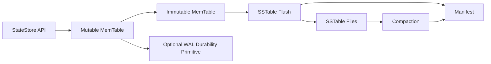

# V4 Experimental LSM State Store Design

Status: documentation only. No V4 code is part of the V3.0.1-V3.2 productionization pass.

Scope: add an optional, experimental LSM state-store module for learning, compacted lookup, secondary-index experiments, and metadata/query sidecar use cases. The LSM state store must not replace MiniMQ's default append-only segmented message log.

## 1. Goals

1. Provide a small ordered key-value state-store abstraction that can be tested independently from broker networking.
2. Support point lookup, range scan, upsert, and tombstone delete semantics for compacted-state experiments.
3. Reuse existing durability concepts where safe, while keeping broker message-log correctness isolated.
4. Establish benchmark and recovery gates before any broker write-path integration is considered.

## 2. Non-Goals

1. Do not replace the partition message log, segmented files, sparse indexes, WAL replay, or replication high-watermark semantics.
2. Do not route normal `PRODUCE`, `FETCH`, or `REPLICA_FETCH` through the LSM store.
3. Do not introduce distributed consensus, cross-node compaction coordination, or a new Controller metadata backend in V4.
4. Do not make the experimental module a default runtime dependency for broker startup.

## 3. Candidate Use Cases

| Use case | Fit | Broker write-path impact |
| --- | --- | --- |
| Compacted topic lookup | Store latest value by key for a future compacted-view API. | None in V4; populated only by explicit tests or offline adapters. |
| Secondary index experiment | Map derived keys to partition offsets for query experiments. | None in V4; index ingestion remains opt-in. |
| Metadata/query sidecar | Serve local queryable state derived from existing logs. | None in V4; sidecar can be rebuilt from source logs. |

## 4. Component Model



### MemTable

- In-memory ordered map keyed by byte-comparable keys.
- Accepts `put`, `delete`, and read-your-write `get` operations before flush.
- Rolls to an immutable MemTable when size or record-count thresholds are reached.

### SSTable

- Immutable sorted-string table containing ordered key/value/tombstone entries.
- Includes sparse block index, min/max key metadata, created-at sequence, and checksum per block.
- Supports binary search for point reads and ordered iteration for ranges.

### Manifest

- Stores active SSTable files, levels, generation numbers, and compaction outputs.
- Uses temp-file write, fsync, and atomic replace, matching the safety pattern already used in storage catalogs.

### Compaction

- Merges SSTables by key order.
- Keeps the newest value for each key, preserves tombstones until they are safe to drop, and validates checksums while reading inputs.
- Runs only through explicit state-store maintenance APIs in V4.

### WAL Reuse Boundary

The existing WAL model may be reused as a durability primitive only if the API boundary is explicit. Reuse means the LSM store can append independent state-store records to a private WAL stream; it does not mean sharing the broker partition WAL or changing partition-log replay.

## 5. API Sketch

```java
interface StateStore extends AutoCloseable {
    void put(byte[] key, byte[] value);
    void delete(byte[] key);
    Optional<byte[]> get(byte[] key);
    StateStoreIterator range(byte[] fromInclusive, byte[] toExclusive);
    StateStoreSnapshot snapshot();
    StateStoreMaintenanceResult flush();
    StateStoreMaintenanceResult compact();
}
```

## 6. Recovery Model

1. Load manifest and validate referenced SSTables.
2. Reject missing or checksum-invalid SSTables with a clear storage exception.
3. Replay the private state-store WAL, if enabled, after the latest durable manifest generation.
4. Rebuild immutable in-memory state from replay records before opening the API.
5. Clean interrupted flush and compaction staging files by manifest reachability.

## 7. Benchmark Gates

Before any broker integration beyond isolated tests:

1. Point lookup p50/p95 must beat scanning the equivalent compacted log fixture.
2. Range scan throughput must remain stable across at least three SSTable generations.
3. Flush and compaction must be bounded by configurable bytes per run.
4. Crash-recovery tests must cover interrupted flush, interrupted compaction, corrupt manifest, and corrupt SSTable block.
5. Broker `PRODUCE`/`FETCH` regression tests must show no behavior change when the LSM module is absent.

## 8. Integration Boundary

V4 may add a new module such as `mq-state-store` and keep it dependency-isolated. Broker integration, if later justified, must be read-only or sidecar-style first. Any default write-path usage requires a separate design review, benchmark report, and rollback plan.
