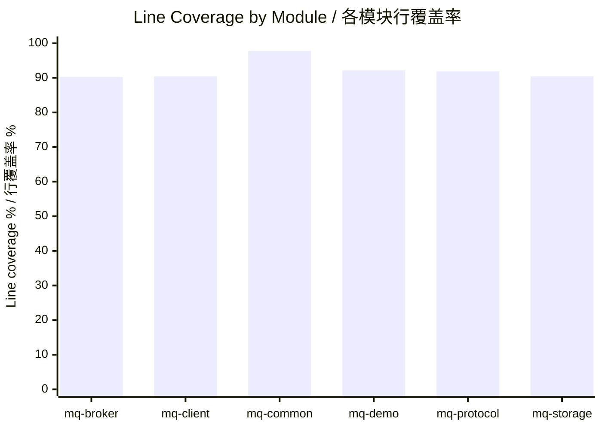

# MiniMQ Test Report / MiniMQ 测试报告 - 2026-07-07

> Version / 版本：`1.2.0-SNAPSHOT`  
> Verification command / 验证命令：`mvn -q -gs .mvn/settings.xml -s .mvn/settings.xml verify`  
> Result / 结果：PASS / 通过

## 1. Executive Summary / 执行摘要

This report records the current V1.2 verification baseline after the Web demo runtime fixes, Maven patch-version upgrade, and documentation synchronization work.
本文记录 V1.2 当前验证基线，覆盖 Web 演示 runtime 修复、Maven 小版本升级和文档同步后的结果。

| Metric / 指标 | Result / 结果 |
| --- | ---: |
| Project version / 项目版本 | `1.2.0-SNAPSHOT` |
| Tests run / 测试总数 | 74 |
| Failures / 失败数 | 0 |
| Errors / 错误数 | 0 |
| Skipped / 跳过数 | 0 |
| Overall instruction coverage / 总体指令覆盖率 | 92.79% |
| Overall branch coverage / 总体分支覆盖率 | 75.13% |
| Overall line coverage / 总体行覆盖率 | 91.70% |
| Overall method coverage / 总体方法覆盖率 | 95.62% |
| Overall class coverage / 总体类覆盖率 | 100.00% |

## 2. Scope / 验证范围

The V1.2 baseline verifies the original broker, client, storage, protocol, and CLI behavior, plus the Web demo runtime introduced for browser-based acceptance testing.
V1.2 基线验证原有 Broker、Client、Storage、Protocol、CLI 行为，同时覆盖为浏览器验收测试新增的 Web 演示 runtime。

Covered areas / 已覆盖范围：

- Broker lifecycle and request handling / Broker 生命周期与请求处理。
- Producer and consumer SDK flows / Producer 与 Consumer SDK 主流程。
- Topic metadata, partition routing, offset commit, and fetch behavior / Topic 元数据、分区路由、Offset 提交与拉取行为。
- Append-only storage read/write behavior / 追加写存储读写行为。
- Binary protocol serialization and deserialization / 二进制协议序列化与反序列化。
- CLI and Web demo launch paths / CLI 与 Web 演示启动路径。
- Web runtime reuse, concurrent request isolation, automatic runtime rebuild, and bounded runtime cache cleanup / Web runtime 复用、并发请求隔离、异常后自动重建、runtime 缓存上限与回收。
- Web API validation paths, including bad JSON, malformed bootstrap addresses, and unsupported HTTP methods / Web API 校验路径，包括错误 JSON、格式错误的 bootstrap 地址和不支持的 HTTP 方法。

## 3. Why V1.2 Runtime Fixes Matter / 为什么 V1.2 Runtime 修复重要

The Web demo originally behaved like an acceptance-test page: each request could create short-lived broker/client runtime state. That was useful for proving the happy path, but weak for repeated manual testing and browser-driven validation.
Web 演示最初更像验收测试页面：每次请求都可能创建短生命周期的 Broker/Client runtime 状态。这有利于证明主流程可用，但不利于重复手工测试和浏览器验证。

| Fix / 修复项 | Risk if not fixed / 不修复的风险 | Fix strategy / 修复方式 |
| --- | --- | --- |
| Runtime reuse / Runtime 复用 | Repeated requests pay startup cost and make the Web flow feel much slower than a normal queue operation. / 重复请求需要反复承担启动成本，使 Web 流程明显慢于正常队列操作。 | Keep reusable runtime state behind the Web backend and reuse it across compatible requests. / 在 Web 后端保留可复用 runtime 状态，并在兼容请求之间复用。 |
| Concurrent request isolation / 并发请求隔离 | Two browser requests can share mutable state and accidentally read or report another request's result. / 两个浏览器请求可能共享可变状态，导致串消息或结果归属错误。 | Isolate per-request data while sharing only safe runtime resources. / 隔离每次请求的数据，只共享安全的 runtime 资源。 |
| Automatic runtime rebuild / 异常后自动重建 | A failed broker/client runtime can poison later requests until the process is restarted manually. / 失败的 Broker/Client runtime 会污染后续请求，必须手动重启进程才能恢复。 | Detect broken runtime state, dispose it, and rebuild on the next valid request. / 检测损坏 runtime 状态，释放后在下一次有效请求时重建。 |
| Bounded runtime cache / Runtime 缓存上限 | Long manual sessions can accumulate stale runtimes and leak memory, files, or ports. / 长时间手工测试会积累过期 runtime，造成内存、文件或端口资源泄漏。 | Add an upper bound and cleanup path for cached runtime entries. / 为缓存 runtime 增加上限和清理路径。 |

## 4. Module Coverage / 模块覆盖率

| Module / 模块 | Instruction / 指令 | Branch / 分支 | Line / 行 | Method / 方法 | Class / 类 |
| --- | ---: | ---: | ---: | ---: | ---: |
| `mq-broker` | 92.56% | 72.08% | 90.29% | 97.75% | 100.00% |
| `mq-client` | 89.09% | 68.06% | 90.46% | 84.00% | 100.00% |
| `mq-common` | 96.96% | 84.38% | 97.81% | 100.00% | 100.00% |
| `mq-demo` | 95.06% | 74.56% | 92.14% | 95.16% | 100.00% |
| `mq-protocol` | 92.55% | 79.53% | 91.88% | 100.00% | 100.00% |
| `mq-storage` | 90.08% | 71.43% | 90.43% | 100.00% | 100.00% |
| **Overall / 总体** | **92.79%** | **75.13%** | **91.70%** | **95.62%** | **100.00%** |

### Coverage Chart / 覆盖率图表



## 5. Coverage Gate / 覆盖率门槛

The project-level JaCoCo gate requires overall line coverage to remain at or above 90%. The current baseline is 91.70%, so the gate passes.
项目级 JaCoCo 门槛要求总体行覆盖率不低于 90%。当前基线为 91.70%，因此门槛通过。

The report and gate exclude blocking process entrypoint classes because they are launch wrappers rather than business logic units: `BrokerMain`, `MiniMqWebMain`, and `MiniMqWebDevMain`.
报告与门槛排除了阻塞式进程入口类，因为它们是启动包装器，不是业务逻辑单元：`BrokerMain`、`MiniMqWebMain`、`MiniMqWebDevMain`。

These entrypoints are still covered indirectly through CLI, broker, launcher, and Web application tests.
这些入口仍通过 CLI、Broker、启动器和 Web 应用测试获得间接覆盖。

## 6. Report Locations / 报告位置

JaCoCo HTML reports are generated after `mvn verify`.
执行 `mvn verify` 后会生成 JaCoCo HTML 报告。

```text
mq-common/target/site/jacoco/index.html
mq-protocol/target/site/jacoco/index.html
mq-storage/target/site/jacoco/index.html
mq-broker/target/site/jacoco/index.html
mq-client/target/site/jacoco/index.html
mq-demo/target/site/jacoco/index.html
```

## 7. Maintenance Notes / 维护说明

- Update this file whenever test count, coverage, JaCoCo exclusions, or quality gates change. / 当测试数量、覆盖率、JaCoCo 排除项或质量门槛变化时更新本文。
- Keep `docs/testing.md`, `docs/roadmap.md`, and this report synchronized. / 保持 `docs/testing.md`、`docs/roadmap.md` 与本文同步。
- Keep historical reports such as `test-report-2026-07-02.md` for comparison, but do not point “latest” links to historical reports. / 保留 `test-report-2026-07-02.md` 等历史报告用于对比，但不要把“最新”链接指向历史报告。
