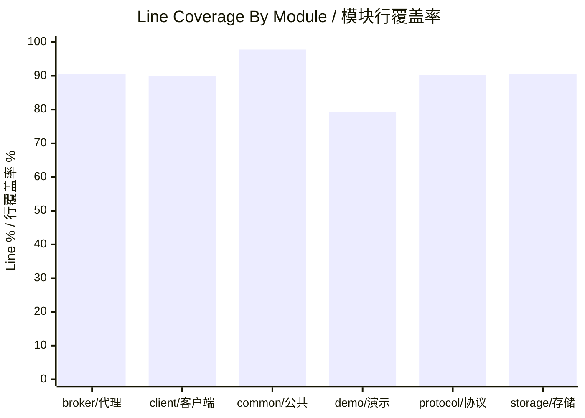
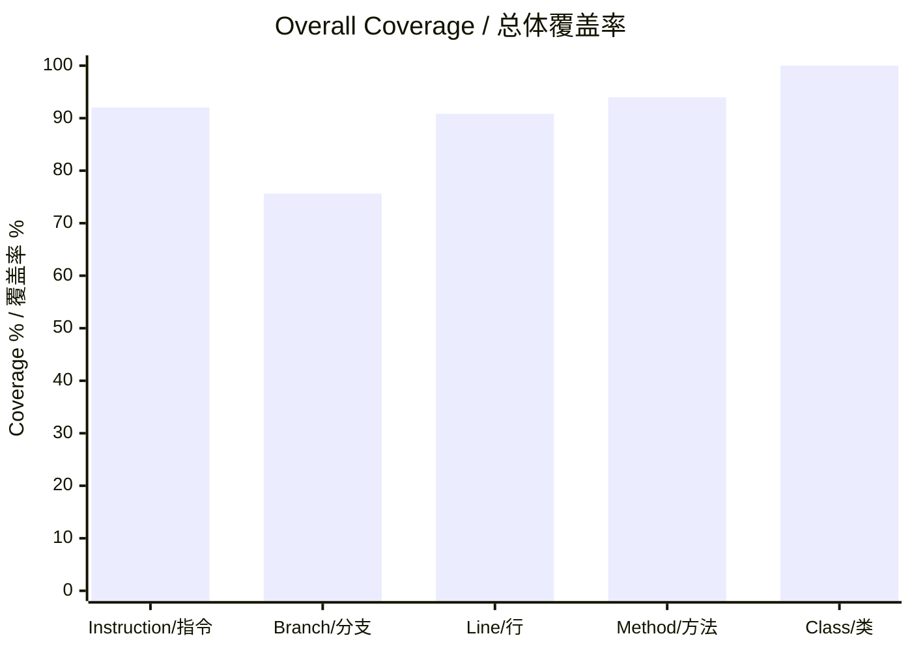

# MiniMQ Testing Guide / MiniMQ 测试文档

> This document records how to run tests, how coverage is measured, what the current baseline is, and where to find reports.
> 本文记录测试运行方式、覆盖率统计方式、当前质量基线以及报告位置。

## 1. Test Philosophy / 测试理念

MiniMQ tests are designed around risk. Low-level protocol and storage code receives direct unit tests because small bugs there can corrupt messages or break network compatibility. Broker and client workflows receive integration tests because correctness depends on multiple modules interacting through real protocol frames. The demo module receives end-to-end tests to verify the whole user-facing path.

MiniMQ 的测试按风险组织。协议和存储属于低层核心模块，小 bug 可能导致消息损坏或网络不兼容，因此使用直接单元测试。Broker 与 Client 的正确性依赖多模块协作，因此使用集成测试。Demo 模块则通过端到端测试验证用户可见路径。

## 2. Test Stack / 测试技术栈

| Tool / 工具 | Purpose / 用途 |
| --- | --- |
| JUnit 5 | Unit and integration test framework. / 单元测试和集成测试框架。 |
| Maven Surefire | Runs tests and writes test reports. / 运行测试并写出测试报告。 |
| JaCoCo | Generates code coverage reports. / 生成代码覆盖率报告。 |
| Netty EmbeddedChannel | Tests channel handlers without opening real sockets. / 在不打开真实 socket 的情况下测试 channel handler。 |
| TempDir | Isolates storage and metadata files per test. / 为每个测试隔离存储文件和元数据文件。 |
| BrokerTestHarness | Starts real test brokers on free local ports. / 在空闲本地端口启动真实测试 Broker。 |

## 3. Commands / 测试命令

Run all tests / 运行全部测试：

```powershell
mvn verify -gs .mvn/settings.xml -s .mvn/settings.xml
```

Run tests quietly / 静默运行测试：

```powershell
mvn -q test -gs .mvn/settings.xml -s .mvn/settings.xml
```

Run one module and its dependencies / 运行单个模块及其依赖模块：

```powershell
mvn -q -pl mq-broker -am test -gs .mvn/settings.xml -s .mvn/settings.xml
```

Run one test class / 运行单个测试类：

```powershell
mvn -q -pl mq-protocol -am -Dtest=ProtocolSerdesTest test -gs .mvn/settings.xml -s .mvn/settings.xml
```

## 4. Current Quality Baseline / 当前质量基线

Latest verified command / 最近验证过的命令：

```powershell
mvn -q test -gs .mvn/settings.xml -s .mvn/settings.xml
```

Latest result / 最近结果：

| Metric / 指标 | Value / 数值 |
| --- | ---: |
| Tests run / 测试总数 | 61 |
| Failures / 失败数 | 0 |
| Errors / 错误数 | 0 |
| Skipped / 跳过数 | 0 |
| Overall line coverage / 总体行覆盖率 | 90.84% |
| Overall instruction coverage / 总体指令覆盖率 | 92.03% |
| Overall branch coverage / 总体分支覆盖率 | 75.63% |
| Overall method coverage / 总体方法覆盖率 | 93.98% |
| Overall class coverage / 总体类覆盖率 | 100.00% |

## 5. Coverage By Module / 模块覆盖率

| Module / 模块 | Instruction / 指令 | Branch / 分支 | Line / 行 | Method / 方法 | Class / 类 |
| --- | ---: | ---: | ---: | ---: | ---: |
| `mq-broker` | 92.05% | 71.43% | 90.63% | 97.75% | 100.00% |
| `mq-client` | 88.01% | 63.33% | 89.81% | 82.22% | 100.00% |
| `mq-common` | 96.96% | 84.38% | 97.81% | 100.00% | 100.00% |
| `mq-demo` | 88.43% | 80.65% | 79.27% | 64.29% | 100.00% |
| `mq-protocol` | 91.68% | 77.17% | 90.25% | 100.00% | 100.00% |
| `mq-storage` | 90.08% | 71.43% | 90.43% | 100.00% | 100.00% |





## 6. Test Suite Map / 测试套件地图

| Module / 模块 | Test class / 测试类 | Type / 类型 | Focus / 关注点 |
| --- | --- | --- | --- |
| `mq-common` | `Murmur2PartitionerTest` | Unit / 单元测试 | Stable partitioning and invalid partition count. / 稳定分区与非法分区数校验。 |
| `mq-common` | `RangeAssignorTest` | Unit / 单元测试 | Range assignment and assignment serialization boundaries. / Range 分配与 assignment 序列化边界。 |
| `mq-common` | `CommonModelTest` | Unit / 单元测试 | Records and error code mapping. / Record 模型与错误码映射。 |
| `mq-storage` | `FilePartitionLogTest` | Unit / 单元测试 | Append/read/reopen recovery and `LogManager` caching. / 追加、读取、重开恢复与 `LogManager` 缓存。 |
| `mq-protocol` | `ProtocolSerdesTest` | Unit / 单元测试 | Request/response round trips, malformed collection counts, frame limits, encoder. / 请求/响应往返、畸形集合 count、帧限制和编码器。 |
| `mq-broker` | `BrokerConfigTest` | Unit / 单元测试 | Broker argument parsing and validation. / Broker 参数解析与校验。 |
| `mq-broker` | `ClusterControllerTest` | Unit / 单元测试 | Topic creation, metadata, snapshot isolation. / Topic 创建、元数据、快照隔离。 |
| `mq-broker` | `GroupCoordinatorTest` | Unit / 单元测试 | Join/sync assignment, heartbeat, offset commit/fetch. / 加组、同步分配、心跳、offset 提交/拉取。 |
| `mq-broker` | `EmbeddedBrokerChannelTest` | Component / 组件测试 | Handler behavior through Netty `EmbeddedChannel`. / 通过 Netty `EmbeddedChannel` 验证 handler 行为。 |
| `mq-broker` | `ProduceFetchIntegrationTest` | Integration / 集成测试 | Real broker produce/fetch and not-leader behavior. / 真实 Broker 生产、拉取与非 leader 行为。 |
| `mq-broker` | `TcpSmokeTest` | Smoke / 冒烟测试 | Basic TCP request/response without noisy stdout. / 无冗余 stdout 的基础 TCP 请求/响应。 |
| `mq-broker` | `BrokerShutdownTest` | Integration / 集成测试 | Broker stop/start resource cleanup on the same port. / Broker 在同一端口停止、重启与资源释放。 |
| `mq-client` | `ClientValidationTest` | Unit / 单元测试 | Bootstrap validation and unconnected close. / bootstrap 校验与未连接关闭。 |
| `mq-client` | `NetworkClientRetryTest` | Unit / 单元测试 | Connect retry attempt budget and fixed backoff validation. / 连接重试次数预算与固定退避参数校验。 |
| `mq-client` | `ProducerIntegrationTest` | Integration / 集成测试 | Producer offsets increase across sends. / Producer 多次发送后 offset 递增。 |
| `mq-client` | `ConsumerIntegrationTest` | Integration / 集成测试 | Consumer poll and commit behavior. / Consumer poll 与提交行为。 |
| `mq-demo` | `DemoCliTest` | Component/Integration / 组件/集成测试 | CLI validation and create/produce/consume path. / CLI 校验与创建/生产/消费链路。 |
| `mq-demo` | `MiniMqE2ETest` | E2E / 端到端测试 | Three-broker cluster with two consumers. / 三节点 Broker 集群与两个 Consumer。 |

## 7. Test Data And Report Locations / 测试数据与报告位置

Surefire text and XML reports / Surefire 文本和 XML 报告：

```text
mq-common/target/surefire-reports
mq-protocol/target/surefire-reports
mq-storage/target/surefire-reports
mq-broker/target/surefire-reports
mq-client/target/surefire-reports
mq-demo/target/surefire-reports
```

JaCoCo HTML, XML, and CSV reports / JaCoCo HTML、XML 和 CSV 报告：

```text
mq-common/target/site/jacoco
mq-protocol/target/site/jacoco
mq-storage/target/site/jacoco
mq-broker/target/site/jacoco
mq-client/target/site/jacoco
mq-demo/target/site/jacoco
```

## 8. Coverage Gate / 覆盖率门槛

The current agreed gate is:

当前约定门槛：

```text
Per-module line coverage >= 90% for modules covered by JaCoCo check / 接入 JaCoCo check 的模块行覆盖率均 >= 90%
```

The project currently satisfies this gate at 90.84% overall line coverage, with JaCoCo `check` bound to Maven `verify`. `BrokerMain` is excluded from the gate because it is a blocking process entrypoint whose behavior is covered indirectly through CLI and broker integration tests.

项目当前总体行覆盖率为 90.84%，并且 JaCoCo `check` 已绑定到 Maven `verify`。`BrokerMain` 是阻塞式进程入口，行为通过 CLI 与 Broker 集成测试间接覆盖，因此从门禁统计中排除。

## 9. Slow Tests / 慢测试说明

The slowest tests are integration and E2E tests that start brokers, open Netty channels, and wait for consumer poll windows. They are valuable because they catch wiring issues that pure unit tests cannot.

耗时较长的测试主要是启动 Broker、打开 Netty 通道、等待 Consumer poll 窗口的集成/端到端测试。这类测试价值较高，因为它们能发现纯单元测试无法覆盖的模块连接问题。

| Test / 测试 | Reason for cost / 耗时原因 |
| --- | --- |
| `MiniMqE2ETest` | Starts a three-broker cluster and two consumers. / 启动三节点 Broker 集群和两个 Consumer。 |
| `ProduceFetchIntegrationTest` | Starts real brokers and verifies leader routing. / 启动真实 Broker 并验证 leader 路由。 |
| `ConsumerIntegrationTest` | Includes subscribe, heartbeat scheduling, poll, and commit. / 包含订阅、心跳调度、poll 和提交。 |
| `DemoCliTest` | Runs CLI create/produce/consume against a real test broker. / 通过真实测试 Broker 运行 CLI 创建、生产、消费流程。 |

## 10. Terms / 测试名词解释

| Term / 术语 | 中文解释 | English explanation / 英文解释 |
| --- | --- | --- |
| Unit test | 只测试小范围类或函数，不依赖真实网络或完整系统。 | A small-scope test of a class/function without full system dependencies. |
| Integration test | 多模块协作测试，可能使用真实网络、本地文件、测试 Broker。 | A test that verifies multiple modules working together. |
| E2E test | 从用户入口到系统输出的端到端路径测试。 | A test that exercises a complete user-facing workflow. |
| Coverage | 测试执行过的代码比例。 | The percentage of code executed by tests. |
| Branch coverage | 条件分支被测试覆盖的比例。 | Percentage of conditional branches executed. |
| Smoke test | 快速确认核心功能没有完全坏掉的测试。 | A quick test that confirms basic system health. |
| Fixture | 测试中预先准备的数据或环境。 | Test setup data or environment. |
