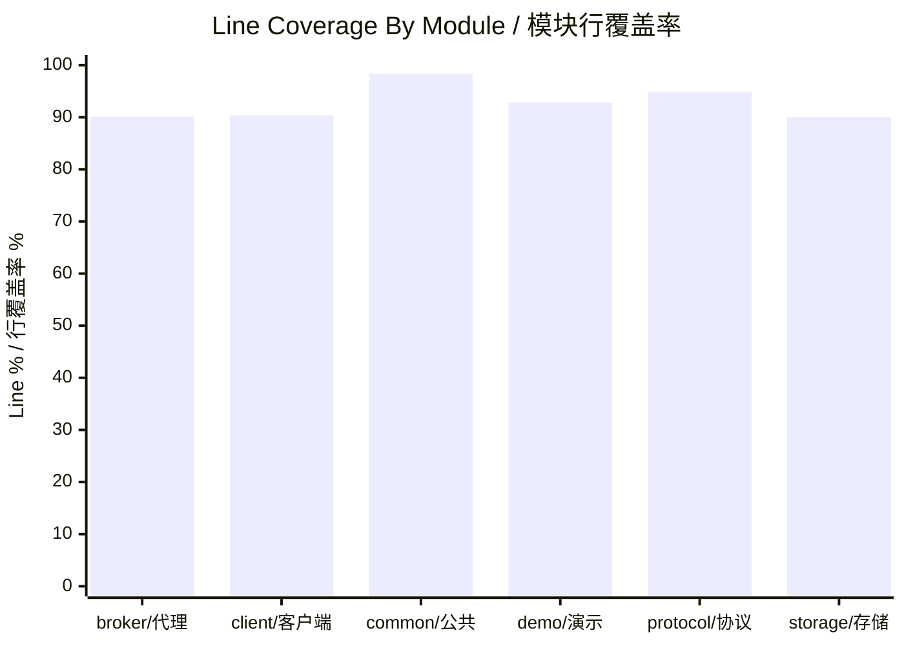
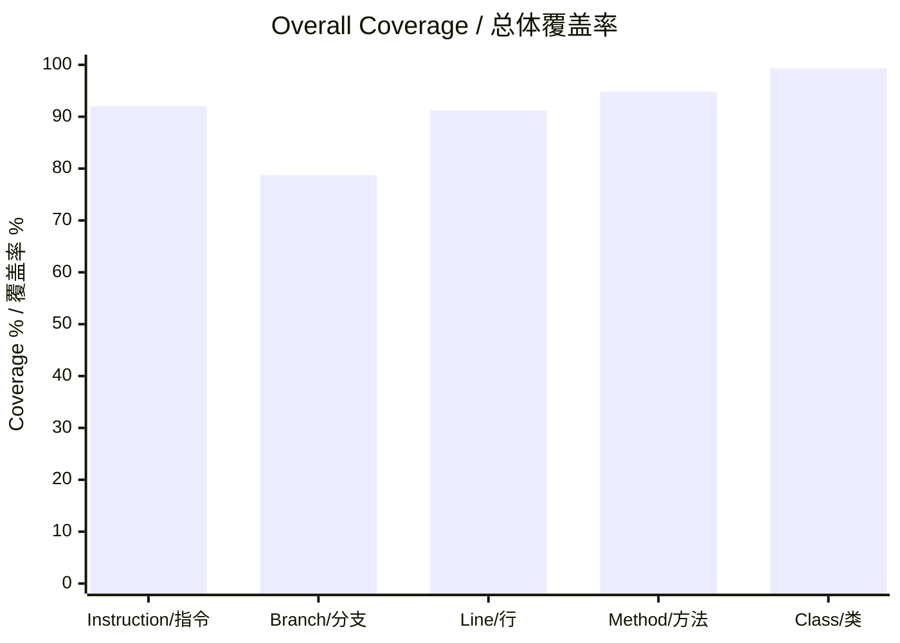

# MiniMQ Testing Guide / MiniMQ 测试文档

> This document records how to run tests, how coverage is measured, what the current baseline is, and where to find reports.
> 本文记录测试运行方式、覆盖率统计方式、当前质量基线以及报告位置。

## 1. Test Philosophy / 测试理念

MiniMQ tests are designed around risk. Low-level protocol and storage code receives direct unit tests because small bugs there can corrupt messages or break network compatibility. Broker and client workflows receive integration tests because correctness depends on multiple modules interacting through real protocol frames. The demo module receives end-to-end tests to verify the whole user-facing path.

MiniMQ 的测试按风险组织。协议和存储属于低层核心模块，小 bug 可能导致消息损坏或网络不兼容，因此使用直接单元测试。Broker 与 Client 的正确性依赖多模块协作，因此使用集成测试。Demo 模块则通过端到端测试验证用户可见路径。

## 2. Test Stack / 测试技术栈

| Tool / 工具 | Purpose / 用途 |
| --- | --- |
| JUnit 5 | Unit and integration test framework. / 单元测试和集成测试框架。 |
| Maven Surefire | Runs tests and writes test reports. / 运行测试并写出测试报告。 |
| JaCoCo | Generates code coverage reports. / 生成代码覆盖率报告。 |
| Netty EmbeddedChannel | Tests channel handlers without opening real sockets. / 在不打开真实 socket 的情况下测试 channel handler。 |
| TempDir | Isolates storage and metadata files per test. / 为每个测试隔离存储文件和元数据文件。 |
| BrokerTestHarness | Starts real test brokers on free local ports. / 在空闲本地端口启动真实测试 Broker。 |

## 3. Commands / 测试命令

Run all tests / 运行全部测试：

```powershell
mvn clean verify -gs .mvn/settings.xml -s .mvn/settings.xml
```

Run tests quietly / 静默运行测试：

```powershell
mvn -q -gs .mvn/settings.xml -s .mvn/settings.xml verify
```

Run one module and its dependencies / 运行单个模块及其依赖模块：

```powershell
mvn -q -pl mq-broker -am test -gs .mvn/settings.xml -s .mvn/settings.xml
```

Run one test class / 运行单个测试类：

```powershell
mvn -q -pl mq-protocol -am -Dtest=ProtocolSerdesTest test -gs .mvn/settings.xml -s .mvn/settings.xml
```

## 4. Current Quality Baseline / 当前质量基线

Latest release-gate command / 最新发布门禁命令：

```powershell
mvn clean verify -gs .mvn/settings.xml -s .mvn/settings.xml
```

Latest V4.0.0 result / 最新 V4.0.0 结果：

| Metric / 指标 | Value / 数值 |
| --- | ---: |
| Tests run / 测试总数 | 712 |
| Failures / 失败数 | 0 |
| Errors / 错误数 | 0 |
| Skipped / 跳过数 | 0 |
| Overall line coverage / 总体行覆盖率 | 91.17% (`10999 / 12064`) |
| Overall instruction coverage / 总体指令覆盖率 | 92.01% (`50235 / 54598`) |
| Overall branch coverage / 总体分支覆盖率 | 78.72% (`4061 / 5159`) |
| Overall method coverage / 总体方法覆盖率 | 94.84% (`1819 / 1918`) |
| Overall class coverage / 总体类覆盖率 | 99.34% (`303 / 305`) |

## 5. Coverage By Module / 模块覆盖率

| Module / 模块 | Instruction / 指令 | Branch / 分支 | Line / 行 | Method / 方法 | Class / 类 |
| --- | ---: | ---: | ---: | ---: | ---: |
| `mq-broker` | 90.92% | 76.81% | 90.09% | 94.08% | 98.97% |
| `mq-client` | 90.77% | 74.86% | 90.36% | 94.12% | 100.00% |
| `mq-common` | 97.92% | 92.96% | 98.40% | 100.00% | 100.00% |
| `mq-demo` | 94.93% | 77.30% | 92.86% | 93.85% | 100.00% |
| `mq-protocol` | 94.97% | 81.70% | 94.92% | 94.27% | 100.00% |
| `mq-storage` | 90.87% | 81.54% | 90.04% | 97.29% | 98.00% |






## 6. Key Flow Test Evidence / 关键流程测试结果截图

The [V4.0.0 closeout report](test-report-2026-07-22-v4.0.0-operator-readiness.md) is the source of truth for the latest verified Surefire and JaCoCo results. The screenshots below remain historical visual aids for the core flows, so a new reader can inspect the main testing shape without opening every `target` report directory.

最终 [V4.0.0 收口报告](test-report-2026-07-22-v4.0.0-operator-readiness.md) 是最新 Surefire 与 JaCoCo 结果的事实来源。下面截图保留为核心流程的历史可视化辅助，新读者无需逐个打开 `target` 报告目录，也能快速看到关键测试形态。

### 6.1 Full Build Verification / 完整构建验证


### 6.2 Protocol And Storage / 协议与存储


### 6.3 Broker And Client Integration / Broker 与客户端集成


### 6.4 CLI And End-To-End Flow / CLI 与端到端流程


### 6.5 Coverage Summary / 覆盖率汇总


## 7. Test Suite Map / 测试套件地图

| Module / 模块 | Test class / 测试类 | Type / 类型 | Focus / 关注点 |
| --- | --- | --- | --- |
| `mq-common` | `Murmur2PartitionerTest` | Unit / 单元测试 | Stable partitioning and invalid partition count. / 稳定分区与非法分区数校验。 |
| `mq-common` | `RangeAssignorTest` | Unit / 单元测试 | Range assignment and assignment serialization boundaries. / Range 分配与 assignment 序列化边界。 |
| `mq-common` | `CommonModelTest` | Unit / 单元测试 | Records and error code mapping. / Record 模型与错误码映射。 |
| `mq-storage` | `FilePartitionLogTest` | Unit / 单元测试 | Append/read/reopen recovery, truncated-tail recovery, structural corruption rejection, close behavior, and `LogManager` caching. / 追加、读取、重开恢复、尾部截断恢复、结构性损坏拒绝、关闭行为与 `LogManager` 缓存。 |
| `mq-storage` | `WriteAheadLogTest` | Unit / 单元测试 | WAL encode/decode, checksum mismatch, truncated-tail recovery, unknown record type rejection, and payload copy safety. / WAL 编解码、校验和不匹配、尾部截断恢复、未知记录类型拒绝与 payload 拷贝安全。 |
| `mq-storage` | `CheckpointStoreTest` | Unit / 单元测试 | Recovery checkpoint safe write, load, corrupt-checkpoint fallback, and temp-file cleanup. / 恢复 checkpoint 安全写入、加载、损坏 checkpoint 回退与临时文件清理。 |
| `mq-storage` | `LogManagerRecoveryTest` | Unit / 单元测试 | WAL replay without checkpoint, replay when partition logs fall behind checkpoint, and duplicate replay idempotence. / 无 checkpoint WAL 重放、分区日志落后 checkpoint 时重放，以及重复重放幂等。 |
| `mq-storage` | `FlushPolicyTest` | Unit / 单元测试 | Flush policy decisions and invalid storage config. / 刷盘策略判断与非法存储配置。 |
| `mq-storage` | `LogManagerFlushPolicyTest` | Unit / 单元测试 | Append-count checkpoint cadence, explicit checkpoint refresh, concurrent append offsets, and close behavior. / 按 append 次数触发 checkpoint、显式 checkpoint 刷新、并发 append offset 与关闭行为。 |
| `mq-storage` | `SegmentedLogConfigTest` | Unit / 单元测试 | Segment size and sparse-index interval validation. / Segment 大小与稀疏索引间隔校验。 |
| `mq-storage` | `PartitionLogRecordCodecTest` | Unit / 单元测试 | Shared partition-record framing, metadata-only scanning, invalid offsets/lengths, incomplete payloads, and `FileRegionSlice` validation. / 共享分区记录帧格式、仅元数据扫描、非法 offset/长度、不完整 payload 与 `FileRegionSlice` 校验。 |
| `mq-storage` | `SparseOffsetIndexTest` | Unit / 单元测试 | Sparse index lookup, reload, replacement, invalid entries, closed behavior, and corrupt index rejection. / 稀疏索引查找、重载、替换、非法条目、关闭行为与损坏索引拒绝。 |
| `mq-storage` | `SegmentCatalogStoreTest` | Unit / 单元测试 | Segment catalog safe write/load, missing/corrupt catalog handling, and descriptor validation. / Segment catalog 安全写入/加载、缺失/损坏 catalog 处理和 descriptor 校验。 |
| `mq-storage` | `SegmentFileTest` | Unit / 单元测试 | Segment file append/read budgets, corrupt index rebuild, missing logs, non-monotonic offsets, and closed behavior. / Segment 文件追加、读取预算、损坏索引重建、缺失日志、非单调 offset 与关闭行为。 |
| `mq-storage` | `SegmentedPartitionLogTest` | Unit / 单元测试 | Segment rolling, cross-segment reads, index rebuild, active-tail truncation, sealed-segment corruption rejection, idempotent replay, and overlapping catalog rejection. / Segment 滚动、跨 segment 读取、索引重建、活跃尾部截断、sealed segment 损坏拒绝、幂等重放和重叠 catalog 拒绝。 |
| `mq-storage` | `LogManagerSegmentRecoveryTest` | Unit / 单元测试 | Legacy single-file migration, WAL/checkpoint replay on segmented layout, legacy cleanup, and interrupted staging cleanup. / 旧单文件迁移、新分段布局上的 WAL/checkpoint 重放、旧文件清理和中断 staging 清理。 |
| `mq-storage` | `LogManagerConfigTest` | Unit / 单元测试 | Maintenance policy validation and compatibility constructors. / 维护策略校验与兼容构造器。 |
| `mq-storage` | `RetentionPlannerTest` | Unit / 单元测试 | Time and size retention selection, combined time/byte accounting, and active-segment protection. / 按时间和容量选择保留删除目标、组合时间/容量计数，并保护活跃 segment。 |
| `mq-storage` | `SegmentedPartitionLogRetentionTest` | Unit / 单元测试 | Sealed-segment retention, catalog `logStartOffset`, file cleanup, and replay after retained offsets are removed. / sealed segment 保留、catalog `logStartOffset`、文件清理，以及保留 offset 被删除后的重放。 |
| `mq-storage` | `SegmentCompactorTest` | Unit / 单元测试 | Latest-key compaction planning, null-key preservation, and bounded segment rewrites. / 最新 key 压缩规划、null-key 保留和有界 segment 重写。 |
| `mq-storage` | `SegmentedPartitionLogCompactionTest` | Unit / 单元测试 | Sealed-only compaction, atomic catalog publication, interrupted replacement recovery, cleaned-file cleanup, and offset-hole reads. / 仅对 sealed segment 压缩、原子 catalog 发布、中断替换恢复、cleaned 文件清理和 offset 空洞读取。 |
| `mq-storage` | `SegmentedPartitionLogSnapshotTest` | Unit / 单元测试 | Concurrent read safety, reader-aware maintenance skips, retry after readers drain, and startup cleanup for interrupted maintenance files. / 并发读取安全、reader 感知维护跳过、reader 退出后的重试，以及中断维护文件的启动清理。 |
| `mq-storage` | `LogManagerMaintenanceTest` | Unit / 单元测试 | Accurate dry-run ordering, action/byte/offset reports, metrics, reader skips, UTC windows, manual execution, checkpointing, and WAL replay after retention or compaction holes. / 精确 dry-run 顺序、动作/字节/offset 报告、指标、reader 跳过、UTC 窗口、手动执行、checkpoint，以及 retention 或 compaction 空洞后的 WAL replay。 |
| `mq-storage` | `SegmentedPartitionLogFetchPlanTest` | Unit / 单元测试 | Cross-segment fetch plans, high-watermark snapshots, reader-lease retention deferral, compaction holes, and exact byte budgets. / 跨 segment FETCH 计划、high watermark 快照、读租约推迟 retention、compaction 空洞和精确字节预算。 |
| `mq-protocol` | `ProtocolSerdesTest` | Unit / 单元测试 | Request/response round trips, FETCH prefix equivalence, malformed collection counts, frame limits, encoder. / 请求/响应往返、FETCH 前缀等价、畸形集合 count、帧限制和编码器。 |
| `mq-broker` | `BrokerConfigTest` | Unit / 单元测试 | Broker argument parsing and validation, including maintenance credentials, storage/fetch options, and strict lease timing. / Broker 参数解析与校验，包括维护凭据、存储/FETCH 参数和严格租约时序。 |
| `mq-broker` | `BrokerAvailabilityGuardTest` | Unit / 单元测试 | Broker state transitions and admission rules for fenced data, replication, and maintenance requests. / Broker 状态转换，以及 fenced 状态下数据、副本和维护请求的准入规则。 |
| `mq-broker` | `BrokerLeaseServiceTest` | Unit / 单元测试 | Registration, heartbeat renewal, self-fencing deadlines, epoch recovery, and bounded shutdown. / 注册、心跳续租、自我 fencing deadline、epoch 恢复与有界关闭。 |
| `mq-broker` | `BrokerLeaseMonitorTest` | Unit / 单元测试 | Controller lease expiry scans, failure isolation, deterministic scheduling, and clean monitor shutdown. / Controller 租约过期扫描、失败隔离、确定性调度和监视器关闭。 |
| `mq-broker` | `FetchTransferMetricsTest` | Unit / 单元测试 | Sendfile/heap/fallback/failure/timeout counters and immutable snapshots. / sendfile/heap/回退/失败/超时计数与不可变快照。 |
| `mq-broker` | `MetadataStoreTest` | Unit / 单元测试 | Metadata safe writes, load validation, corrupt-file failure, and quarantine recovery. / 元数据安全写入、加载校验、损坏文件失败与隔离恢复。 |
| `mq-broker` | `ClusterControllerTest` | Unit / 单元测试 | Topic creation, Broker epochs and leases, replica/ISR metadata, LEO-aware clean election, frozen partitions, and snapshot isolation. / Topic 创建、Broker epoch 与租约、副本/ISR 元数据、LEO 感知 clean election、分区冻结和快照隔离。 |
| `mq-broker` | `ReplicaStateManagerTest` | Unit / 单元测试 | ISR minimum high watermark math. / ISR 最小 high watermark 计算。 |
| `mq-broker` | `ReplicationIntegrationTest` | Integration / 集成测试 | Follower catch-up, replication-aware FETCH, real TCP Controller isolation, fencing-before-election ordering, no-ISR freeze, higher-epoch recovery, and client redirects. / Follower 追平、复制感知 FETCH、真实 TCP Controller 隔离、先 fencing 后选主时序、无 ISR 冻结、更高 epoch 恢复和客户端重定向。 |
| `mq-broker` | `GroupCoordinatorTest` | Unit / 单元测试 | Join/sync assignment, heartbeat, offset commit/fetch. / 加组、同步分配、心跳、offset 提交/拉取。 |
| `mq-broker` | `MaintenanceAdminServiceTest` | Unit / 单元测试 | Constant-time token authorization, single-run admission, dedicated executor threading, rejection recovery, and idempotent shutdown. / 常量时间令牌鉴权、单次执行准入、专用执行器线程、拒绝恢复与幂等关闭。 |
| `mq-broker` | `EmbeddedBrokerChannelTest` | Component / 组件测试 | Authorized async maintenance report/run routing, error mapping, correlation IDs, metrics, and enabled segment actions through Netty `EmbeddedChannel`. / 通过 Netty `EmbeddedChannel` 验证鉴权后的异步维护报告/执行路由、错误映射、关联 ID、指标与已启用的 segment 动作。 |
| `mq-broker` | `FetchResponseWriterTest` | Component / 组件测试 | AUTO/HEAP selection, DefaultFileRegion outbound messages, unsupported fallbacks, and transfer-timeout lease release. / AUTO/HEAP 选择、DefaultFileRegion 出站消息、不支持回退，以及传输超时释放读租约。 |
| `mq-broker` | `ProduceFetchIntegrationTest` | Integration / 集成测试 | Real broker produce/fetch and not-leader behavior. / 真实 Broker 生产、拉取与非 leader 行为。 |
| `mq-broker` | `ZeroCopyFetchIntegrationTest` | Integration / 集成测试 | Real loopback TCP AUTO sendfile FETCH, HEAP equivalence, and transfer metrics. / 真实回环 TCP AUTO sendfile FETCH、HEAP 等价与传输指标。 |
| `mq-broker` | `TcpSmokeTest` | Smoke / 冒烟测试 | Basic TCP request/response without noisy stdout. / 无冗余 stdout 的基础 TCP 请求/响应。 |
| `mq-broker` | `BrokerShutdownTest` | Integration / 集成测试 | Broker stop/start resource cleanup on the same port. / Broker 在同一端口停止、重启与资源释放。 |
| `mq-client` | `ClientValidationTest` | Unit / 单元测试 | Bootstrap validation and unconnected close. / bootstrap 校验与未连接关闭。 |
| `mq-client` | `NetworkClientRetryTest` | Unit / 单元测试 | Connect retry attempt budget and fixed backoff validation. / 连接重试次数预算与固定退避参数校验。 |
| `mq-client` | `ProducerIntegrationTest` | Integration / 集成测试 | Producer offsets increase across sends. / Producer 多次发送后 offset 递增。 |
| `mq-client` | `ConsumerIntegrationTest` | Integration / 集成测试 | Consumer poll and commit behavior. / Consumer poll 与提交行为。 |
| `mq-demo` | `DemoCliTest` | Component/Integration / 组件/集成测试 | Single-broker/token validation, unauthorized responses, maintenance/runtime metrics CLI output, and real TCP enabled retention/compaction output alongside create/produce/consume. / 单 Broker/令牌校验、未授权响应、维护/运行时指标 CLI 输出，以及真实 TCP 下启用 retention/compaction 的输出和创建/生产/消费链路。 |
| `mq-demo` | `FetchBenchmarkTest` | Unit / 单元测试 | Benchmark argument parsing, network transport selector parsing, output rendering, and latency percentile summarization. / 基准参数解析、网络传输选择解析、输出渲染与延迟百分位汇总。 |
| `mq-demo` | `MiniMqE2ETest` | E2E / 端到端测试 | Three-broker cluster with two consumers. / 三节点 Broker 集群与两个 Consumer。 |
| `mq-demo` | `MiniMqWebAppTest` | Web integration / Web 集成测试 | Static assets, real Web flow, pre-side-effect mock fallback, HTTP errors, runtime reuse, concurrent request isolation, stale-runtime rebuild, post-side-effect error propagation, and LRU runtime eviction. / 静态资源、真实 Web 主流程、写入副作用前的 mock fallback、HTTP 错误、runtime 复用、并发请求隔离、旧 runtime 重建、写入副作用后的错误透传和 LRU runtime 淘汰。 |

### 7.1 V2.0 Storage Recovery Closeout / V2.0 存储恢复收口

The V2.0 storage recovery closeout is recorded in `docs/test-report-2026-07-10-v2-storage.md`.
V2.0 存储恢复收口记录见 `docs/test-report-2026-07-10-v2-storage.md`。

### 7.2 V2.1.0 Segmented Log Closeout / V2.1.0 分段日志收口

The V2.1.0 segmented-log closeout is recorded in `docs/test-report-2026-07-15-v2.1.0-segmented-log.md`.
V2.1.0 分段日志收口记录见 `docs/test-report-2026-07-15-v2.1.0-segmented-log.md`。

### 7.3 V2.1.1 Retention And Compaction Closeout / V2.1.1 保留策略与压缩收口

The V2.1.1 retention and compaction closeout is recorded in `docs/test-report-2026-07-15-v2.1.1-retention-compaction.md`.
V2.1.1 保留策略与压缩收口记录见 `docs/test-report-2026-07-15-v2.1.1-retention-compaction.md`。

### 7.4 V2.2 Read Performance Closeout / V2.2 读取性能收口

The V2.2 zero-copy FETCH closeout is recorded in `docs/test-report-2026-07-17-v2.2-read-performance.md`.
V2.2 零拷贝 FETCH 收口记录见 `docs/test-report-2026-07-17-v2.2-read-performance.md`。

Benchmark command / 基准命令：

```powershell
java -jar mq-demo/target/mq-demo-3.0.0.jar benchmark-fetch --records 256 --value-bytes 32768 --fetch-bytes 8388608 --warmup 10 --iterations 50 --segment-bytes 1048576 --network-transport nio
```

### 7.5 V2.3 Replication Closeout / V2.3 副本机制收口

V2.3 adds partition replicas, follower `REPLICA_FETCH`, replication-aware client FETCH visibility, static-controller leader failover through `MARK_BROKER_OFFLINE`, election grace for post-failover reads, and monotonic replica LEO updates.

V2.3 增加分区副本、Follower `REPLICA_FETCH`、复制感知的客户端 FETCH 可见性、通过 `MARK_BROKER_OFFLINE` 触发的静态 Controller Leader 故障转移、failover 后读取选举宽限期，以及单调副本 LEO 更新。

Code-review findings and release split / 代码审查问题与发布拆分：

| Document / 文档 | Purpose / 用途 |
| --- | --- |
| `docs/code-review-2026-07-17-v2.3-replication.md` | Records pre-fix issues, `2.3.0` P0 fixes, and `2.3.1` P1 backlog. / 记录修复前问题、`2.3.0` P0 修复与 `2.3.1` P1 待办。 |
| `docs/test-report-2026-07-17-v2.3-replication.md` | Release verification evidence for `2.3.0`. / `2.3.0` 发布验证证据。 |

| Test / 测试 | Covers / 覆盖 |
| --- | --- |
| `ReplicationIntegrationTest.clientFetchWaitsForReplicationHighWatermark` | Client FETCH blocked before replication completes / 复制完成前客户端 FETCH 被阻塞 |
| `ReplicationIntegrationTest.clientFetchAfterFailoverWithoutWaitingForFollowerFetch` | Failover read grace / failover 后立即可读 |
| `ReplicaStateManagerTest.staleReplicaFetchOffsetDoesNotLowerHighWatermark` | Monotonic LEO / 单调 LEO |
| `FetchResponseWriterTest` sendfile/heap HW cap tests | Replication HW on both FETCH paths / 两条 FETCH 路径的 replication HW |

Focused verification command / 聚焦验证命令：

```powershell
mvn -q -gs .mvn/settings.xml -s .mvn/settings.xml -pl mq-broker -am -Dtest=ClusterControllerTest,ReplicaStateManagerTest,ReplicationIntegrationTest,FetchResponseWriterTest -Dsurefire.failIfNoSpecifiedTests=false test
```

### 7.6 V2.4.0 Maintenance Operations Closeout / V2.4.0 维护运维入口收口

V2.4.0 hardens broker admin protocol APIs 13-15 with a shared token, `UNAUTHORIZED` and `MAINTENANCE_BUSY` responses, and a broker-scoped maintenance executor. Report/run work is kept off the Netty EventLoop, while the CLI requires one explicit `--broker` target and `--admin-token`.

V2.4.0 使用共享令牌加固 Broker 管理协议 API 13-15，增加 `UNAUTHORIZED`、`MAINTENANCE_BUSY` 响应和 Broker 级维护执行器。报告/执行任务不会阻塞 Netty EventLoop，CLI 必须显式提供单一 `--broker` 目标和 `--admin-token`。

Operator commands / 运维命令：

```text
broker ... --admin-token <secret>
maintenance-report --broker 127.0.0.1:9092 --admin-token <secret>
maintenance-run --broker 127.0.0.1:9092 --admin-token <secret>
maintenance-metrics --broker 127.0.0.1:9092 --admin-token <secret>
```

`ProtocolSerdesTest`, `MaintenanceAdminServiceTest`, and `EmbeddedBrokerChannelTest` cover authorization, admission, asynchronous routing, and protocol responses. `DemoCliTest` reaches a real TCP broker and verifies non-empty enabled retention and compaction segment actions.

`ProtocolSerdesTest`、`MaintenanceAdminServiceTest` 与 `EmbeddedBrokerChannelTest` 覆盖鉴权、准入、异步路由和协议响应；`DemoCliTest` 连接真实 TCP Broker，验证已启用 retention 与 compaction 时返回非空 segment 动作。

Verification evidence / 验证证据：`docs/test-report-2026-07-19-v2.4.0-maintenance-ops.md`。

### 7.7 V2.5.0 Broker Leases And Automatic Failover Closeout / V2.5.0 Broker 租约与自动故障转移收口

V2.5.0 adds persisted Broker epochs, API 16 heartbeats, local self-fencing, Controller lease monitoring, clean LEO-aware ISR election, persistent frozen partitions, and higher-epoch recovery. Producer and Consumer also refresh metadata and retry once when a routed Broker returns `BROKER_FENCED`.

V2.5.0 增加持久化 Broker epoch、API 16 心跳、本地自我 fencing、Controller 租约监视、LEO 感知 ISR 内 clean election、持久化分区冻结和更高 epoch 恢复。Producer 与 Consumer 在目标 Broker 返回 `BROKER_FENCED` 时也会刷新元数据并重试一次。

Key regression coverage / 关键回归覆盖：

| Test / 测试 | Verified behavior / 验证行为 |
| --- | --- |
| `BrokerLeaseServiceTest` | Registration, epoch-confirming heartbeat, deadline self-fencing, reconnect recovery, and shutdown. / 注册、epoch 确认心跳、deadline 自我 fencing、重连恢复与关闭。 |
| `BrokerLeaseMonitorTest` | Expired-lease scans, scan-failure isolation, and scheduler cleanup. / 过期租约扫描、扫描失败隔离和调度器清理。 |
| `ClusterControllerTest` and `MetadataStoreTest` | Stale epoch rejection, atomic persisted epoch/frozen state, clean election, and restart normalization. / 过期 epoch 拒绝、epoch/frozen 状态原子持久化、clean election 与重启归一化。 |
| `ProducerNotLeaderRetryTest` and `ConsumerNotLeaderRetryTest` | Fenced Broker connection invalidation, metadata refresh, bounded retry, and error context. / fenced Broker 连接失效、元数据刷新、有界重试和错误上下文。 |
| `ReplicationIntegrationTest` | Real TCP Controller isolation proves old-Leader fencing before election, no-ISR freeze, and same-directory higher-epoch recovery. / 真实 TCP Controller 隔离验证旧 Leader 先 fencing 再选主、无 ISR 冻结，以及原数据目录更高 epoch 恢复。 |

Verification evidence / 验证证据：`docs/test-report-2026-07-19-v2.5.0-broker-leases-auto-failover.md`。

### 7.8 Web Runtime Regression Coverage / Web Runtime 回归覆盖

The Web backend has dedicated regression tests for the three runtime risks fixed in the current version.

Web 后端已为当前版本修复的三个 runtime 风险补充专门回归测试。

| Test / 测试 | Why It Exists / 为什么要测 | Verified Behavior / 验证行为 |
| --- | --- | --- |
| `isolatesConcurrentRealFlowRequestsOnSharedRuntime` | A shared Consumer can otherwise let two simultaneous requests consume each other's messages. / 共享 Consumer 否则可能让两个并发请求消费到对方消息。 | Two concurrent real-mode requests on the same runtime each receive their own `consumedValue`. / 同一 runtime 上两个并发 real 请求分别拿到自己的 `consumedValue`。 |
| `rebuildsCachedRuntimeAfterRuntimeFailure` | A closed runtime used to stay cached and could make later requests timeout. / 已关闭 runtime 曾可能继续留在缓存里，导致后续请求超时。 | Closing the cached runtime causes the next real request to evict, rebuild, retry, and still return `mode=real`; ordinary failures are surfaced after eviction instead of being retried blindly. / 关闭缓存 runtime 后，下一次真实请求会驱逐、重建、重试，并仍返回 `mode=real`；普通失败会在驱逐后直接透传，而不会盲目重试。 |
| `evictsRuntimeCacheWhenLimitIsExceeded` | Runtime cache without a cap can leak connections and heartbeat threads during exploratory Web testing. / 无上限 runtime 缓存在探索式 Web 测试中会泄露连接和心跳线程。 | Creating more than 4 distinct runtimes keeps `runtimeCount()` at the configured cap. / 创建超过 4 个不同 runtime 后，`runtimeCount()` 保持在配置上限。 |

Latest focused verification command / 最近一次聚焦验证命令：

```powershell
mvn -q -gs .mvn/settings.xml -s .mvn/settings.xml -pl mq-demo -am '-Dtest=MiniMqWebAppTest' '-Dsurefire.failIfNoSpecifiedTests=false' test
```

Latest focused result / 最近一次聚焦结果：

| Test class / 测试类 | Tests / 数量 | Failures / 失败 | Errors / 错误 | Result / 结果 |
| --- | ---: | ---: | ---: | --- |
| `MiniMqWebAppTest` | 10 | 0 | 0 | Passed / 通过 |

## 8. Test Data And Report Locations / 测试数据与报告位置

Surefire text and XML reports / Surefire 文本和 XML 报告：

```text
mq-common/target/surefire-reports
mq-protocol/target/surefire-reports
mq-storage/target/surefire-reports
mq-broker/target/surefire-reports
mq-client/target/surefire-reports
mq-demo/target/surefire-reports
```

JaCoCo HTML, XML, and CSV reports / JaCoCo HTML、XML 和 CSV 报告：

```text
mq-common/target/site/jacoco
mq-protocol/target/site/jacoco
mq-storage/target/site/jacoco
mq-broker/target/site/jacoco
mq-client/target/site/jacoco
mq-demo/target/site/jacoco
```

## 9. Coverage Gate / 覆盖率门槛

The current agreed gate is:

当前约定门槛：

```text
Per-module line coverage >= 90% for modules covered by JaCoCo check / 接入 JaCoCo check 的模块行覆盖率均 >= 90%
```

JaCoCo `check` is bound to Maven `verify`. The 2026-07-29 V4.0.0 release run passed with every module above the 90% line rule and 91.17% overall line coverage. Blocking process entrypoints (`BrokerMain`, `MiniMqWebMain`, and `MiniMqWebDevMain`) are excluded from the report and gate because their behavior is covered indirectly through CLI, broker integration, and Web launcher tests.

JaCoCo `check` 已绑定到 Maven `verify`。2026-07-29 的 V4.0.0 发布验证中，每个模块均超过 90% 行覆盖率，总体行覆盖率为 91.17%。阻塞式进程入口（`BrokerMain`、`MiniMqWebMain`、`MiniMqWebDevMain`）的行为已通过 CLI、Broker 集成测试和 Web 启动器测试间接覆盖，因此从报告和门禁统计中排除。

## 10. Slow Tests / 慢测试说明

The slowest tests are integration and E2E tests that start brokers, open Netty channels, and wait for consumer poll windows. They are valuable because they catch wiring issues that pure unit tests cannot.

耗时较长的测试主要是启动 Broker、打开 Netty 通道、等待 Consumer poll 窗口的集成/端到端测试。这类测试价值较高，因为它们能发现纯单元测试无法覆盖的模块连接问题。

| Test / 测试 | Reason for cost / 耗时原因 |
| --- | --- |
| `MiniMqE2ETest` | Starts a three-broker cluster and two consumers. / 启动三节点 Broker 集群和两个 Consumer。 |
| `ProduceFetchIntegrationTest` | Starts real brokers and verifies leader routing. / 启动真实 Broker 并验证 leader 路由。 |
| `ConsumerIntegrationTest` | Includes subscribe, heartbeat scheduling, poll, and commit. / 包含订阅、心跳调度、poll 和提交。 |
| `DemoCliTest` | Runs CLI create/produce/consume and maintenance admin commands against a real test broker. / 通过真实测试 Broker 运行 CLI 创建、生产、消费和维护管理命令。 |

## 11. V3.0.0 Controller HA Verification / Controller 高可用验证

V3.0 adds focused unit suites for Controller election, revision-CAS metadata, monotonic watches, Leader activation state, crash-safe truncation, exact data-plane epochs, complete bootstrap discovery, and bounded retries. Real etcd tests run under the `etcd-it` profile:

```powershell
mvn -q -gs .mvn/settings.xml -pl mq-broker -am -Petcd-it -Dtest=NoSuchUnitTest -Dsurefire.failIfNoSpecifiedTests=false -Dit.test=ControllerFailoverIT,LeaderEpochFailoverIT -Djacoco.skip=true verify
```

The targeted command skips unrelated unit coverage aggregation; the final `mvn clean verify` remains responsible for the JaCoCo gate. `ControllerFailoverIT` starts real etcd and real Brokers, verifies unique election, epoch increments, bootstrap discovery, and takeover. `LeaderEpochFailoverIT` verifies that an old Controller identity cannot commit after takeover. Unclean election is intentionally absent and no-ISR partitions must remain frozen.

V3.0 增加 Controller 选举、revision CAS、单调 watch、Leader 激活状态、崩溃安全截断、数据面精确 epoch、完整 bootstrap 发现与有界重试测试。定向 etcd 命令只跳过无关模块的覆盖率聚合；最终 `mvn clean verify` 仍负责 JaCoCo 门禁。真实测试会启动 etcd 与 Broker，并验证唯一选举、epoch 递增、发现、接管和旧 Controller 写 fencing。unclean election 明确不在范围内，无 ISR 分区必须保持 frozen。

Evidence / 验证证据：`docs/test-report-2026-07-20-v3.0.0-control-plane-ha.md`。

## 12. V3.0.1-V3.2 Productionization Verification / 生产化验证

V3.0.1 stabilizes the failover-read test by waiting for the promoted Broker's local leader view and Controller metadata with `leaderReady=true` before client `FETCH`. V3.1 adds runtime metrics, in-flight throttling, Controller request circuit breaking, and `STORAGE_DEGRADED` behavior. V3.2 adds `--network-transport nio|auto|epoll` with NIO as the default and safe AUTO fallback.

V3.0.1-V3.2 verification is intentionally resource-controlled: focused Surefire suites cover the new behavior, a local broker-module test run covers non-Docker regressions, and real-etcd Failsafe verification remains pending until Docker API access is available.

Focused commands / 定向命令：

```powershell
mvn -q -gs .mvn/settings.xml -s .mvn/settings.xml -pl mq-broker -am '-Dtest=ReplicationIntegrationTest#clientFetchAfterFailoverWithoutWaitingForFollowerFetch' '-Dsurefire.failIfNoSpecifiedTests=false' '-Djacoco.skip=true' test
mvn -q -gs .mvn/settings.xml -s .mvn/settings.xml -pl mq-broker -am '-Dtest=BrokerRuntimeMetricsTest,BrokerRuntimeMetricsIntegrationTest,CircuitBreakerTest,RequestThrottlerTest,BrokerAvailabilityGuardTest,ReplicaStateReporterTest,NettyTransportFactoryTest,BrokerConfigTest,BrokerShutdownTest' '-Dsurefire.failIfNoSpecifiedTests=false' '-Djacoco.skip=true' test
mvn -q -gs .mvn/settings.xml -s .mvn/settings.xml -pl mq-broker -am '-Djacoco.skip=true' test
```

Real-etcd command to run only when Docker API access is available / 仅在 Docker API 可用时运行：

```powershell
mvn -q -gs .mvn/settings.xml -s .mvn/settings.xml -pl mq-broker -am -Petcd-it verify
```

Evidence / 验证证据：`docs/test-report-2026-07-21-v3.0.1-v3.2-productionization.md` and `docs/known-issues-2026-07-20-v3.0.1-v3.2.md`。

## 13. V3.3-V3.5 Production Hardening Verification / 生产化增强验证

V3.3-V3.5 adds authenticated runtime metrics export, a deterministic resilience matrix, and a transport-aware fetch benchmark. Verification is intentionally bounded: protocol, embedded broker, demo CLI, and benchmark tests run as focused Surefire commands with `-Djacoco.skip=true`.

Focused commands / 定向命令：

```powershell
mvn -q -pl mq-protocol -am '-Djacoco.skip=true' '-Dtest=ProtocolSerdesTest' '-Dsurefire.failIfNoSpecifiedTests=false' test
mvn -q -pl mq-broker -am '-Djacoco.skip=true' '-Dtest=EmbeddedBrokerChannelTest,RequestThrottlerTest,BrokerRuntimeMetricsIntegrationTest' '-Dsurefire.failIfNoSpecifiedTests=false' test
mvn -q -pl mq-demo -am '-Djacoco.skip=true' '-Dtest=DemoCliTest,FetchBenchmarkTest' '-Dsurefire.failIfNoSpecifiedTests=false' test
```

Evidence / 验证证据：`docs/test-report-2026-07-21-v3.3-v3.5-production-hardening.md`。
## 14. Terms / 测试名词解释

| Term / 术语 | 中文解释 | English explanation / 英文解释 |
| --- | --- | --- |
| Unit test | 只测试小范围类或函数，不依赖真实网络或完整系统。 | A small-scope test of a class/function without full system dependencies. |
| Integration test | 多模块协作测试，可能使用真实网络、本地文件、测试 Broker。 | A test that verifies multiple modules working together. |
| E2E test | 从用户入口到系统输出的端到端路径测试。 | A test that exercises a complete user-facing workflow. |
| Coverage | 测试执行过的代码比例。 | The percentage of code executed by tests. |
| Branch coverage | 条件分支被测试覆盖的比例。 | Percentage of conditional branches executed. |
| Smoke test | 快速确认核心功能没有完全坏掉的测试。 | A quick test that confirms basic system health. |
| Fixture | 测试中预先准备的数据或环境。 | Test setup data or environment. |
